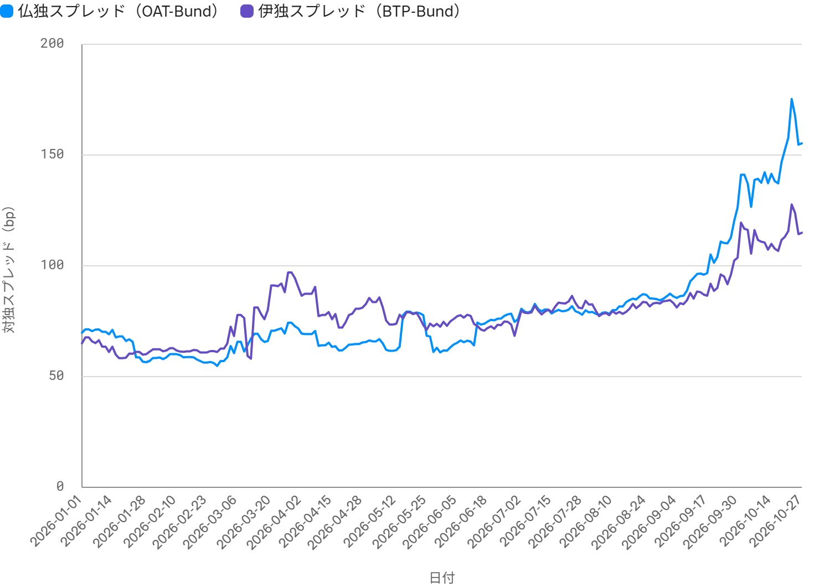

<!--
id: RX-USECASE-0110
type: use-case
language: en
locale: en
author: Reflexivity GTM Team
provider: 株式会社QUICK
source_created: 2026-10-28
published: 2026-11-17
revised: 2026-11-17
editorial_reviewed: 2026-11-17
resource: QUICK Reflexivity usage example: Compare Fed, ECB and BOJ policy stances and bond-market risks
status: published
translation_status: canonical
publication_mode: faithful-source-preserving
prompt_status: present
prompt_basis: source-verbatim
-->

# Compare Fed, ECB and BOJ policy stances and bond-market risks

<!-- locale-switcher:start -->
**Languages:** **English** · [日本語](../../../../ja/05-ユースケース/03-運用資産別/03-マクロ/FRB・ECB・日銀の政策姿勢と国債リスクを比較する.md) · [한국어](../../../../ko/05-유스케이스/03-운용자산별/03-매크로/연준·ECB·일본은행-정책-방향과-국채-리스크-비교.md) · [简体中文](../../../../zh-cn/05-使用案例/03-按资产类别/03-宏观/比较美联储-欧央行-日银政策及债券风险.md) · [繁體中文（臺灣）](../../../../zh-tw/05-使用案例/03-依資產類別/03-總體/比較聯儲局-歐央行-日銀政策及債券風險.md) · [繁體中文（香港）](../../../../zh-hk/05-使用案例/03-按資產類別/03-宏觀/比較聯儲局-歐央行-日銀政策及債券風險.md)
<!-- locale-switcher:end -->

[← All use cases](../../README.md)

**Example date:** 2026-10-28  
**Primary research tools:** Alfred

Compare rate-path probabilities, inflation risks and guidance across three central banks, followed by implications for French sovereign credit.

> [!NOTE]
> This is a dated research example. Figures, forecasts and user-interface state refer to the indicated source date, not live market data.

## Prompt used

> [!IMPORTANT]
> FRB、ECB、BOJのそれぞれの金融スタンスと、利上げや利下げの可能性をどのように考えているかをまとめてください。

The demonstration question was entered in Japanese; the wording above is preserved verbatim to retain all requested conditions.

## Research question and workflow

1. Compare rate-path probabilities, inflation risks and guidance across three central banks, followed by implications for French sovereign credit.
2. Inspect supporting company, theme, event and market inputs rather than using the summary alone.
3. Check the observation window, definitions and possible alternative explanations before drawing a current investment conclusion.

## What the example shows

Compare rate-path probabilities, inflation risks and guidance across three central banks, followed by implications for French sovereign credit.

The 28 October policy comparison defined Fed target range, ECB deposit rate and BOJ overnight rate separately, then extended the analysis to French sovereign bond stress.

## Related product screens and charts

## How to interpret this example

This is a dated research example. Figures, forecasts and user-interface state refer to the indicated source date, not live market data.

## Related product features

- [Alfred](https://github.com/reflexivity-kb/platform/blob/main/en/03-product/alfred.md)

The linked product manuals may require authorized access.

---

This use case was provided by QUICK; investment figures and scenario assessments describe the research example at its stated date.

[← All use cases](../../README.md)
