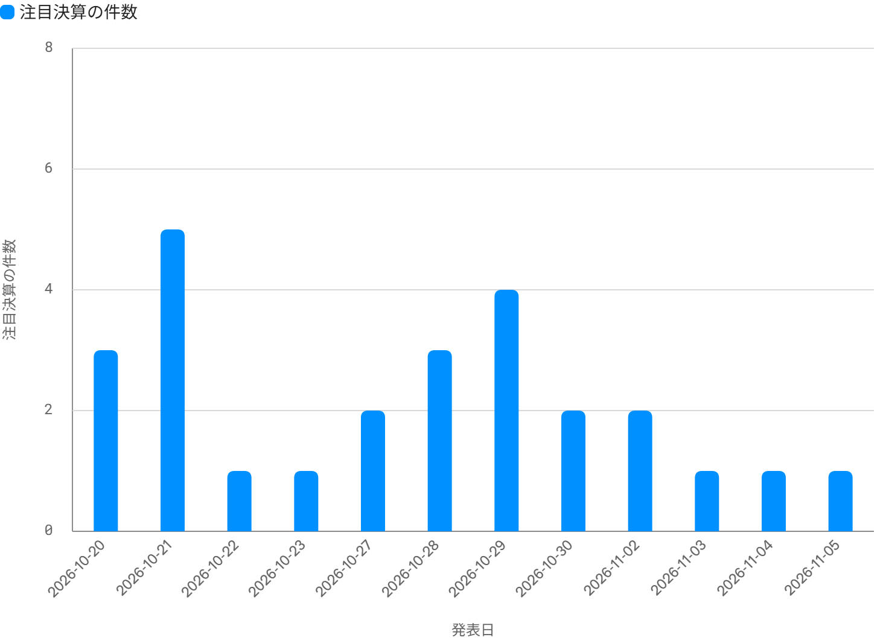

<!--
id: RX-USECASE-0109
type: use-case
language: en
locale: en
author: Reflexivity GTM Team
provider: 株式会社QUICK
source_created: 2026-10-15
published: 2026-11-17
revised: 2026-11-17
editorial_reviewed: 2026-11-17
resource: QUICK Reflexivity usage example: Build a dated earnings watchlist for US reporting season
status: published
translation_status: canonical
publication_mode: faithful-source-preserving
prompt_status: present
prompt_basis: source-verbatim
-->

# Build a dated earnings watchlist for US reporting season

<!-- locale-switcher:start -->
**Languages:** **English** · [日本語](../../../../ja/05-ユースケース/03-運用資産別/04-株式/米国決算シーズンの注目銘柄を発表日順に整理する.md) · [한국어](../../../../ko/05-유스케이스/03-운용자산별/04-주식/미국-실적-시즌-관심-기업을-날짜별로-정리.md) · [简体中文](../../../../zh-cn/05-使用案例/03-按资产类别/04-股票/按发布日期整理美国财报季关注公司.md) · [繁體中文（臺灣）](../../../../zh-tw/05-使用案例/03-依資產類別/04-股票/按公布日期整理美國業績季關注企業.md) · [繁體中文（香港）](../../../../zh-hk/05-使用案例/03-按資產類別/04-股票/按公布日期整理美國業績季關注企業.md)
<!-- locale-switcher:end -->

[← All use cases](../../README.md)

**Example date:** 2026-10-15  
**Primary research tools:** Alfred, Events

Choose market-moving companies for the October-November reporting window, arrange them by release date, and explain the importance of each event.

> [!NOTE]
> This is a dated research example. Figures, forecasts and user-interface state refer to the indicated source date, not live market data.

## Prompt used

> [!IMPORTANT]
> 10月20日から11月6日にかけて多くの企業の決算発表があります。 マーケットの動向をモニターするために、注目すべき企業の決算発表について発表日順にリストアップしてください。注目すべき理由についても記載してください。

The demonstration question was entered in Japanese; the wording above is preserved verbatim to retain all requested conditions.

## Research question and workflow

1. Choose market-moving companies for the October-November reporting window, arrange them by release date, and explain the importance of each event.
2. Inspect supporting company, theme, event and market inputs rather than using the summary alone.
3. Check the observation window, definitions and possible alternative explanations before drawing a current investment conclusion.

## What the example shows

Choose market-moving companies for the October-November reporting window, arrange them by release date, and explain the importance of each event.

The reporting-window source estimated roughly 1,260 issuer events and curated 26 market-moving companies for 20 October to 6 November, rather than listing every reporter.

## Related product screens and charts

## How to interpret this example

This is a dated research example. Figures, forecasts and user-interface state refer to the indicated source date, not live market data.

## Related product features

- [Alfred](https://github.com/reflexivity-kb/platform/blob/main/en/03-product/alfred.md)
- [Events](https://github.com/reflexivity-kb/platform/blob/main/en/03-product/events.md)

The linked product manuals may require authorized access.

---

This use case was provided by QUICK; investment figures and scenario assessments describe the research example at its stated date.

[← All use cases](../../README.md)
