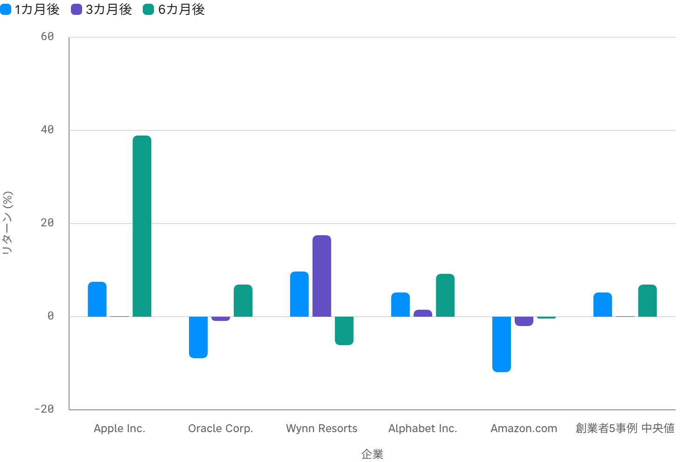

<!--
id: RX-USECASE-0092
type: use-case
language: en
locale: en
author: Reflexivity GTM Team
provider: 株式会社QUICK
source_created: 2026-11-13
published: 2026-11-17
revised: 2026-11-17
editorial_reviewed: 2026-11-17
resource: QUICK Reflexivity usage example: Compare founder-CEO departures and subsequent stock performance
status: published
translation_status: canonical
publication_mode: faithful-source-preserving
prompt_status: present
prompt_basis: source-verbatim
-->

# Compare founder-CEO departures and subsequent stock performance

<!-- locale-switcher:start -->
**Languages:** **English** · [日本語](../../../../ja/05-ユースケース/03-運用資産別/04-株式/創業者CEO辞任後の株価と業界波及を比較する.md) · [한국어](../../../../ko/05-유스케이스/03-운용자산별/04-주식/창업자-CEO-사임-이후-주가와-업계-영향-비교.md) · [简体中文](../../../../zh-cn/05-使用案例/03-按资产类别/04-股票/比较创始人-CEO-辞任后的股价与行业影响.md) · [繁體中文（臺灣）](../../../../zh-tw/05-使用案例/03-依資產類別/04-股票/比較創辦人-CEO-辭任後的股價及行業影響.md) · [繁體中文（香港）](../../../../zh-hk/05-使用案例/03-按資產類別/04-股票/比較創辦人-CEO-辭任後的股價及行業影響.md)
<!-- locale-switcher:end -->

[← All use cases](../../README.md)

**Example date:** 2026-11-13  
**Primary research tools:** Alfred

Use NVIDIA’s leadership change to compare founder exits and one-, three- and six-month stock reactions, then consider spillovers to AI infrastructure.

> [!NOTE]
> This is a dated research example. Figures, forecasts and user-interface state refer to the indicated source date, not live market data.

## Prompt used

> [!IMPORTANT]
> NVIDIAのジェイスン・ファンCEOが辞任しました。過去20年間でこのように時価総額の大きな会社で創業者が突然辞任するようなケースがあったかを調べてください。その際の１か月後、３か月後、６か月後の株価のパフォーマンスも分析してください。 また、今回のファンCEOの辞任で、AIやデータセンターの業界に与える影響がどの程度と市場は見ていますでしょうか？

The demonstration question was entered in Japanese; the wording above is preserved verbatim to retain all requested conditions.

## Research question and workflow

1. Use NVIDIA’s leadership change to compare founder exits and one-, three- and six-month stock reactions, then consider spillovers to AI infrastructure.
2. Inspect supporting company, theme, event and market inputs rather than using the summary alone.
3. Check the observation window, definitions and possible alternative explanations before drawing a current investment conclusion.

## What the example shows

Use NVIDIA’s leadership change to compare founder exits and one-, three- and six-month stock reactions, then consider spillovers to AI infrastructure.

The 13 November research compared five founder transitions (including Apple, Oracle, Alphabet and Amazon) and separated immediate NVIDIA stock reaction from uncertain six-month industry effects.

- [Relevant primary disclosure](https://nvidianews.nvidia.com/news/nvidia-announces-ceo-transition)

## Related product screens and charts

## How to interpret this example

This is a dated research example. Figures, forecasts and user-interface state refer to the indicated source date, not live market data.

## Related product features

- [Alfred](https://github.com/reflexivity-kb/platform/blob/main/en/03-product/alfred.md)

The linked product manuals may require authorized access.

---

This use case was provided by QUICK; investment figures and scenario assessments describe the research example at its stated date.

[← All use cases](../../README.md)
