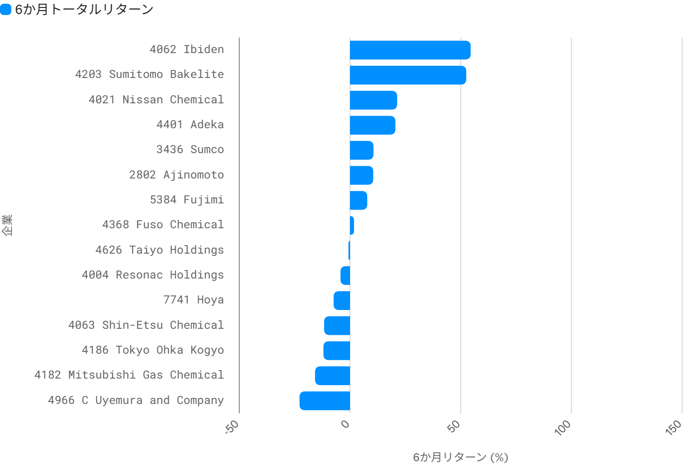

<!--
id: RX-USECASE-0101
type: use-case
language: en
locale: en
author: Reflexivity GTM Team
provider: 株式会社QUICK
source_created: 2026-10-23
published: 2026-11-17
revised: 2026-11-17
editorial_reviewed: 2026-11-17
resource: QUICK Reflexivity usage example: Compare Japanese stocks inside the semiconductor materials theme
status: published
translation_status: canonical
publication_mode: faithful-source-preserving
prompt_status: present
prompt_basis: source-verbatim
-->

# Compare Japanese stocks inside the semiconductor materials theme

<!-- locale-switcher:start -->
**Languages:** **English** · [日本語](../../../../ja/05-ユースケース/03-運用資産別/04-株式/半導体材料テーマの日本企業を騰落別に分析する.md) · [한국어](../../../../ko/05-유스케이스/03-운용자산별/04-주식/반도체-소재-테마의-일본-기업-성과-비교.md) · [简体中文](../../../../zh-cn/05-使用案例/03-按资产类别/04-股票/比较半导体材料主题中的日本公司表现.md) · [繁體中文（臺灣）](../../../../zh-tw/05-使用案例/03-依資產類別/04-股票/比較半導體材料主題中的日本企業表現.md) · [繁體中文（香港）](../../../../zh-hk/05-使用案例/03-按資產類別/04-股票/比較半導體材料主題中的日本企業表現.md)
<!-- locale-switcher:end -->

[← All use cases](../../README.md)

**Example date:** 2026-10-23  
**Primary research tools:** Themes, Knowledge Graph, Alfred

Use Knowledge Graph’s semiconductor-materials companies to compare six-month leaders and laggards and investigate firm-specific drivers.

> [!NOTE]
> This is a dated research example. Figures, forecasts and user-interface state refer to the indicated source date, not live market data.

## Prompt used

> [!IMPORTANT]
> 業界テーマ「半導体材料」に含まれている日本企業で、過去6か月間のパフォーマンスを分析し、高パフォーマンスの企業と、低パフォーマンスの企業の背景について説明してください。

The demonstration question was entered in Japanese; the wording above is preserved verbatim to retain all requested conditions.

## Research question and workflow

1. Use Knowledge Graph’s semiconductor-materials companies to compare six-month leaders and laggards and investigate firm-specific drivers.
2. Inspect supporting company, theme, event and market inputs rather than using the summary alone.
3. Check the observation window, definitions and possible alternative explanations before drawing a current investment conclusion.

## What the example shows

Use Knowledge Graph’s semiconductor-materials companies to compare six-month leaders and laggards and investigate firm-specific drivers.

The six-month semiconductor-materials study evaluated 15 high-exposure Japanese companies; Ibiden (+54.5%) and Sumitomo Bakelite (+52.5%) were leaders in the source snapshot.

## Related product screens and charts

## How to interpret this example

This is a dated research example. Figures, forecasts and user-interface state refer to the indicated source date, not live market data.

## Related product features

- [Themes](https://github.com/reflexivity-kb/platform/blob/main/en/03-product/themes.md)
- [Knowledge Graph](https://github.com/reflexivity-kb/platform/blob/main/en/03-product/knowledge-graph.md)
- [Alfred](https://github.com/reflexivity-kb/platform/blob/main/en/03-product/alfred.md)

The linked product manuals may require authorized access.

---

This use case was provided by QUICK; investment figures and scenario assessments describe the research example at its stated date.

[← All use cases](../../README.md)
