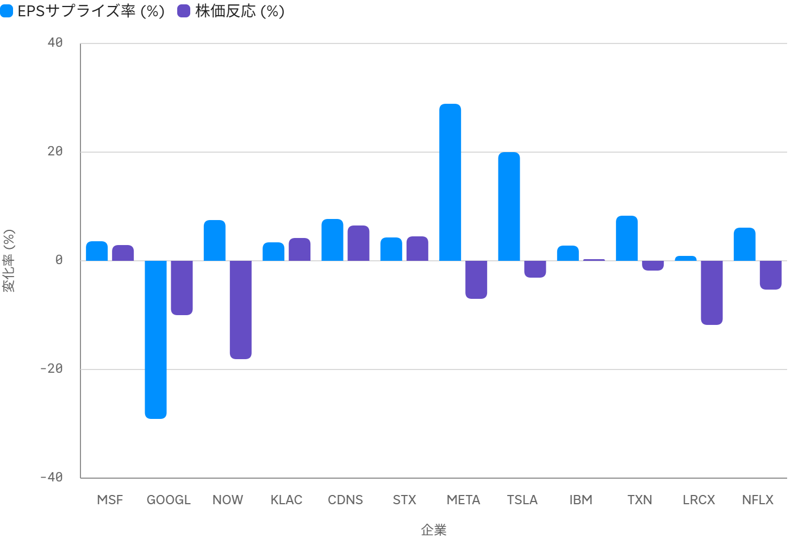

<!--
id: RX-USECASE-0096
type: use-case
language: en
locale: en
author: Reflexivity GTM Team
provider: 株式会社QUICK
source_created: 2026-10-29
published: 2026-11-17
revised: 2026-11-17
editorial_reviewed: 2026-11-17
resource: QUICK Reflexivity usage example: Compare major US technology earnings, EPS surprises and stock reactions
status: published
translation_status: canonical
publication_mode: faithful-source-preserving
prompt_status: present
prompt_basis: source-verbatim
-->

# Compare major US technology earnings, EPS surprises and stock reactions

<!-- locale-switcher:start -->
**Languages:** **English** · [日本語](../../../../ja/05-ユースケース/03-運用資産別/04-株式/主要米国IT企業の決算と株価反応を横断比較する.md) · [한국어](../../../../ko/05-유스케이스/03-운용자산별/04-주식/미국-주요-IT-기업의-실적·EPS-서프라이즈-비교.md) · [简体中文](../../../../zh-cn/05-使用案例/03-按资产类别/04-股票/横向比较美国大型科技公司的财报与股价反应.md) · [繁體中文（臺灣）](../../../../zh-tw/05-使用案例/03-依資產類別/04-股票/橫向比較美國大型科技公司的業績與股價反應.md) · [繁體中文（香港）](../../../../zh-hk/05-使用案例/03-按資產類別/04-股票/橫向比較美國大型科技公司的業績與股價反應.md)
<!-- locale-switcher:end -->

[← All use cases](../../README.md)

**Example date:** 2026-10-29  
**Primary research tools:** Alfred

Bring reported revenue, profit, consensus EPS, subsequent price reactions and forward strategies into one side-by-side review.

> [!NOTE]
> This is a dated research example. Figures, forecasts and user-interface state refer to the indicated source date, not live market data.

## Prompt used

> [!IMPORTANT]
> 先週と今週に発表された主要な米国IT企業の決算発表の結果をまとめてください。売上高、利益に加え、予想EPSと実際の差を表示してください。 またそれぞれについてその後の市場の反応と、各社の今後の戦略と業績見込みについても記載してください。

The demonstration question was entered in Japanese; the wording above is preserved verbatim to retain all requested conditions.

## Research question and workflow

1. Bring reported revenue, profit, consensus EPS, subsequent price reactions and forward strategies into one side-by-side review.
2. Inspect supporting company, theme, event and market inputs rather than using the summary alone.
3. Check the observation window, definitions and possible alternative explanations before drawing a current investment conclusion.

## What the example shows

Bring reported revenue, profit, consensus EPS, subsequent price reactions and forward strategies into one side-by-side review.

The snapshot covered 12 technology companies reporting on 19–28 October; 11 beat expected EPS, yet some sold off, underscoring the role of capex and guidance.

## Related product screens and charts

## How to interpret this example

This is a dated research example. Figures, forecasts and user-interface state refer to the indicated source date, not live market data.

## Related product features

- [Alfred](https://github.com/reflexivity-kb/platform/blob/main/en/03-product/alfred.md)

The linked product manuals may require authorized access.

---

This use case was provided by QUICK; investment figures and scenario assessments describe the research example at its stated date.

[← All use cases](../../README.md)
