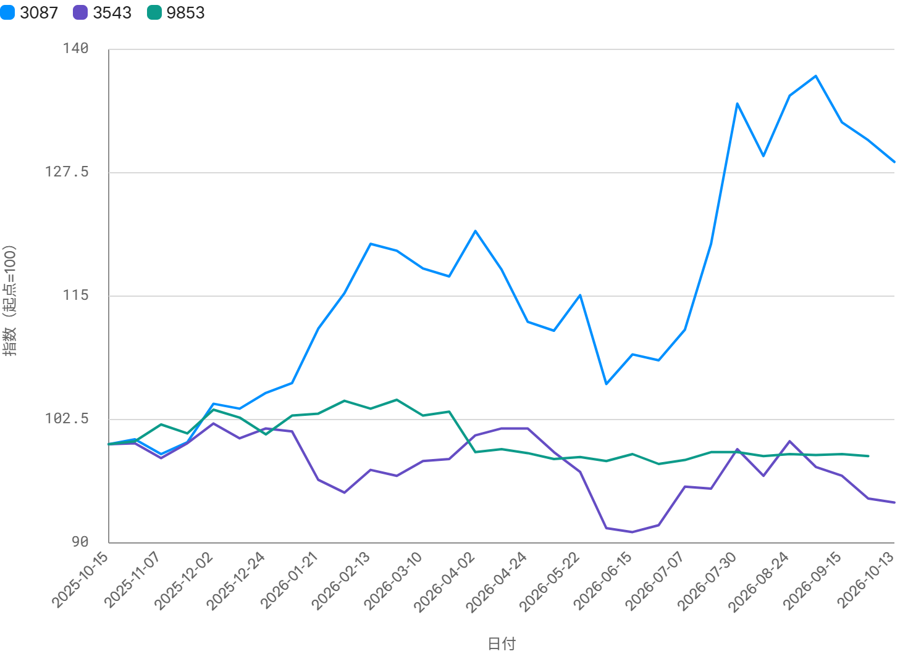

<!--
id: RX-USECASE-0087
type: use-case
language: en
locale: en
author: Reflexivity GTM Team
source_type: partner-provided-use-case
provider: QUICK
source_manifest: RX-USECASE-0087
source_created: 2026-10-15
published: 2026-11-17
revised: 2026-11-17
editorial_reviewed: 2026-11-17
resource: QUICK-provided Reflexivity research example
status: published
translation_status: canonical
prompt_status: present
prompt_basis: faithful-translation
-->

# Compare Starbucks restructuring with US coffee-chain competitors

<!-- locale-switcher:start -->
**Languages:** **English** · [日本語](../../../../ja/05-ユースケース/03-運用資産別/04-株式/スターバックスの店舗閉鎖と米国コーヒーチェーン競争を分析する.md) · [한국어](../../../../ko/05-유스케이스/03-운용자산별/04-주식/스타벅스-구조조정과-미국-커피체인-경쟁을-비교하기.md) · [简体中文](../../../../zh-cn/05-使用案例/03-按资产类别/04-股票/比较星巴克关店与美国咖啡连锁竞争格局.md) · [繁體中文（臺灣）](../../../../zh-tw/05-使用案例/03-依資產類別/04-股票/比較星巴克關店與美國咖啡連鎖競爭格局.md) · [繁體中文（香港）](../../../../zh-hk/05-使用案例/03-按資產類別/04-股票/比較星巴克關店與美國咖啡連鎖競爭格局.md)
<!-- locale-switcher:end -->

[← Use Cases](../../README.md)

**QUICK | 2026-10-15**

## Prompt used

> [!IMPORTANT]
> Report the state of US coffee chains and competitors, including their strategies, after Starbucks announced 250 US store closures.

## The research workflow

Start with a company-specific restructuring announcement, then examine whether it signals weaker category demand or a deliberate shift in store economics. Compare store format, growth, profitability and share-price reaction across Starbucks, Dutch Bros and McDonald's.

## Source-period findings

The October 15 report referenced around 250 Starbucks closures and about $300 million of restructuring costs. The source-period one-year price-return comparison listed SBUX +12.5%, Dutch Bros -28.8% and McDonald's -21.9%, while noting Dutch Bros revenue growth of approximately 27.9%.

## Interpretation and limitations

Store closures and costs are historical reported figures; some comparable-store sales assessments came from analysts, not company filings. Company strategies, reporting windows and total-return definitions differ.

## Related product feature

- [Alfred](https://github.com/reflexivity-kb/platform/blob/main/en/03-product/alfred.md)

The linked Product manual may require authorized access.

## Research screens and charts

These original research visuals reflect the source date, not today's market.

## Provider

This content was provided by QUICK.

Depending on country or region, language environment, product used, entitlements, and data coverage, the example may not be directly reproducible as written.

[← Use Cases](../../README.md)
