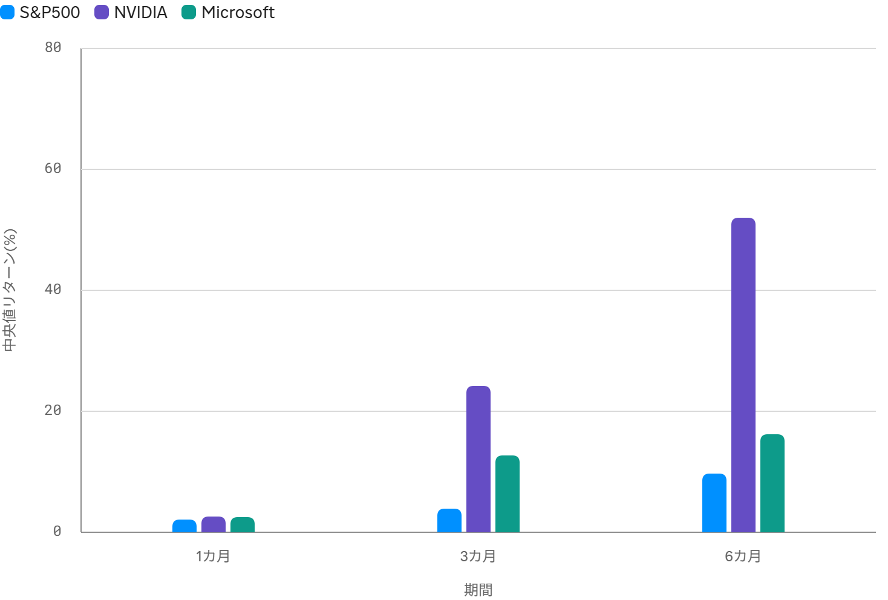

<!--
id: RX-USECASE-0085
type: use-case
language: en
locale: en
author: Reflexivity GTM Team
provider: 株式会社QUICK
source_created: 2026-10-21
published: 2026-11-17
revised: 2026-11-17
editorial_reviewed: 2026-11-17
resource: QUICK Reflexivity usage example: Has the AI and semiconductor rally peaked?
status: published
translation_status: canonical
publication_mode: faithful-source-preserving
prompt_status: present
prompt_basis: source-verbatim
-->

# Has the AI and semiconductor rally peaked?

<!-- locale-switcher:start -->
**Languages:** **English** · [日本語](../../../../ja/05-ユースケース/03-運用資産別/04-株式/AI・半導体相場のピークアウトを検証する.md) · [한국어](../../../../ko/05-유스케이스/03-운용자산별/04-주식/AI·반도체-상승세의-정점-여부-분석.md) · [简体中文](../../../../zh-cn/05-使用案例/03-按资产类别/04-股票/研判-AI-与半导体行情是否见顶.md) · [繁體中文（臺灣）](../../../../zh-tw/05-使用案例/03-依資產類別/04-股票/研判-AI-與半導體行情是否見頂.md) · [繁體中文（香港）](../../../../zh-hk/05-使用案例/03-按資產類別/04-股票/研判-AI-與半導體行情是否見頂.md)
<!-- locale-switcher:end -->

[← All use cases](../../README.md)

**Example date:** 2026-10-21  
**Primary research tools:** Alfred

Assess whether declines signal a correction or trend reversal, including hyperscaler financing and credit stress; test a resilient alternative scenario.

> [!NOTE]
> This is a dated research example. Figures, forecasts and user-interface state refer to the indicated source date, not live market data.

## Prompt used

> [!IMPORTANT]
> AI相場や半導体相場はすでにピークを迎えているのでしょうか？ハイパースケーラーの資金調達難や信用不安も考慮して現在の状況を分析して下さい。

The demonstration question was entered in Japanese; the wording above is preserved verbatim to retain all requested conditions.

## Research question and workflow

1. Assess whether declines signal a correction or trend reversal, including hyperscaler financing and credit stress; test a resilient alternative scenario.
2. Inspect supporting company, theme, event and market inputs rather than using the summary alone.
3. Check the observation window, definitions and possible alternative explanations before drawing a current investment conclusion.

## What the example shows

Assess whether declines signal a correction or trend reversal, including hyperscaler financing and credit stress; test a resilient alternative scenario.

In the 21 October snapshot, the source cited a semiconductor index down about 27.6% from its June peak and CCC credit spreads at 12.97%; it weighed a correction against the longer positive trend.

## Related product screens and charts

## How to interpret this example

This is a dated research example. Figures, forecasts and user-interface state refer to the indicated source date, not live market data.

## Related product features

- [Alfred](https://github.com/reflexivity-kb/platform/blob/main/en/03-product/alfred.md)

The linked product manuals may require authorized access.

---

This use case was provided by QUICK; investment figures and scenario assessments describe the research example at its stated date.

[← All use cases](../../README.md)
