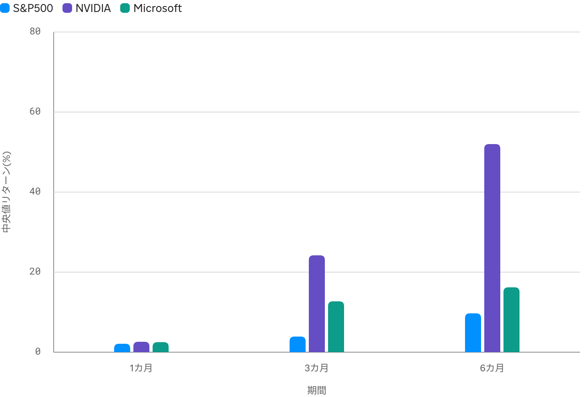
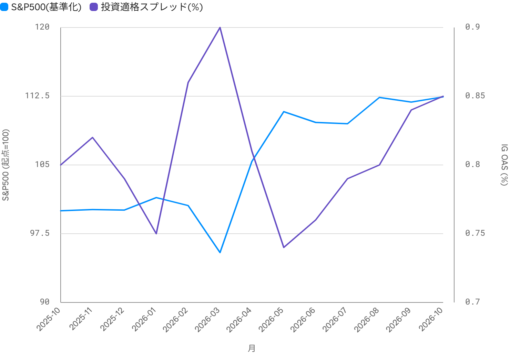

<!--
id: RX-USECASE-0089
type: use-case
language: en
locale: en
author: Reflexivity GTM Team
source_type: partner-provided-use-case
provider: QUICK
source_manifest: RX-USECASE-0089
source_created: 2026-10-21
published: 2026-11-17
revised: 2026-11-17
editorial_reviewed: 2026-11-17
resource: QUICK provided Reflexivity workflow
status: published
translation_status: canonical
prompt_status: present
prompt_basis: faithful-translation
-->

# Is the AI and semiconductor rally peaking?

<!-- locale-switcher:start -->
**Languages:** **English** · [日本語](../../../../ja/05-ユースケース/03-運用資産別/04-株式/AI・半導体相場はピークを迎えたのか検証する.md) · [한국어](../../../../ko/05-유스케이스/03-운용자산별/04-주식/AI·반도체-랠리의-정점-신호를-검증하기.md) · [简体中文](../../../../zh-cn/05-使用案例/03-按资产类别/04-股票/判断-AI-与半导体行情是否已触顶.md) · [繁體中文（臺灣）](../../../../zh-tw/05-使用案例/03-依資產類別/04-股票/判斷-AI-與半導體行情是否已見頂.md) · [繁體中文（香港）](../../../../zh-hk/05-使用案例/03-按資產類別/04-股票/判斷-AI-及半導體行情是否已見頂.md)
<!-- locale-switcher:end -->

[← Use Cases](../../README.md)

**QUICK | 2026-10-21**

## Prompt used

> [!IMPORTANT]
> Have AI and semiconductor stocks already peaked? Include hyperscaler funding pressures and credit risk in the analysis.

## Research workflow

The October 21 research separated a short-term correction from the longer AI investment trend by checking index drawdowns, the preceding year's gains, corporate capital expenditure and speculative-grade credit spreads.

## Source-period findings

In its source snapshot, the semiconductor-select indicator had fallen 27.6% from a June peak but still gained about 34% over one year. Oracle capital spending was 174% of operating cash flow while CCC spreads were elevated: an example of divergence between theme momentum and funding capacity.

## Interpretation and limitations

A peak can only be confirmed retrospectively. The source uses a constructed thematic basket, and credit stress was concentrated in the lowest rating tier. Commentators' bubble warnings are opinions rather than observed earnings failures.

## Related product features

- [Alfred](https://github.com/reflexivity-kb/platform/blob/main/en/03-product/alfred.md)

Product manual access may require authorization.

## Research screens and charts

These original research visuals reflect the source date, not today's market.

## Provider

*Courtesy of QUICK, our partner in Japan.* · [Use Case Disclaimer](../../DISCLAIMER.md)

[← Use Cases](../../README.md)
