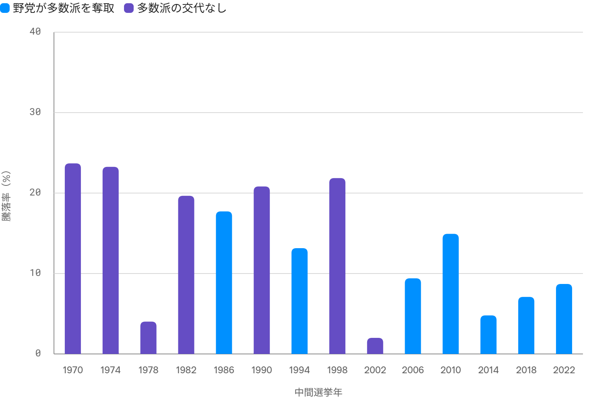

<!--
id: RX-USECASE-0105
type: use-case
language: en
locale: en
author: Reflexivity GTM Team
provider: 株式会社QUICK
source_created: 2026-11-02
published: 2026-11-17
revised: 2026-11-17
editorial_reviewed: 2026-11-17
resource: QUICK Reflexivity usage example: Study six-month S&P 500 returns after US midterm elections
status: published
translation_status: canonical
publication_mode: faithful-source-preserving
prompt_status: present
prompt_basis: source-verbatim
-->

# Study six-month S&P 500 returns after US midterm elections

<!-- locale-switcher:start -->
**Languages:** **English** · [日本語](../../../../ja/05-ユースケース/03-運用資産別/04-株式/米中間選挙後6か月のS&P500を長期比較する.md) · [한국어](../../../../ko/05-유스케이스/03-운용자산별/04-주식/미국-중간선거-후-6개월-S&P500-수익률-검증.md) · [简体中文](../../../../zh-cn/05-使用案例/03-按资产类别/04-股票/检验美国中期选举后六个月标普-500-回报.md) · [繁體中文（臺灣）](../../../../zh-tw/05-使用案例/03-依資產類別/04-股票/檢驗美國中期選舉後六個月標普-500-回報.md) · [繁體中文（香港）](../../../../zh-hk/05-使用案例/03-按資產類別/04-股票/檢驗美國中期選舉後六個月標普-500-回報.md)
<!-- locale-switcher:end -->

[← All use cases](../../README.md)

**Example date:** 2026-11-02  
**Primary research tools:** Alfred

Use election cycles since 1970 to calculate six-month outcomes, then compare opposition victories with cases without a majority change.

> [!NOTE]
> This is a dated research example. Figures, forecasts and user-interface state refer to the indicated source date, not live market data.

## Prompt used

> [!IMPORTANT]
> 米国中間選挙の６か月後のS&P500の数値は中間選挙前と比べてパフォーマンスがどうなっているのかを1970年以降から現在までを分析してください。また、政権を取っていない側の政党が勝利した場合と、政権側がそのまま多数議席を獲得した場合とで違いがあるかも調べてください。

The demonstration question was entered in Japanese; the wording above is preserved verbatim to retain all requested conditions.

## Research question and workflow

1. Use election cycles since 1970 to calculate six-month outcomes, then compare opposition victories with cases without a majority change.
2. Inspect supporting company, theme, event and market inputs rather than using the summary alone.
3. Check the observation window, definitions and possible alternative explanations before drawing a current investment conclusion.

## What the example shows

Use election cycles since 1970 to calculate six-month outcomes, then compare opposition victories with cases without a majority change.

For 14 midterms since 1970, the source calculated an average six-month price return of +13.65% (median +14.04%); historical averages do not forecast an individual future election.

## Related product screens and charts

## How to interpret this example

This is a dated research example. Figures, forecasts and user-interface state refer to the indicated source date, not live market data.

## Related product features

- [Alfred](https://github.com/reflexivity-kb/platform/blob/main/en/03-product/alfred.md)

The linked product manuals may require authorized access.

---

This use case was provided by QUICK; investment figures and scenario assessments describe the research example at its stated date.

[← All use cases](../../README.md)
