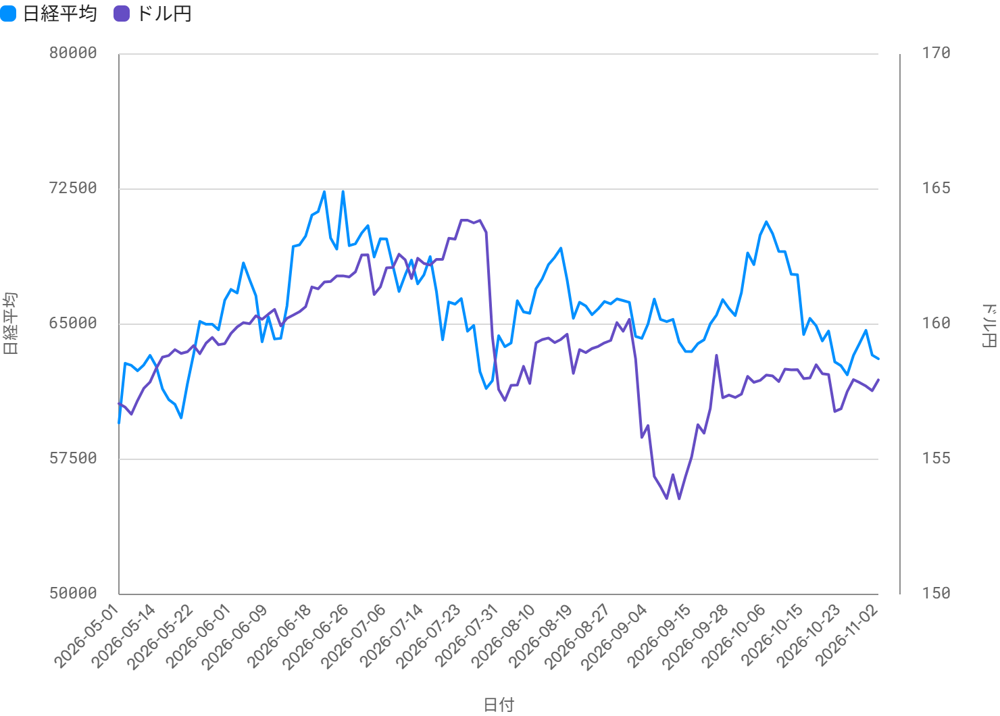

<!--
id: RX-USECASE-0097
type: use-case
language: en
locale: en
author: Reflexivity GTM Team
provider: 株式会社QUICK
source_created: 2026-11-04
published: 2026-11-17
revised: 2026-11-17
editorial_reviewed: 2026-11-17
resource: QUICK Reflexivity usage example: Build a morning Japan market briefing with a short Alfred prompt
status: published
translation_status: canonical
publication_mode: faithful-source-preserving
prompt_status: present
prompt_basis: source-verbatim
-->

# Build a morning Japan market briefing with a short Alfred prompt

<!-- locale-switcher:start -->
**Languages:** **English** · [日本語](../../../../ja/05-ユースケース/03-運用資産別/05-マルチアセット/短いプロンプトで日本市場の朝会資料を作る.md) · [한국어](../../../../ko/05-유스케이스/03-운용자산별/05-멀티에셋/짧은-프롬프트로-일본-증시-아침-브리핑-만들기.md) · [简体中文](../../../../zh-cn/05-使用案例/03-按资产类别/05-多资产/用简短提示生成日本市场晨会简报.md) · [繁體中文（臺灣）](../../../../zh-tw/05-使用案例/03-依資產類別/05-多資產/用簡短提示生成日本市場晨會簡報.md) · [繁體中文（香港）](../../../../zh-hk/05-使用案例/03-按資產類別/05-多資產/用簡短提示生成日本市場晨會簡報.md)
<!-- locale-switcher:end -->

[← All use cases](../../README.md)

**Example date:** 2026-11-04  
**Primary research tools:** Alfred

Summarize overnight futures, equity trends, USD/JPY, rates and upcoming events, while keeping the briefing tied to its observation date.

> [!NOTE]
> This is a dated research example. Figures, forecasts and user-interface state refer to the indicated source date, not live market data.

## Prompt used

> [!IMPORTANT]
> 今日の日本の相場環境をまとめて

The demonstration question was entered in Japanese; the wording above is preserved verbatim to retain all requested conditions.

## Research question and workflow

1. Summarize overnight futures, equity trends, USD/JPY, rates and upcoming events, while keeping the briefing tied to its observation date.
2. Inspect supporting company, theme, event and market inputs rather than using the summary alone.
3. Check the observation window, definitions and possible alternative explanations before drawing a current investment conclusion.

## What the example shows

Summarize overnight futures, equity trends, USD/JPY, rates and upcoming events, while keeping the briefing tied to its observation date.

A one-line request produced an opening briefing for 4 November, including the prior Japan holiday, futures, USD/JPY and midterm-election risks.

## Related product screens and charts

## How to interpret this example

This is a dated research example. Figures, forecasts and user-interface state refer to the indicated source date, not live market data.

## Related product features

- [Alfred](https://github.com/reflexivity-kb/platform/blob/main/en/03-product/alfred.md)

The linked product manuals may require authorized access.

---

This use case was provided by QUICK; investment figures and scenario assessments describe the research example at its stated date.

[← All use cases](../../README.md)
