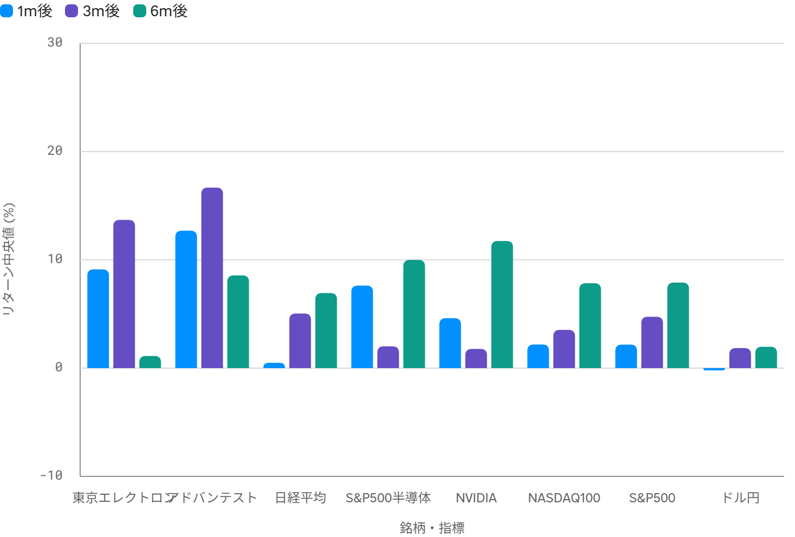

<!--
id: RX-USECASE-0106
type: use-case
language: en
locale: en
author: Reflexivity GTM Team
provider: 株式会社QUICK
source_created: 2026-11-05
published: 2026-11-17
revised: 2026-11-17
editorial_reviewed: 2026-11-17
resource: QUICK Reflexivity usage example: Explain different US and Japan equity reactions to midterm results
status: published
translation_status: canonical
publication_mode: faithful-source-preserving
prompt_status: present
prompt_basis: source-verbatim
-->

# Explain different US and Japan equity reactions to midterm results

<!-- locale-switcher:start -->
**Languages:** **English** · [日本語](../../../../ja/05-ユースケース/03-運用資産別/05-マルチアセット/米中間選挙後の米株と日本株の反応差を分析する.md) · [한국어](../../../../ko/05-유스케이스/03-운용자산별/05-멀티에셋/미국-중간선거-후-미국·일본-주가-반응-차이-분석.md) · [简体中文](../../../../zh-cn/05-使用案例/03-按资产类别/05-多资产/解释美国中期选举后美日股市反应分化.md) · [繁體中文（臺灣）](../../../../zh-tw/05-使用案例/03-依資產類別/05-多資產/解釋美國中期選舉後美日股市反應分化.md) · [繁體中文（香港）](../../../../zh-hk/05-使用案例/03-按資產類別/05-多資產/解釋美國中期選舉後美日股市反應分化.md)
<!-- locale-switcher:end -->

[← All use cases](../../README.md)

**Example date:** 2026-11-05  
**Primary research tools:** Alfred

Contrast US index gains with Japanese AI/semiconductor weakness, then frame policy, semiconductor and USD/JPY scenarios separately.

> [!NOTE]
> This is a dated research example. Figures, forecasts and user-interface state refer to the indicated source date, not live market data.

## Prompt used

> [!IMPORTANT]
> 米国中間選挙の結果、民主党が大勝しました。この結果、日本の株式市場ではAI関連株や半導体関連株が下落しました。一方で米国ではS&P500もNASDAQ指数も上昇しました。今後のAI関連株や半導体関連株について市場の見通しはどうなるのかシナリオを示してください。また、ドル円の為替レートの見通しも合わせてシナリオを提示して下さい。

The demonstration question was entered in Japanese; the wording above is preserved verbatim to retain all requested conditions.

## Research question and workflow

1. Contrast US index gains with Japanese AI/semiconductor weakness, then frame policy, semiconductor and USD/JPY scenarios separately.
2. Inspect supporting company, theme, event and market inputs rather than using the summary alone.
3. Check the observation window, definitions and possible alternative explanations before drawing a current investment conclusion.

## What the example shows

Contrast US index gains with Japanese AI/semiconductor weakness, then frame policy, semiconductor and USD/JPY scenarios separately.

The 5 November commentary contrasted Japanese AI-sector weakness with gains in broader US indices and framed three scenarios (base, upside and downside); scenario weights were subjective.

## Related product screens and charts

## How to interpret this example

This is a dated research example. Figures, forecasts and user-interface state refer to the indicated source date, not live market data.

## Related product features

- [Alfred](https://github.com/reflexivity-kb/platform/blob/main/en/03-product/alfred.md)

The linked product manuals may require authorized access.

---

This use case was provided by QUICK; investment figures and scenario assessments describe the research example at its stated date.

[← All use cases](../../README.md)
