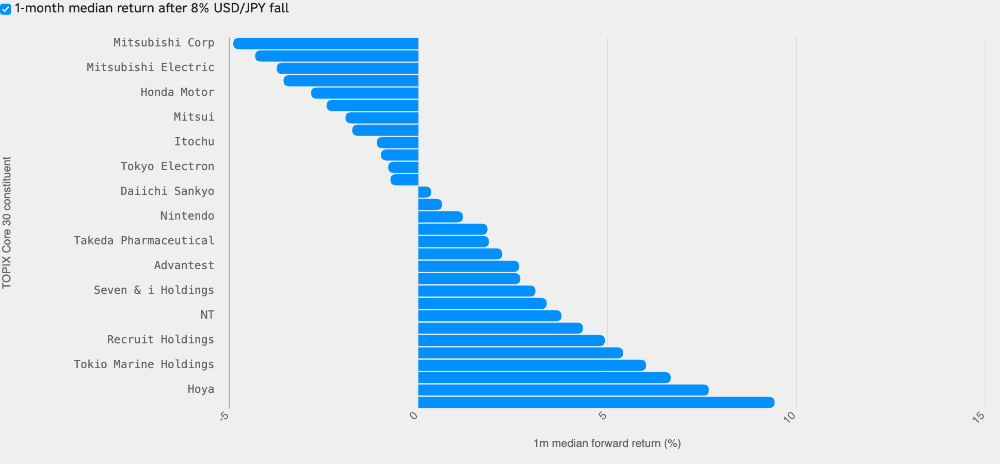

<!--
id: RX-USECASE-0080
type: use-case
language: ja
locale: ja
author: Reflexivity Research
kb_imported: 2026-10-17
status: draft
translation_status: localized_from_en_canonical
original_language: en
source_type: reflexivity-platform-demo
source_manifest: RX-USECASE-0080
prompt_status: present
prompt_basis: localized_from_en_verbatim
-->

# 急激な円高でTOPIX Core 30銘柄の影響を比較する

<!-- locale-switcher:start -->
**Languages:** [English](../../../../en/05-use-cases/03-asset-class/01-FX/usdjpy-appreciation-topix-core30-sensitivity.md) · **日本語** · [한국어](../../../../ko/05-유스케이스/03-운용자산별/01-FX/엔화-급등-시-TOPIX-Core-30-종목별-민감도-비교하기.md) · [简体中文](../../../../zh-cn/05-使用案例/03-按资产类别/01-FX/评估-日元快速升值-对TOPIX-Core-30股票的影响.md) · [繁體中文（台灣）](../../../../zh-tw/05-使用案例/03-依資產類別/01-FX/評估-日圓快速升值-對TOPIX-Core-30個股的影響.md) · [繁體中文（香港）](../../../../zh-hk/05-使用案例/03-按資產類別/01-FX/評估-日圓急升-對TOPIX-Core-30股票的影響.md)
<!-- locale-switcher:end -->

[← 運用資産別](../README.md) · [ユースケース一覧](../../README.md)

**対象ユーザー：** 日本株運用者、FX運用者、リスク管理担当者  
**主な資産：** 外国為替、日本株  
**調査の対象期間：** 1990～2024年の過去事例と2024年夏の円キャリー巻き戻し

> 数値や市場状況は該当期間の研究例であり、最新の市況や投資推奨ではありません。

**[Reflexivityで調査例を開く →](https://app.reflexivity.com/alfred?mode=research&conversationId=a1c43683-e81a-46d0-b9a4-0ab6a96d91b7&scrollTo=top)**

## 使用したプロンプト

> [!IMPORTANT]
> 2024年7～8月の円キャリー取引の巻き戻しのようにUSD/JPYが1カ月で8%下落した場合、TOPIX Core 30のどの銘柄に最も大きな影響があり、どの銘柄への影響が小さいでしょうか。各銘柄の円相場に対する過去の感応度を基に、輸出企業と内需企業を比較してください。

## 円高ショックを個別株の研究に落とし込む

USD/JPYが1カ月で8%下がる局面では、輸出企業の円換算利益、国内企業の需要、世界的なリスク選好が同時に変わる可能性があります。単純な「円高は輸出株に不利」という説明だけでは十分ではありません。

2024年7月3日～8月5日にはUSD/JPYが約 **161.70から144.20**へ下落しました。研究では、1990～2024年の21営業日間でUSD/JPYが8%以上下落した **13件の過去イベント**を抽出し、その後1カ月の株価リターンの中央値を比較します。

## 銘柄別の条件付きリターン

*図1：過去の条件付き1カ月リターン中央値です。次の円高局面の株価予測やFX回帰ベータではありません。*

| 銘柄 | 過去リターン中央値 | 有効事例数 |
| --- | ---: | ---: |
| 三菱商事 | −4.90% | 13 |
| トヨタ | −4.32% | 13 |
| ソニーグループ | −3.57% | 13 |
| ホンダ | −2.84% | 13 |
| みずほFG | +6.68% | 6 |
| HOYA | +7.69% | 13 |
| MUFG | +9.43% | 6 |

この選別条件では輸出企業群の平均が **−2.74%**、内需企業群は **+4.31%** でした。ただし観測件数は企業ごとに異なり、2件しかない企業も含まれます。政策転換や世界的なリスク回避が混在するため、為替だけによる因果効果ではありません。売上通貨やヘッジ方針、ローリングFXベータを追加調査する出発点として利用します。

## 関連資料のお問い合わせ

同じ質問を **LSEG Workspaceなど別の調査環境で再現した結果**については、アクセス権と再配布条件を確認のうえ、個別提供の可否をご案内します。**jim@reflexivity.com** 宛に文書番号 **RX-USECASE-0080** を添えてお問い合わせください。

---

[← 運用資産別](../README.md) · [ユースケース一覧](../../README.md)
