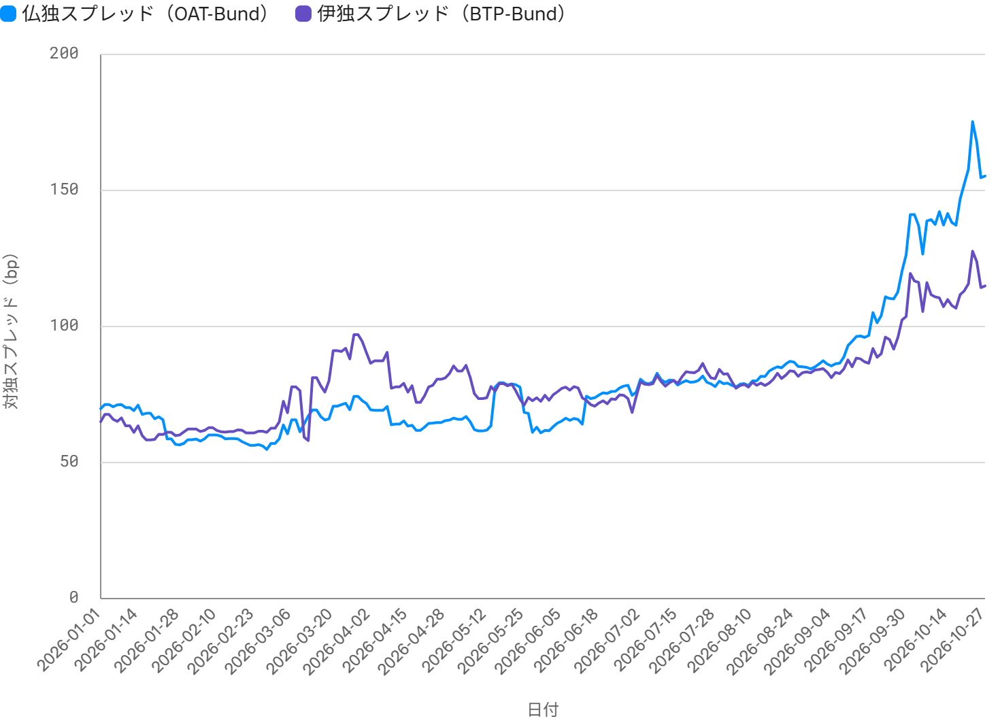

<!--
id: RX-USECASE-0110
type: use-case
language: ja
locale: ja
author: Reflexivity GTM Team
provider: 株式会社QUICK
source_created: 2026-10-28
published: 2026-11-17
revised: 2026-11-17
editorial_reviewed: 2026-11-17
resource: QUICK Reflexivity usage example: Compare Fed, ECB and BOJ policy stances and bond-market risks
status: published
translation_status: current
publication_mode: faithful-source-preserving
prompt_status: present
prompt_basis: source-verbatim
-->

# FRB・ECB・日銀の政策姿勢と国債リスクを比較する

<!-- locale-switcher:start -->
**Languages:** [English](../../../../en/05-use-cases/03-asset-class/03-macro/compare-fed-ecb-and-boj-policy-stances-and-bond-market-risks.md) · **日本語** · [한국어](../../../../ko/05-유스케이스/03-운용자산별/03-매크로/연준·ECB·일본은행-정책-방향과-국채-리스크-비교.md) · [简体中文](../../../../zh-cn/05-使用案例/03-按资产类别/03-宏观/比较美联储-欧央行-日银政策及债券风险.md) · [繁體中文（臺灣）](../../../../zh-tw/05-使用案例/03-依資產類別/03-總體/比較聯儲局-歐央行-日銀政策及債券風險.md) · [繁體中文（香港）](../../../../zh-hk/05-使用案例/03-按資產類別/03-宏觀/比較聯儲局-歐央行-日銀政策及債券風險.md)
<!-- locale-switcher:end -->

[← ユースケース一覧](../../README.md)

**活用例の日付:** 2026-10-28  
**中心となる機能:** Alfred

FRB・ECB・日銀の金利見通しとインフレリスクを比較し、追加質問でフランス国債の信用不安まで確認します。

> [!NOTE]
> 数値、予測、画面構成は記載日の調査例です。最新の相場やすべての利用環境での提供状況を示すものではありません。

## 使用したプロンプト

> [!IMPORTANT]
> FRB、ECB、BOJのそれぞれの金融スタンスと、利上げや利下げの可能性をどのように考えているかをまとめてください。

## 調査の目的と進め方

1. FRB・ECB・日銀の金利見通しとインフレリスクを比較し、追加質問でフランス国債の信用不安まで確認します。
2. 要約だけで判断せず、関連する企業、テーマ、イベントや市場の元データを確認します。
3. 分析期間と指標の定義、別の説明要因を確認してから現在の投資判断につなげます。

## この例で確認できること

FRB・ECB・日銀の金利見通しとインフレリスクを比較し、追加質問でフランス国債の信用不安まで確認します。

10月28日時点のFRB目標レンジ、ECB預金ファシリティ金利、日銀翌日物金利を区別して比較し、フランス国債リスクへ広げました。

## 画面と分析図表

## 提供時点の詳しい分析

以下は当時の分析内容と数値を保持したスナップショットです。最新の相場見通しとして読むものではありません。

サマリー
2026年10月28日時点で、FRB・ECB・日銀の3中銀はいずれも*引き締め（利上げ）方向*
にあります。中東情勢に伴うエネルギー高と上振れするインフレが共通の背景です。3中銀とも9月に25bpずつ利上げしました。今週の10月会合はいずれも
*据え置きが大勢*で、次の利上げは*12月会合が焦点*です。利下げを示唆する中銀はありません。
本稿の「政策金利」の定義は次の通りです。

   - FRB：フェデラルファンド（FF）金利の誘導目標レンジ
   - ECB：預金ファシリティ金利（主要リファイナンス金利MROを併記）
   - 日銀：無担保コール翌日物金利の誘導目標

主な調査結果 *1. FRB（米連邦準備制度）: タカ派で、年内にあと1回の利上げを想定*

   - 9月16日の会合では、全会一致でFF金利誘導目標を3.75-4.00%へ0.25%pt引き上げました。
   - 9月会合の議事要旨によると、FOMC参加者の大半は年内の追加利上げを想定し、インフレリスクは上方に偏っていると評価しています。
   - ただしウォーラー理事やボウマン副議長は、追加利上げを連続会合で行う必要はないとの考えを示しています。
   - 市場では10月会合の据え置きが大勢です（FedWatch 90.6%、Polymarket 95.75%）。
   - Polymarketでは、2026年の利上げ回数が2回となる確率が75.5%です。これは12月にもう1回利上げがあるとの見方に相当します。
   - 利下げの可能性は、事実上織り込まれていません。

*2. ECB（欧州中央銀行）: 利上げ姿勢だが「データ次第」で慎重*

   - 9月10日に主要3金利を25bp引き上げ、預金金利は2.50%となりました（MROは2.65%）。
   - インフレ見通しのリスクは上方と見ています。一方でデータ次第・会合ごとの判断を維持し、特定の金利経路を約束していない姿勢です。
   -
   議事要旨では、預金金利2.50%がスタッフ推計の中立金利レンジ内にあるとの指摘もありました。追加利上げの余地は残しつつ、ペースは柔軟に判断する構えです。
   - 理事会メンバーの発言が9月会合より和らいだこともあり、Danske BankやDeutsche
   Bankは10月29日のECB会合での据え置きを予想しています。12月の利上げは引き続き選択肢です。

*3. 日銀（日本銀行）: 「利上げを継続し緩和度合いを調整」する方針で、次は12月が有力*

   - 9月18日に7対2の賛成多数で政策金利を1.25%へ引き上げました。1995年以来の高水準です。
   - 植田総裁は追加利上げの可能性を示唆する一方、10月の連続利上げには消極的とされます。
   - 民間調査ではエコノミストの83%が12月会合での利上げを予想しています。
   - 9月のコアCPIは2.1%と目標を上回ったことも、利上げ論を後押ししています。
   - 10月29-30日の会合では、展望レポートで示される物価見通しが注目点です。

*4. 3中銀の比較*

   - 3中銀とも引き締め方向で、利上げ幅はFRBが2025年末比0.25%pt、日銀が同0.50%pt、ECBが底値比0.50%ptです。
   -
   金利差は、FRBと日銀の政策金利差は2.75%pt、ECB預金金利と日銀の差は1.25%ptです。日銀の利上げにより、いずれも縮小傾向にあります。

データ表・チャート FRB・ECB・日銀の金融スタンスと次回会合の見通し
中央銀行 現行政策金利 直近の決定 スタンス 次回会合 中銀自身の見方／市場予想
FRB 3.75-4.00% 2026/9/16 +25bp（全会一致） 引き締め（タカ派） 10/28（日本時間10/29未明発表）
大半が年内追加利上げを想定／10月据え置き確率90.6%（FedWatch）
ECB 預金金利2.50%（MRO 2.65%） 2026/9/10 +25bp（全員支持） 引き締め（データ次第） 10/29
金利経路を事前約束せず／大手行は10月据え置き予想
日銀 1.25% 2026/9/18 +25bp（7対2） 利上げ継続で緩和度合いを調整 10/29-30（展望レポート）
10月は据え置き予想／83%が12月利上げを予想
FRB・ECB・日銀の政策金利推移（月末値、2024年以降）
使用した時系列は、FRB・ECB・日銀の政策金利（社内系列、月末値）とECB預金金利です。チャート上のECBの線は、社内系列の主要リファイナンス金利（MRO）です。
留意点

   -
   社内の政策金利系列は月末値で最終更新が2026年9月30日です。また、FRB・ECB・日銀の10月会合はいずれも本稿作成時点で未開催であり、結果次第で見通しが変わり得る点にご注意ください。
   - 日銀については、社内の文書データベースで9〜10月の公式文書を取得できませんでした。総裁発言や市場予想はニュース報道に基づいています。
   -
   市場確率（FedWatch、Polymarket）は取得時点の値で、日々変動します。ECB・日銀の会合を直接対象とするPolymarket市場は見つかりませんでした。

今週の各会合の結果（FOMC声明、ECBの記者会見、日銀の展望レポート）が出た後に、スタンスの変化を更新・比較することもできます。 情報源
エンティティ（8）

   - ECB
   - FED
   - BOJ
   - FRA_G10Y
   - DEU_G10Y
   - EURUSD
   - ITA_G10Y
   - JAP_G10Y

時系列データ（8）

   - FED.central_bank_policy_rate
   - ECB.central_bank_policy_rate
   - BOJ.central_bank_policy_rate
   - FRA_G10Y.yield
   - DEU_G10Y.yield
   - ITA_G10Y.yield
   - JAP_G10Y.yield
   - EURUSD.price

イベント（3件）

   - 米国 の経済イベント
   - 日本 の経済イベント
   - ドイツ の経済イベント

参照元（3件）

   - 「"FRB FOMC monetary policy stance and outlook for rate cuts or
   hikes"」に関するドキュメント（3件）
   - 「"ECB monetary policy stance and outlook for rate cuts or
   hikes"」に関するドキュメント（3件）
   - 「"ECB view on France sovereign bond spreads, fragmentation risk and
   Transmission Protection Instrument"」に関するドキュメント（3件）

ニュース（40件）

   - Japan Raises Interest Rate to 31-Year High on Inflation Pressures,
   Weaker Yen
   - BOJ Shifts Policy Focus to Anchoring 2% Inflation After September Rate
   Hike
   - Bank of Japan Hikes Interest Rate to 31-Year High
   - Danske Bank: European Central Bank No Longer Expected to Hike Rate in
   October
   - Japanese Stocks Rebound as BOJ Leans Toward October Rate Pause
   - Market Chatter: BOJ Seen Hiking in December as Economists Bet on
   Quarterly Pace
   - Bank of Japan Governor Says Further Rate Hikes Possible Amid Higher
   Inflation Risks
   - BOJ Policymakers Debated Inflation Overshoot Risks, Need for Rate
   Hikes in September Meeting
   - Japanese Stocks Slip at Open Ahead of Megacap Earnings, Central Bank
   Decisions
   - Japan's Core Inflation Tops BOJ Target, Bolstering Rate Hike Case
   - Fed Minutes Hint to Another Hike This Year: Traders Don't See It
   Coming In October
   - Kevin Warsh-Led Fed Faces Inflation Test Ahead Of Midterms As Stephen
   Moore Calls For Another Hike: Crypto Bettors Weigh In
   - Fed, ECB Expected To Hold Rates Next Week, But December Hikes Still In
   Play
   - FOMC Expected to Maintain Target Rate Range at October Meeting After
   September Hike
   - Federal Reserve Watch for Oct. 8: Waller Says Further Rate Hikes
   Needed, Suggests October Hike Not Certainty
   - Mark Zandi Warns Fed Rate Hike Would Be a Policy 'Misstep' as
   'Growing' Economic Risks Mount Ahead of This Week’s Meeting
   - Most Fed Officials View Additional Rate Hike By Year-End Necessary,
   Minutes Show
   - Federal Reserve Watch for Oct. 14: Bowman Says FOMC Can be Patient on
   Next Rate Hike
   - DAX Index Little Changed as German Economic Sentiment Falls
   - Deutsche Bank Expects Rate Pause from ECB in October Amid 'Tighter'
   Financial Conditions
   - Commerzbank Says Treasuries Strengthen, US Equity Futures Higher,
   Brent Oil Pares Gains
   - KPMG Canada Now Expects Bank of Canada Rate Hike in October, Moves Up
   Forecast From December
   - French Bonds Breach 5%, Briefly Overtaking U.S. Treasurys: Why It
   Matters For American Investors
   - France Erupts In Worst Unrest In Years as 2,400 Arrested: Emmanuel
   Macron Says 'Nothing Justifies It, Nothing Explains It, Nothing Excuses It'
   - Correction: Market Chatter: Sumitomo Mitsui DS Portfolio Manager Sells
   French Government Bonds Amid Fiscal Woes
   - Easing Bond Yields, Relatively Steady Oil Prices Churn European
   Bourses Midday
   - European Stocks Close Mostly Higher Monday Despite France, Spain
   Political Strains
   - European Stocks Close Higher in Tuesday Trading Amid Political Unrest
   in France, Spain
   - Commerzbank Says Treasuries Weaker, US Equity Futures Decline as Oil
   Prices Rebounds
   - US Treasury Yields Extend Declines From Two-Decade High as October Fed
   Rate-Hike Bets Sink Following Downbeat Jobs Report
   - Street Turmoil in France, Debt Concerns Dampen European Bourses Midday
   - Digital Realty Trust Closes Offering of Swiss Bonds
   - Market Chatter: Sumitomo Mitsui DS Asset Management Drops French
   Government Bonds Amid Fiscal Woes
   - Canadian Provincial Bonds Underperform as Global Yield Selloff Weighs
   on Returns, BMO Says
   - France to Release 10 Million Barrels of Diesel Under G7 Agreement
   - Spie Issues Sustainability-linked Bonds
   - Easing Crude, Stable Bond Yields Boost European Bourses Midday
   - Moody's Spares France a Downgrade, Cites Rising Yields and Social
   Unrest as Risks
   - BondBloxx’s Emerging Markets Bond ETF Crosses $1 Billion in AUM
   - Meta Is Coming for Europe’s Bond Market: AI Debt Is Going Global

信頼できる外部データ（16）

   - [Link recorded in original source]
   - [Link recorded in original source]
   - [Link recorded in original source]
   -
   [Link recorded in original source]
   - [Link recorded in original source]
   - [Link recorded in original source]
   -
   [Link recorded in original source]
   -
   [Link recorded in original source]
   - [Link recorded in original source]
   -
   [Link recorded in original source]
   - [Link recorded in original source]
   - [Link recorded in original source]
   -
   [Link recorded in original source]
   - [Link recorded in original source]
   - [Link recorded in original source]
   - [Link recorded in original source]

ウェブリンク（33）

   - [Link recorded in original source]
   - [Link recorded in original source]
   - [Link recorded in original source]
   - [Link recorded in original source]
   - [Link recorded in original source]
   - [Link recorded in original source]
   -
   [Link recorded in original source]
   - [Link recorded in original source]
   -
   [Link recorded in original source]
   -
   [Link recorded in original source]
   -
   [Link recorded in original source]
   -
   [Link recorded in original source]
   -
   [Link recorded in original source]
   - [Link recorded in original source]
   -
   [Link recorded in original source]
   - [Link recorded in original source]
   - [Link recorded in original source]
   - [Link recorded in original source]
   - [Link recorded in original source]
   - [Link recorded in original source]
   - [Link recorded in original source]
   - [Link recorded in original source]
   - [Link recorded in original source]
   - [Link recorded in original source]
   -
   [Link recorded in original source]
   -
   [Link recorded in original source]
   -
   [Link recorded in original source]
   -
   [Link recorded in original source]
   -
   [Link recorded in original source]
   -
   [Link recorded in original source]
   - [Link recorded in original source]
   -
   [Link recorded in original source]
   - [Link recorded in original source]

*フランス国債の信用不安に対して、何か影響はありますか？ *サマリー
あります。最も大きく影響を受けているのはECBで、利上げの必要性をむしろ下げる方向に働いています。FRBと日銀への影響は、現時点では間接的で限定的です。
背景には、2027年予算を巡る政治的膠着と大規模な抗議デモがあります。これを受けて仏10年国債利回りは2002年以来の高水準となり、一時5%を突破して米国債を上回ったと報じられています。
本稿の「スプレッド」は、各国10年国債利回りからドイツ10年国債利回りを差し引いた値（bp）です。
主な調査結果 *1. 市場：フランス固有の売りが中心で、波及は限定的*

   - 仏独10年スプレッドは155.3bpです。1カ月で45.2bp、2025年末比で84.8bp拡大しました。
   - 10月22日には175.3bpとデータ期間の最大を記録しています。
   - イタリアにも一部波及しました。伊独スプレッドも1カ月で23.2bp拡大し114.9bpとなったが、拡大幅は仏の約半分にとどまります。
   - 足元では伊10年債利回りは仏を40.4bp下回っている状態です。市場はフランスを特別に選別しているといえます。
   - 安全資産への逃避もみられます。同じ1カ月で独10年債利回りは-26.8bp、ユーロ/ドルは-2.35%の変化でした。
   - 10月19日には仏の騒乱と債務懸念で欧州株が下落し、Stoxx600銀行株指数は1.9%下げた。
   - 格付け面では、ムーディーズは10月23日に仏格付けをAa3に据え置いたが、見通しはネガティブのままです。

*2. ECB：利上げ確率は低下、ただし救済（TPI）には否定的*

   - ラガルド総裁は「第一の解決策はフランス国内の財政政策にある」と述べています。
   - 仏中銀総裁も介入の「条件は満たされていない」としており、TPIの発動は見込まれていない状況です。
   - TPI（伝達保護措置）は、財政規律に問題がない国の「不当な」市場変動に対応するための手段です。財政悪化が原因のケースは対象外とされています。
   - 金利面では、INGは仏危機が追加利上げの可能性をむしろ低下させたと指摘し、10月は据え置き、12月の最終利上げが大勢の予想です。
   - スプレッドの拡大自体が金融環境を引き締めるため、「債券市場が利上げの役割を代替している」という見方です。
   - なお、9月の理事会時点では、ユーロ圏国債市場は秩序的で、市場は発行体ごとに選別していると評価されていた。
   - 9月以降にスプレッドが急拡大したため、明日（10月29日）の理事会での評価の変化が注目されます。

*3. FRB・日銀：間接的な影響にとどまる*

   -
   FRBについては、フランス問題を理由に政策見通しを変えたとの公式発言は確認できていません。世界の長期金利やリスク心理、ドル高を通じた間接的な影響が中心です。
   - 日本では、日本の運用会社のファンドが仏国債を売却し独国債や日本の短期国債に資金を移したと報じられた例があります。
   -
   日本10年国債利回りは同じ1カ月で-28.0bp低下しました。ただし仏問題との因果関係は確認できていないため、日銀の12月利上げシナリオへの直接的な影響は現時点ではみられません。

データ表・チャート フランス国債不安後の主要市場指標（直近と1カ月変化）
指標 直近（2026-10-27） 1カ月前（2026-09-25） 1カ月変化
仏独10年スプレッド 155.3bp 110.1bp +45.2bp
仏10年国債利回り 4.908% 4.724% +18.4bp
伊独10年スプレッド 114.9bp 91.7bp +23.2bp
独10年国債利回り 3.355% 3.623% -26.8bp
ユーロ/ドル（EURUSD） 1.1124 1.1392 -2.35%
日本10年国債利回り 2.795% 3.075% -28.0bp
仏独・伊独10年国債スプレッドの推移（2026年）
フランス国債不安の中央銀行別・経路別の影響評価
対象 主な波及経路 影響度 政策への含意
ECB 仏スプレッド拡大・金融環境の引き締まり・分断リスク 大 10月は据え置き、追加利上げの確率は低下。TPI発動は見送りの公算
欧州市場 独国債への逃避、伊スプレッドの連れ高、ユーロ安、銀行株安 中 波及は限定的で、市場は仏を選別
FRB 世界の長期金利・リスク心理・ドル高 小（間接的） 政策見通しを変えたとの公式発言は確認できず
日銀 本邦投資家の欧州債ポジション、円相場、安全資産需要 小（間接的） 12月利上げシナリオへの直接的影響は確認できず
上の「影響度」は、収集した市場データと報道をもとにした当方の評価です。使用した時系列は、仏・独・伊・日本の10年国債利回りとユーロ/ドル（社内データ、日次）です。
留意点

   - 米10年国債利回りは社内系列で取得できず、仏国債が米国債を上回ったとの点は報道の見出しに基づくものです。
   - また、FRB・日銀への影響を直接示す公式発言は確認できていない状況です。
   - 独国債利回りや日本国債利回りの低下には、原油価格や各国固有の要因も含まれます。そのため、フランス要因だけを切り分けたものではありません。
   - ECB・FRB・日銀の10月会合はいずれも未開催です。仏予算審議の行方とあわせて、状況は短期間で変わり得ます。

明日のECB理事会でラガルド総裁が仏スプレッドやTPIにどう言及するかを確認し、影響評価を更新することもできます。 情報源エンティティ（8）

   - ECB
   - FED
   - BOJ
   - FRA_G10Y
   - DEU_G10Y
   - EURUSD
   - ITA_G10Y
   - JAP_G10Y

時系列データ（8）

   - FED.central_bank_policy_rate
   - ECB.central_bank_policy_rate
   - BOJ.central_bank_policy_rate
   - FRA_G10Y.yield
   - DEU_G10Y.yield
   - ITA_G10Y.yield
   - JAP_G10Y.yield
   - EURUSD.price

イベント（3件）

   - 米国 の経済イベント
   - 日本 の経済イベント
   - ドイツ の経済イベント

参照元（3件）

   - 「"FRB FOMC monetary policy stance and outlook for rate cuts or
   hikes"」に関するドキュメント（3件）
   - 「"ECB monetary policy stance and outlook for rate cuts or
   hikes"」に関するドキュメント（3件）
   - 「"ECB view on France sovereign bond spreads, fragmentation risk and
   Transmission Protection Instrument"」に関するドキュメント（3件）

ニュース（40件）

   - Japan Raises Interest Rate to 31-Year High on Inflation Pressures,
   Weaker Yen
   - BOJ Shifts Policy Focus to Anchoring 2% Inflation After September Rate
   Hike
   - Bank of Japan Hikes Interest Ra

（以下は掲載範囲外）

## 解釈上の注意

数値、予測、画面構成は記載日の調査例です。最新の相場やすべての利用環境での提供状況を示すものではありません。

## 関連機能

- [Alfred](https://github.com/reflexivity-kb/platform/blob/main/ja/03-%E8%A3%BD%E5%93%81/Alfred.md)

リンク先の製品マニュアルにはアクセス権が必要な場合があります。

---

本コンテンツは株式会社QUICKから提供された活用例です。数値や市場の見方は提供時点のものです。

[← ユースケース一覧](../../README.md)
