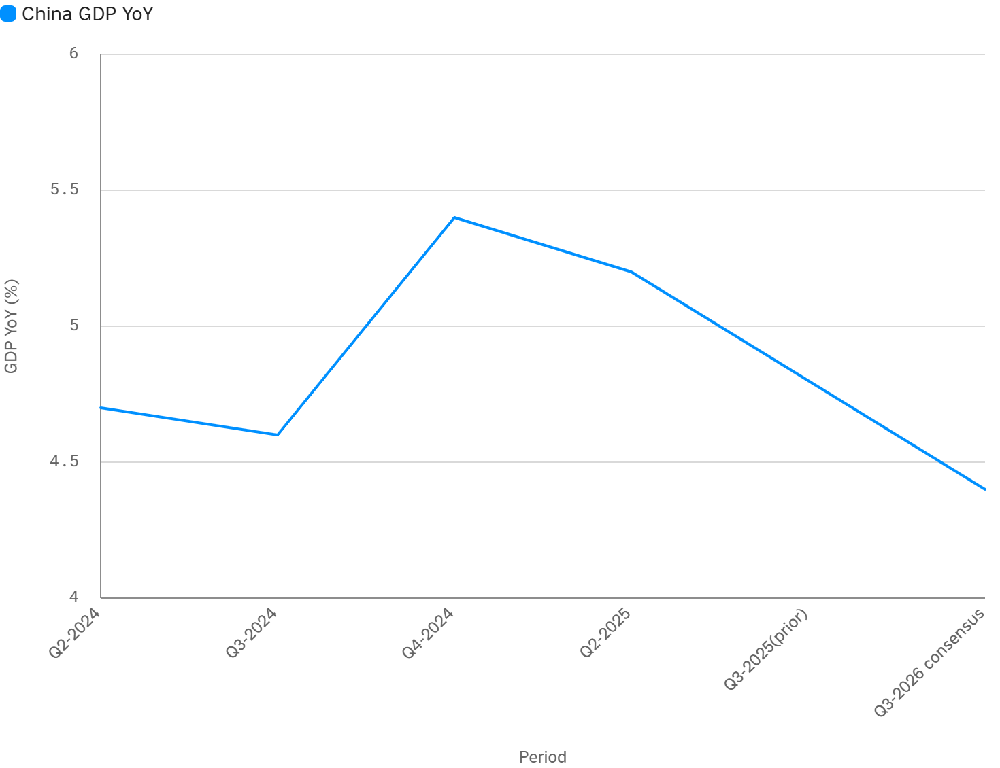

<!--
id: RX-USECASE-0095
type: use-case
language: ja
locale: ja
author: Reflexivity GTM Team
provider: 株式会社QUICK
source_created: 2026-10-19
published: 2026-11-17
revised: 2026-11-17
editorial_reviewed: 2026-11-17
resource: QUICK Reflexivity usage example: Compare China GDP sensitivity in Japanese and Hong Kong equities
status: published
translation_status: current
publication_mode: faithful-source-preserving
prompt_status: present
prompt_basis: source-verbatim
-->

# 中国GDP発表への日本株と香港株の反応を比較する

<!-- locale-switcher:start -->
**Languages:** [English](../../../../en/05-use-cases/03-asset-class/03-macro/compare-china-gdp-sensitivity-in-japanese-and-hong-kong-equities.md) · **日本語** · [한국어](../../../../ko/05-유스케이스/03-운용자산별/03-매크로/중국-GDP-발표에-대한-일본·홍콩-증시-민감도-비교.md) · [简体中文](../../../../zh-cn/05-使用案例/03-按资产类别/03-宏观/比较中国-GDP-对日股与港股的敏感度.md) · [繁體中文（臺灣）](../../../../zh-tw/05-使用案例/03-依資產類別/03-總體/比較中國-GDP-對日股與港股的敏感度.md) · [繁體中文（香港）](../../../../zh-hk/05-使用案例/03-按資產類別/03-宏觀/比較中國-GDP-對日股與港股的敏感度.md)
<!-- locale-switcher:end -->

[← ユースケース一覧](../../README.md)

**活用例の日付:** 2026-10-19  
**中心となる機能:** Alfred

中国GDPの発表が日本株と香港株に与える影響の差を、過去の反応と中国への景気感応度から比較します。

> [!NOTE]
> 数値、予測、画面構成は記載日の調査例です。最新の相場やすべての利用環境での提供状況を示すものではありません。

## 使用したプロンプト

> [!IMPORTANT]
> 今日中国のGDPの発表がありますが、発表結果が日本株式市場に与える影響はどの程度ありますか？ また香港株式市場は中国のGDP成長率をどのように見ていますか？

## 調査の目的と進め方

1. 中国GDPの発表が日本株と香港株に与える影響の差を、過去の反応と中国への景気感応度から比較します。
2. 要約だけで判断せず、関連する企業、テーマ、イベントや市場の元データを確認します。
3. 分析期間と指標の定義、別の説明要因を確認してから現在の投資判断につなげます。

## この例で確認できること

中国GDPの発表が日本株と香港株に与える影響の差を、過去の反応と中国への景気感応度から比較します。

10月19日の事前分析では中国GDP予想+4.4%（前期+4.8%）を取り上げ、香港株の感応度が相対的に高いと整理しました。

## 画面と分析図表

## 提供時点の詳しい分析

以下は当時の分析内容と数値を保持したスナップショットです。最新の相場見通しとして読むものではありません。

結論
(a) 日本株式市場への影響度 : 限定的・間接的

   -
   中国GDPが段階的に減速した過去11回のエピソードで、日経平均の中央値リターンは1週間後+1.08%、3カ月後+3.31%でした。つまり日本株は中国GDPの弱さに対してむしろ底堅く推移する傾向があります。
   - 直近の日経平均は 65,324.29（10/16）で、約1カ月で+2.05%。足元の日本株はAI・米国株・国内政治（高市トレード）など
   China 以外の要因に強く左右されており、中国GDPは数ある材料の一つにとどまります。
   - したがって今回の発表が*単独で日本市場を大きく動かす可能性は低い*
   と見ます。ただしコンセンサスを大幅に下回る「ネガティブ・サプライズ」が出た場合は、中国関連売上の大きい機械・素材・インバウンド関連などセクター単位で短期的な下押しが生じ得ます。

(b) 香港市場は中国GDP成長率をどう見ているか : 敏感だが「織り込み済み」で底堅い

   -
   同じエピソードで香港ハンセン指数の中央値リターンは1週間後-0.20%、1カ月後-0.87%と、日本より明確に弱い反応を示します。香港株は中国本土経済のプロキシであり、成長率に直接連動します。
   -
   一方で足元のポジショニングは香港株は底堅く、過去の中国GDP下振れ時にも上昇を続け、ハンセン銀行はAI輸出ブームを背景に2026年の香港成長率見通しを4.4%へ引き上げています。市場は中国の構造的減速をある程度「織り込み済み」で、刺激策（PBoCの金利据え置き決定も明日控える）やテーマ物色（AI・テック）に注目しています。
   -
   ハンセンは24,062.72（10/15）で、約1カ月-2.45%とさえない地合い。コンセンサスが示す前年比0.4ポイントの減速が確認されれば短期の重しになりますが、刺激策期待が下支えとなる構図です。

データ・チャート
China GDP step-down episodes: median forward returns (Nikkei vs Hang
Seng)[image:
image.png]
China GDP growth (YoY): recent trajectory and today's consensus[image:
image.png]
China Q3-2026 GDP release & market snapshot
Item Value Detail
China GDP YoY : consensus (Q3-2026) 4.4% Due today ~10:00 Tokyo; QoQ exp.
1.1%
China GDP YoY : prior print 4.8% Implied -0.4pp deceleration
Nikkei 225 : latest 65,324.29 2026-10-16; ~1M +2.05%, ~3M -2.85%
Hang Seng : latest 24,062.72 2026-10-15; ~1M -2.45%, ~3M -2.03%
Nikkei median fwd (post weak-GDP) +1.08% (1w) / +3.31% (3m) 11 historical
episodes
Hang Seng median fwd (post weak-GDP) -0.20% (1w) / -0.87% (1m) 11
historical episodes
留意点（データの限界）

   - 本日のGDPは発表前（コンセンサス値）です。実績値・サプライズは未確定で、反応は「下振れ/上振れ」の方向で変わります。
   - シナリオ分析は「中国GDP前年比が3カ月で0.2ポイント以上低下」した*過去11エピソード*
   の中央値であり、将来を保証しません。マクロ時系列のタイムスタンプ特性上、前回実績の参照日付には幅があります。
   - 指数リターンは取引日ベースの近似（約21/63営業日）で計算しています。

情報源シナリオ（1）

   - China falls by 0.2 percentage points (20 bps) over 63d : 11 distinct
   episodes (2015-07-15 → 2025-10-20)

エンティティ（3）

   - HSI
   - NKY
   - CHN

時系列データ（4）

   - NKY.price
   - HSI.price
   - CHN.gdp_yoy_actual
   - CHN.gdp_yoy_consensus

イベント（2件）

   - 中国 の経済イベント
   - 中国 の経済イベント

ニュース（12件）

   - Sanae Takaichi Set to Highlight Japan's Investments in US Amid Defense
   Spending Pressure by Trump Administration: Report
   - Japanese Equities Open Higher
   - Japanese Stocks Open Higher Monday
   - Japanese Equities Climb Tracking US Chip Gains
   - Market Chatter: Japanese Industry Group Calls for Clarity on China's
   Export Controls
   - Japanese Shares Rebound Tracking Wall Street's Bets on AI Stocks
   - Hong Kong Stocks Climb at Open as Investors Eye China Data
   - Hong Kong Stocks Extend Gains Despite China's GDP Miss; Insilico
   Medicine Climbs
   - Hong Kong Stocks Open Lower as Nvidia Rally Fails to Lift Sentiment
   - Hong Kong Stocks Rally on China Stimulus Hopes; Alibaba Advances
   - Hang Seng Bank Raises Hong Kong 2026 Growth Forecast to 4.4%
   - Hang Seng Upgrades Hong Kong 2026 GDP Forecast to 4.4% on AI Export
   Boom

中国GDPの*実際の発表値が出た後*に、サプライズの大きさに応じた日本・香港セクター別の反応を精査することもできます。
よろしければAlfredでお試しください。

## 解釈上の注意

数値、予測、画面構成は記載日の調査例です。最新の相場やすべての利用環境での提供状況を示すものではありません。

## 関連機能

- [Alfred](https://github.com/reflexivity-kb/platform/blob/main/ja/03-%E8%A3%BD%E5%93%81/Alfred.md)

リンク先の製品マニュアルにはアクセス権が必要な場合があります。

---

本コンテンツは株式会社QUICKから提供された活用例です。数値や市場の見方は提供時点のものです。

[← ユースケース一覧](../../README.md)
