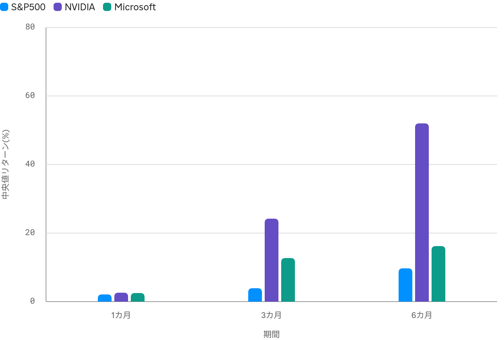

<!--
id: RX-USECASE-0089
type: use-case
language: ja
locale: ja
source_type: partner-provided-use-case
provider: 株式会社QUICK
source_manifest: RX-USECASE-0089
source_created: 2026-10-21
published: 2026-11-17
revised: 2026-11-17
editorial_reviewed: 2026-11-17
resource: QUICK provided Reflexivity workflow
status: published
translation_status: current
prompt_status: present
prompt_basis: source-verbatim
-->

# AI・半導体相場はピークを迎えたのか検証する

<!-- locale-switcher:start -->
**言語:** [English](../../../../en/05-use-cases/03-asset-class/04-equities/is-the-ai-and-semiconductor-rally-peaking.md) · **日本語** · [한국어](../../../../ko/05-유스케이스/03-운용자산별/04-주식/AI·반도체-랠리의-정점-신호를-검증하기.md) · [简体中文](../../../../zh-cn/05-使用案例/03-按资产类别/04-股票/判断-AI-与半导体行情是否已触顶.md) · [繁體中文（臺灣）](../../../../zh-tw/05-使用案例/03-依資產類別/04-股票/判斷-AI-與半導體行情是否已見頂.md) · [繁體中文（香港）](../../../../zh-hk/05-使用案例/03-按資產類別/04-股票/判斷-AI-及半導體行情是否已見頂.md)
<!-- locale-switcher:end -->

[← Use Cases](../../README.md)

**QUICK | 2026-10-21**

## 使用したプロンプト

> [!IMPORTANT]
> AI相場や半導体相場はすでにピークを迎えているのでしょうか？ハイパースケーラーの資金調達難や信用不安も考慮して現在の状況を分析して下さい。

## この調査の進め方

10月21日の分析は、短期の下落だけで相場の終わりと判断せず、指数の高値からの下落率、1年リターン、ハイパースケーラーの設備投資と低格付け債のスプレッドを比較しました。

## 提供日時点の分析

半導体セレクトは6月高値から約27.6%下落した一方、1年騰落率は約+34%でした。Oracleの設備投資は営業CFの174%で、CCC格付けスプレッドも拡大。株価モメンタムと資金調達耐久力を分けて評価しました。

## 読み方と注意点

相場の天井は事後的にしか確認できません。AIテーマは社内構成バスケットで、信用ストレスは主に低格付け帯に集中していました。著名人の警告は事実と区別して読みます。

## 関連機能

- [Alfred](https://github.com/reflexivity-kb/platform/blob/main/ja/03-%E8%A3%BD%E5%93%81/Alfred.md)

製品マニュアルの閲覧にはアクセス権が必要な場合があります。

## 調査画面と図表

以下は提供日時点の調査画面・図表であり、現在の市場数値ではありません。

## 提供元

本コンテンツは、株式会社QUICKよりご提供いただいたものです。

国・地域や言語環境、利用製品、データ提供範囲などによっては、内容をそのまま適用できない場合があります。

[← Use Cases](../../README.md)
