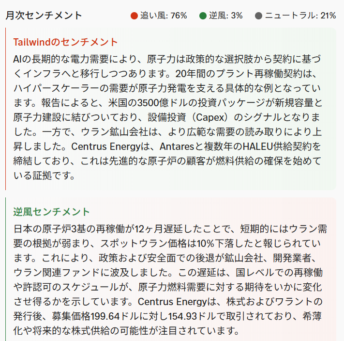

<!--
id: RX-USECASE-0094
type: use-case
language: ja
locale: ja
author: Reflexivity GTM Team
provider: 株式会社QUICK
source_created: 2026-10-07
published: 2026-11-17
revised: 2026-11-17
editorial_reviewed: 2026-11-17
resource: QUICK Reflexivity usage example: Move from Dashboard theme performance to underlying companies
status: published
translation_status: current
publication_mode: faithful-source-preserving
prompt_status: not_provided
prompt_basis: not_provided
-->

# ダッシュボードのテーマ騰落から構成銘柄へ進む

<!-- locale-switcher:start -->
**Languages:** [English](../../../../en/05-use-cases/03-asset-class/04-equities/move-from-dashboard-theme-performance-to-underlying-companies.md) · **日本語** · [한국어](../../../../ko/05-유스케이스/03-운용자산별/04-주식/대시보드-테마-성과에서-구성-종목-분석.md) · [简体中文](../../../../zh-cn/05-使用案例/03-按资产类别/04-股票/从仪表盘主题表现深入成分股.md) · [繁體中文（臺灣）](../../../../zh-tw/05-使用案例/03-依資產類別/04-股票/從儀表板主題表現深入成份股.md) · [繁體中文（香港）](../../../../zh-hk/05-使用案例/03-按資產類別/04-股票/從儀表板主題表現深入成份股.md)
<!-- locale-switcher:end -->

[← ユースケース一覧](../../README.md)

**活用例の日付:** 2026-10-07  
**中心となる機能:** Dashboard, Themes

テーマ別パフォーマンスから構成銘柄へ進み、短期の上昇を1年間の推移と比較して持続性を見ます。

> [!NOTE]
> 数値、予測、画面構成は記載日の調査例です。最新の相場やすべての利用環境での提供状況を示すものではありません。

## 使用したプロンプト

提供資料では、使用したプロンプトの全文は確認できません。

## 調査の目的と進め方

1. テーマ別パフォーマンスから構成銘柄へ進み、短期の上昇を1年間の推移と比較して持続性を見ます。
2. 要約だけで判断せず、関連する企業、テーマ、イベントや市場の元データを確認します。
3. 分析期間と指標の定義、別の説明要因を確認してから現在の投資判断につなげます。

## この例で確認できること

テーマ別パフォーマンスから構成銘柄へ進み、短期の上昇を1年間の推移と比較して持続性を見ます。

米国の原子力関連テーマをダッシュボードから開き、構成銘柄と1年の推移を確認する例です。

## 画面と分析図表

## 提供時点の詳しい分析

以下は当時の分析内容と数値を保持したスナップショットです。最新の相場見通しとして読むものではありません。

ニュースでもお聞きかと思いますが、昨日のNY株式市場は原子力関連がにぎわったようです。

Reflexivityのダッシュボードの「テーマ別パフォーマンス」でもご確認いただけます。

テーマのところをクリックいただくと構成銘柄などの詳細が確認できます。

とはいえ、過去1年間のパフォーマンスで見ると必ずしも順調とは言えないようです。

テーマ探しや銘柄選定の参考情報としてご活用ください。

## 解釈上の注意

数値、予測、画面構成は記載日の調査例です。最新の相場やすべての利用環境での提供状況を示すものではありません。

## 関連機能

- [Dashboard](https://github.com/reflexivity-kb/platform/blob/main/ja/03-%E8%A3%BD%E5%93%81/%E3%83%80%E3%83%83%E3%82%B7%E3%83%A5%E3%83%9C%E3%83%BC%E3%83%89.md)
- [Themes](https://github.com/reflexivity-kb/platform/blob/main/ja/03-%E8%A3%BD%E5%93%81/%E3%83%86%E3%83%BC%E3%83%9E.md)

リンク先の製品マニュアルにはアクセス権が必要な場合があります。

---

本コンテンツは株式会社QUICKから提供された活用例です。数値や市場の見方は提供時点のものです。

[← ユースケース一覧](../../README.md)
