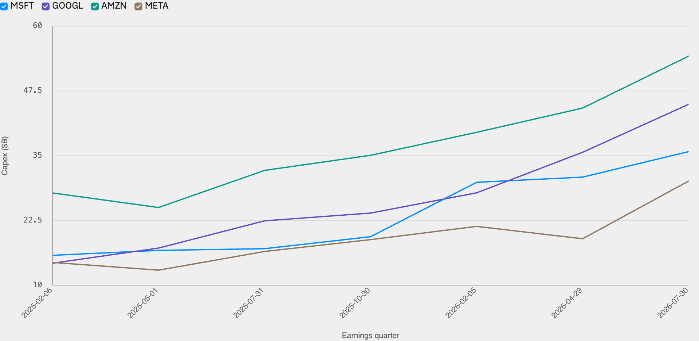
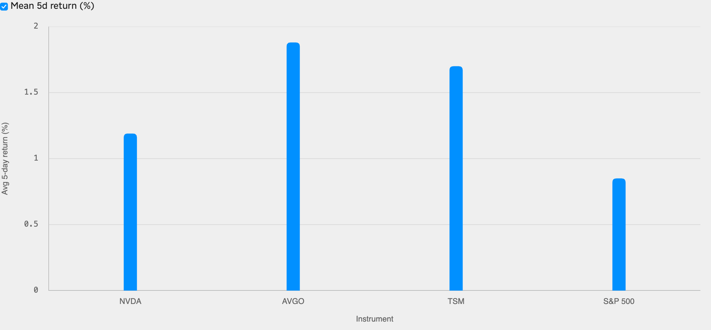

<!--
id: RX-USECASE-0077
type: use-case
language: ja
locale: ja
author: Reflexivity Research
kb_imported: 2026-10-17
status: draft
translation_status: localized_from_en_canonical
original_language: en
source_type: reflexivity-platform-demo
source_manifest: RX-USECASE-0077
prompt_status: present
prompt_basis: localized_from_en_verbatim
-->

# ハイパースケーラーの設備投資と半導体株の反応を比較する

[← 運用資産別](../README.md) · [ユースケース一覧](../../README.md)

**対象ユーザー：** テクノロジー株運用者、テーマ運用者  
**主な資産：** 米国株、半導体  
**調査の対象期間：** 2025～2026年の決算四半期

> 数値や市場状況は該当期間の研究例であり、最新の市況や投資推奨ではありません。

**[Reflexivityで調査例を開く →](https://app.reflexivity.com/alfred?mode=research&conversationId=9f8a2812-9afc-43b6-b198-62712b7b12ea&scrollTo=top)**

## 使用したプロンプト

> [!IMPORTANT]
> 直近8四半期のMicrosoft、Alphabet、Amazon、Metaの決算発表で設備投資（Capex）ガイダンスがどう変化したか調べてください。各社がガイダンスを引き上げた後の5営業日で、NVIDIA、Broadcom、TSMCの株価がS&P 500に対してどう動いたか比較してください。

## AI設備投資を半導体株のイベント研究につなげる

大手クラウド企業が投資を増やしても、半導体株が毎回同じ方向に動くわけではありません。設備投資の観測値、決算日、5営業日の株価反応を対応づけます。

## 四半期設備投資の推移

*図1：実際に報告された四半期Capex（十億米ドル）です。経営陣の将来投資ガイダンスそのものではありません。*

対象期間の初回と最終観測値を比べると、CapexはMicrosoft **約126.6%**、Alphabet **214.6%**、Amazon **94.8%**、Meta **108.7%** 増加しました。Amazonの直近値は約 **542.1億ドル** です。

## 発表後5営業日のリターン

*図2：実績Capexが前四半期比で増えた決算を抽出した比較です。重複するリターン期間を独立イベントとして扱うことはできません。*

| 銘柄 | 平均5営業日リターン | S&P 500との差 |
| --- | ---: | ---: |
| Broadcom | +1.88% | +1.03ポイント |
| TSMC | +1.70% | +0.85ポイント |
| NVIDIA | +1.19% | +0.34ポイント |
| S&P 500 | +0.85% | 基準 |

この実行では **将来Capexガイダンスの上方修正を、実績Capexの前四半期比増加で代替**しています。21件の選択イベントには同日の決算や価格観測期間の重複も含まれます。ガイダンスそのものの検証や因果関係の評価には、経営陣の一次発言と重複除去が必要です。

## 関連資料のお問い合わせ

同じ質問を **LSEG Workspaceなど別の調査環境で再現した結果**については、アクセス権と再配布条件を確認のうえ、個別提供の可否をご案内します。**jim@reflexivity.com** 宛に文書番号 **RX-USECASE-0077** を添えてお問い合わせください。

---

[← 運用資産別](../README.md) · [ユースケース一覧](../../README.md)
