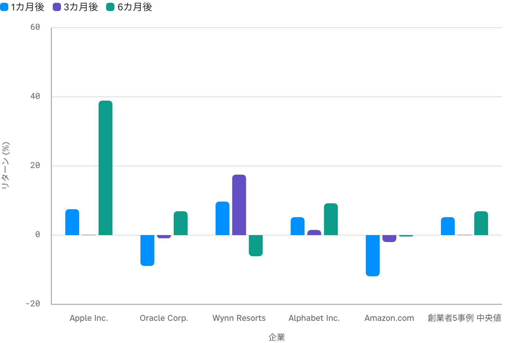

<!--
id: RX-USECASE-0092
type: use-case
language: ja
locale: ja
author: Reflexivity GTM Team
provider: 株式会社QUICK
source_created: 2026-11-13
published: 2026-11-17
revised: 2026-11-17
editorial_reviewed: 2026-11-17
resource: QUICK Reflexivity usage example: Compare founder-CEO departures and subsequent stock performance
status: published
translation_status: current
publication_mode: faithful-source-preserving
prompt_status: present
prompt_basis: source-verbatim
-->

# 創業者CEO辞任後の株価と業界波及を比較する

<!-- locale-switcher:start -->
**Languages:** [English](../../../../en/05-use-cases/03-asset-class/04-equities/compare-founder-ceo-departures-and-subsequent-stock-performance.md) · **日本語** · [한국어](../../../../ko/05-유스케이스/03-운용자산별/04-주식/창업자-CEO-사임-이후-주가와-업계-영향-비교.md) · [简体中文](../../../../zh-cn/05-使用案例/03-按资产类别/04-股票/比较创始人-CEO-辞任后的股价与行业影响.md) · [繁體中文（臺灣）](../../../../zh-tw/05-使用案例/03-依資產類別/04-股票/比較創辦人-CEO-辭任後的股價及行業影響.md) · [繁體中文（香港）](../../../../zh-hk/05-使用案例/03-按資產類別/04-股票/比較創辦人-CEO-辭任後的股價及行業影響.md)
<!-- locale-switcher:end -->

[← ユースケース一覧](../../README.md)

**活用例の日付:** 2026-11-13  
**中心となる機能:** Alfred

NVIDIAの経営トップ交代を過去の創業者退任例と比較し、1・3・6か月の株価推移とAI業界への波及を整理します。

> [!NOTE]
> 数値、予測、画面構成は記載日の調査例です。最新の相場やすべての利用環境での提供状況を示すものではありません。

## 使用したプロンプト

> [!IMPORTANT]
> NVIDIAのジェイスン・ファンCEOが辞任しました。過去20年間でこのように時価総額の大きな会社で創業者が突然辞任するようなケースがあったかを調べてください。その際の１か月後、３か月後、６か月後の株価のパフォーマンスも分析してください。 また、今回のファンCEOの辞任で、AIやデータセンターの業界に与える影響がどの程度と市場は見ていますでしょうか？

## 調査の目的と進め方

1. NVIDIAの経営トップ交代を過去の創業者退任例と比較し、1・3・6か月の株価推移とAI業界への波及を整理します。
2. 要約だけで判断せず、関連する企業、テーマ、イベントや市場の元データを確認します。
3. 分析期間と指標の定義、別の説明要因を確認してから現在の投資判断につなげます。

## この例で確認できること

NVIDIAの経営トップ交代を過去の創業者退任例と比較し、1・3・6か月の株価推移とAI業界への波及を整理します。

5件の創業者退任例を比較し、NVIDIA個別株への短期反応とAI産業全体への中期影響を別の問いとして扱います。

- [関連する一次情報](https://nvidianews.nvidia.com/news/nvidia-announces-ceo-transition)

## 画面と分析図表

## 提供時点の詳しい分析

以下は当時の分析内容と数値を保持したスナップショットです。最新の相場見通しとして読むものではありません。

サマリー NVIDIA
Corp.（NVDA）は2026年11月12日に、ジェンスン・フアン氏が社長・CEO・取締役を即時辞任したと発表しました。CFOのコレット・クレス氏が暫定CEOに就任し、後任の正式CEOは社内外から選びます。発表当日のNVDAは-4.34%下落しました。S&P500は-0.35%にとどまり、下落はNVDA固有の要因が中心です。AI・データセンター業界全体へのリスクとしては、市場は
*限定的*とみています。
主な調査結果 *1. 過去の類似事例（過去20年）*

   - 大型株で創業者がCEOを退いた主な事例は5件確認しました。
   - Apple Inc.（AAPL、2011年、ジョブズ氏）
   - Oracle Corp.（ORCL、2014年、エリソン氏）
   - Wynn Resorts（WYNN、2018年、ウィン氏）
   - Alphabet Inc.（GOOGL、2019年、ペイジ氏・ブリン氏）
   - Amazon.com（AMZN、2021年、ベゾス氏）
   - 今回に最も近いのはWYNNです。不祥事による即時辞任で、会長職も含めて完全に退いた点が共通します。
   - 他の4件は、創業者が会長などとして会社に残る「計画的な権限移譲」の色合いが強いケースです。
   - 参考として、非創業者のIntel（INTC、2018年）も載せています。社員との関係による即時辞任という点で、今回と経緯が似ています。

*2. 発表後の株価パフォーマンス*

   -
   リターンの定義：発表直前の終値（調整後）から、N営業日後（1カ月＝21日、3カ月＝63日、6カ月＝126日）の終値までの価格変化率です。配当は含みません。
   - 創業者5事例の中央値は次のとおりです。
   - 1カ月後：+5.2%
   - 3カ月後：+0.1%
   - 6カ月後：+6.9%
   - S&P500に対する超過リターンの中央値は、6カ月後で+4.8ptでした。
   - 6カ月後に上昇していたのは5件中3件です。平均すると大きな毀損は見られませんでした。
   - 一方、事例ごとのばらつきは大きくなっています。
   - AMZN：6カ月後に-16.0ptと、S&P500を大きく下回りました。
   - WYNN：3カ月後は+17.5%でしたが、6カ月後には-6.1%に反転しました。
   - INTC（不祥事型）：6カ月後に-14.8%でした。後継CEOの決定までに約7カ月かかり、その間に製造の遅れが重なって株価が低迷しました。
   - 今回と同じ不祥事型では、正式な後継者が決まるまでの不透明感が中期的な重しになりやすいという示唆があります。

*3. NVDAの現状*

   - スキャンダル報道前（11/6）から11/12までに、NVDAは-10.96%下落しました。同じ期間にS&P500は+2.92%上昇しています。
   - 報道後の2営業日で約4,300億ドルの時価総額が失われたと報じられました。
   - 1カ月物のATMインプライド・ボラティリティは48.37%から57.53%へ上昇しました。

*4. AI・データセンター業界への影響を市場はどうみているか*

   - 総じて「NVIDIA固有のガバナンス・地政学リスク」であり、AI設備投資サイクル全体のリスクではない、という評価です。
   - 競合は大きく上昇しました（11/6以降）。
   - AMD：+30.3%
   - Broadcom（AVGO）：+24.1%
   - 資金がNVIDIAの代替となるAI半導体へ移った構図とみられます。
   - データセンター関連も上昇しました（11/6以降）。
   - Vertiv（VRT）：+14.7%
   - Arista（ANET）：+21.0%
   - 需要そのものへの懸念は織り込まれていません。
   - ハイパースケーラーの発表当日の値動きは小幅でした。
   - Microsoft（MSFT）：+0.36%
   - Alphabet（GOOGL）：+1.79%
   - 例外はSuper Micro
   Computer（SMCI）で、発表当日に-11.3%下落しました。司法省がスパイ疑惑の女性による同社製品の対中密輸関与を調査中との報道が原因で、スキャンダルとの直接の関係が意識されたものです。
   - 懸念として挙がっている点は次のとおりです。
   - Oppenheimerは「頭脳流出」を招きうる、投資テーゼを変えかねない重大イベントと指摘しています。
   - 中国AI企業は米国の規制強化を懸念し、国外の計算資源の確保を急いでいると報じられました。対中輸出規制が強化されるリスクも意識されています。

データ表・チャート 大型株の創業者CEO突然退任事例と発表後の株価リターン
企業 退任者 発表日 内容 翌日 1カ月後 3カ月後 6カ月後 6カ月 対S&P500
Amazon.com (AMZN) ジェフ・ベゾス 2021-02-02 CEO退任を発表（会長に移行） -2.0% -11.9% -2.0%
-0.4% -16.0pt
Alphabet Inc. (GOOGL) ラリー・ペイジ／セルゲイ・ブリン 2019-12-03 CEO・社長職から退任（取締役に留任） +1.9%
+5.2% +1.5% +9.2% +11.3pt
Wynn Resorts (WYNN) スティーブ・ウィン 2018-02-06 性的不正行為疑惑でCEO・会長を辞任 +8.6% +9.7%
+17.5% -6.1% -10.5pt
Oracle Corp. (ORCL) ラリー・エリソン 2014-09-18 CEO退任（会長兼CTOに留任） -4.2% -8.9% -0.9%
+6.9% +4.8pt
Apple Inc. (AAPL) スティーブ・ジョブズ 2011-08-24 健康上の理由でCEO辞任（会長に留任） -0.7% +7.5%
+0.1% +38.9% +23.5pt
Intel Corp. (INTC) ※非創業者・参考 ブライアン・クルザニッチ 2018-06-21 社員との関係で規程違反、即時辞任 -2.4%
-2.9% -13.7% -14.8% -10.5pt
創業者CEO退任後の株価リターン（1・3・6カ月）
NVIDIA騒動期間のAI・データセンター関連株の騰落率
留意点

   - 過去事例の発表日・経緯は既知の公開情報に基づくもので、ツールでは直接検証していません。
   - 事例数は5件と少数です。
   - AMZNは決算発表と同時でした。
   - GOOGLの6カ月窓にはコロナ禍が含まれます。
   - Twitter（2021年）は株価データがないため除外しました。
   -
   AIテーマのバスケット指数と予測市場データは取得できませんでした。そのため、業界への影響は個別銘柄の値動きとニュースで代替評価したものです。AMDなどの上昇には、他の材料が含まれている可能性があります。
   -
   次の材料は、NVIDIAが第3四半期決算を11月17日に予定通り発表することです。ガイダンスと後任CEO選びの見通しが、次の株価の方向を左右します。

11/17の決算後に、NVDAの反応をWYNN・INTCの不祥事型事例と日次で重ねて比較することもできます。ご希望があればお知らせください。 情報源
エンティティ（17）

   - SPX
   - NVDA:NASD
   - TSM:NYSE
   - MU:NASD
   - MSFT:NASD
   - GOOGL:NASD
   - VRT:NYSE
   - AMD:NASD
   - AVGO:NASD
   - SMCI:NASD
   - META:NASD
   - AMZN:NASD
   - ORCL:NYSE
   - ANET:NYSE
   - WYNN:NASD
   - INTC:NASD
   - AAPL:NASD

時系列データ（18）

   - ORCL:NYSE.price
   - WYNN:NASD.price
   - SPX.price
   - NVDA:NASD.implied_vol_1m
   - AMD:NASD.price
   - MSFT:NASD.price
   - AMZN:NASD.price
   - VRT:NYSE.price
   - NVDA:NASD.price
   - ANET:NYSE.price
   - AVGO:NASD.price
   - TSM:NYSE.price
   - MU:NASD.price
   - SMCI:NASD.price
   - META:NASD.price
   - GOOGL:NASD.price
   - AAPL:NASD.price
   - INTC:NASD.price

ニュース（43件）

   - --Street Color: Nvidia CEO Jensen Huang Resigns
   - Trump’s Bombshell Choice for Nvidia’s Next CEO: ‘A Legend Replaces a
   Legend’
   - Former Nvidia CEO Jensen Huang Had An Intimate Relationship With A
   Second Employee, Sources Say
   - Trump Says Tim Cook Should Replace Jensen Huang as Nvidia CEO
   - Nvidia Board Weighs CFO Colette Kress For Interim CEO Role Amid
   Uncertainty Over Jensen Huang’s Future: Report
   - 'Do Not Fire Jensen Huang,' Kobeissi Letter Says, Warning Ousting CEO
   Could Be a 'Costly Mistake' and a 'Net Negative for Nvidia'
   - Update: US Equity Indexes Shrug Off Turmoil at Nvidia as CEO Jensen
   Huang Resigns
   - --Nvidia CEO Jensen Huang Resigns
   - Update: Nvidia CEO Jensen Huang Resigns
   - Nvidia CEO Jensen Huang Resigns
   - Nvidia CEO Jensen Huang Steps Down; CFO Colette Kress Becomes Interim
   Chief
   - Jensen Huang Scandal Widens: Former Nvidia CEO Linked to Second
   Employee
   - GOP Senator Kevin Cramer Calls for Nvidia CEO Jensen Huang’s
   Resignation Over China Spy Concerns, Says Potential for Extortion Is
   ‘Tremendous’
   - Top Midday Stories: Nvidia CEO Jensen Huang Resigns; Nebius Shares
   Fall on Soft Guidance
   - Will Jensen Huang Survive Nvidia's Spy Scandal? What Prediction
   Markets Say
   - Nvidia Interim CEO Kress To Host A Company Meeting On November 18 At
   9:00AM PT
   - Update: Wall Street Ends Choppy Session Lower as CEO Exit Drives
   Nvidia Sell-Off
   - Nvidia ETFs Have a New Problem: Life After Jensen Huang
   - US Equity Markets End Lower After Crude Oil Prices Rise, Nvidia CEO
   Resigns
   - China's AI Firms Fear Jensen Huang's Turmoil Could Cut Off Their
   Nvidia Lifeline : Now They're Hunting for Computing Power Abroad: Report
   - Warren Buffett Said ‘We Can Afford to Lose Money’ But Not ‘Even a
   Shred of Reputation’ : Nvidia’s Board Just Showed What That Means With
   Jensen Huang’s Exit
   - Voters Rejected Data Centers In 10 States, Raising Regulatory Risk for
   CoreWeave, Nvidia and AI Build-Out
   - NVIDIA Says Colette Kress To Serve As Interim CEO Until Permanent
   Successor Named; Board Is Initiating Search For Permanent CEO And Will
   Consider Internal And External Candidates
   - Jensen Huang's Biggest Strength Isn't His Tech Knowledge but His
   Decision-Making, Analyst Says Amid NVDA Ouster Reports
   - Update: US Equity Indexes Fall as Nvidia CEO Jensen Huang Resigns,
   Crude Oil Jumps
   - Nvidia (NVDA) Stock Is Trending in Pre-Market: Here’s What Is Happening
   - China Stocks Open Lower Amid Nvidia Leadership Crisis
   - Equity Futures Mostly Down as Nvidia Declines Amid Uncertainty Over
   CEO's Fate
   - What's Going On With Super Micro Computer Stock Thursday?
   - Market Chatter: Chinese AI Firms Rushing to Rent Nvidia-Powered
   Capacity as CEO Scandal Could Provoke US Restrictions
   - Jensen Huang Is Out At Nvidia: 4 Private Equity Giants with Big Bets
   on Its AI Infrastructure Future
   - From AI Chips to Rocket Ships: Will Jensen Huang Join Elon Musk?
   - Market Chatter: Nvidia CEO Jensen Huang Said to Have Had Extramarital
   Affair With Nvidia Executive
   - Nvidia’s Huang Admits Affair With Suspected Chinese Spy, Board Will
   Investigate
   - Nvidia CEO Huang's Washington Influence at Risk Amid Chinese Spy
   Probe, Wedbush Says
   - Nvidia Launches Probe Amid Reports CEO Huang Was Target of 'Foreign
   Intelligence Effort'
   - Market Chatter: Nvidia Faces China Spy Allegations as Beijing Calls
   Claims 'Smears'
   - Nvidia’s Huang Admits Affair With Suspected Chinese Spy, Board Will
   Investigate
   - Nvidia CEO Personal Ties Could Intensify Washington Scrutiny
   - Trump Says ‘I Know The FBI Is Looking Into It’ as Nvidia CEO Jensen
   Huang Faces Scrutiny Over Suspected Chinese Spy Allegations
   - Nvidia Faces Deeper Scrutiny Over China Chip Ties and CEO Affair
   - Update: Market Chatter: Nvidia CEO Jensen Huang Said to Have Had
   Extramarital Affair With Nvidia Executive
   - Who is Colette Kress? 5 Things to Know About New Nvidia CEO

信頼できる外部データ（5）

   -
   [Link recorded in original source]
   -
   [Link recorded in original source]
   -
   [Link recorded in original source]
   -
   [Link recorded in original source]
   -
   [Link recorded in original source]

ウェブリンク（11）

   - [Link recorded in original source]
   -
   [Link recorded in original source]
   -
   [Link recorded in original source]
   -
   [Link recorded in original source]
   -
   [Link recorded in original source]
   -
   [Link recorded in original source]
   - [Link recorded in original source]
   - [Link recorded in original source]
   -
   [Link recorded in original source]
   - [Link recorded in original source]
   - [Link recorded in original source]

## 解釈上の注意

数値、予測、画面構成は記載日の調査例です。最新の相場やすべての利用環境での提供状況を示すものではありません。

## 関連機能

- [Alfred](https://github.com/reflexivity-kb/platform/blob/main/ja/03-%E8%A3%BD%E5%93%81/Alfred.md)

リンク先の製品マニュアルにはアクセス権が必要な場合があります。

---

本コンテンツは株式会社QUICKから提供された活用例です。数値や市場の見方は提供時点のものです。

[← ユースケース一覧](../../README.md)
