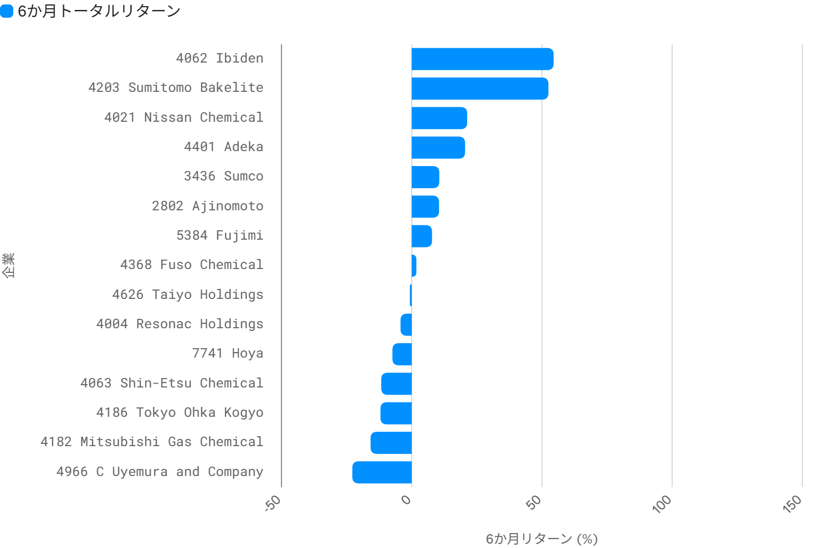

<!--
id: RX-USECASE-0101
type: use-case
language: ja
locale: ja
author: Reflexivity GTM Team
provider: 株式会社QUICK
source_created: 2026-10-23
published: 2026-11-17
revised: 2026-11-17
editorial_reviewed: 2026-11-17
resource: QUICK Reflexivity usage example: Compare Japanese stocks inside the semiconductor materials theme
status: published
translation_status: current
publication_mode: faithful-source-preserving
prompt_status: present
prompt_basis: source-verbatim
-->

# 半導体材料テーマの日本企業を騰落別に分析する

<!-- locale-switcher:start -->
**Languages:** [English](../../../../en/05-use-cases/03-asset-class/04-equities/compare-japanese-stocks-inside-the-semiconductor-materials-theme.md) · **日本語** · [한국어](../../../../ko/05-유스케이스/03-운용자산별/04-주식/반도체-소재-테마의-일본-기업-성과-비교.md) · [简体中文](../../../../zh-cn/05-使用案例/03-按资产类别/04-股票/比较半导体材料主题中的日本公司表现.md) · [繁體中文（臺灣）](../../../../zh-tw/05-使用案例/03-依資產類別/04-股票/比較半導體材料主題中的日本企業表現.md) · [繁體中文（香港）](../../../../zh-hk/05-使用案例/03-按資產類別/04-股票/比較半導體材料主題中的日本企業表現.md)
<!-- locale-switcher:end -->

[← ユースケース一覧](../../README.md)

**活用例の日付:** 2026-10-23  
**中心となる機能:** Themes, Knowledge Graph, Alfred

ナレッジグラフの半導体材料テーマに含まれる日本企業を抽出し、6か月リターンと業績・需要の背景を比較します。

> [!NOTE]
> 数値、予測、画面構成は記載日の調査例です。最新の相場やすべての利用環境での提供状況を示すものではありません。

## 使用したプロンプト

> [!IMPORTANT]
> 業界テーマ「半導体材料」に含まれている日本企業で、過去6か月間のパフォーマンスを分析し、高パフォーマンスの企業と、低パフォーマンスの企業の背景について説明してください。

## 調査の目的と進め方

1. ナレッジグラフの半導体材料テーマに含まれる日本企業を抽出し、6か月リターンと業績・需要の背景を比較します。
2. 要約だけで判断せず、関連する企業、テーマ、イベントや市場の元データを確認します。
3. 分析期間と指標の定義、別の説明要因を確認してから現在の投資判断につなげます。

## この例で確認できること

ナレッジグラフの半導体材料テーマに含まれる日本企業を抽出し、6か月リターンと業績・需要の背景を比較します。

半導体材料テーマの日本企業15社を比較し、イビデン+54.5%、住友ベークライト+52.5%などの差を示しました。

## 画面と分析図表

## 提供時点の詳しい分析

以下は当時の分析内容と数値を保持したスナップショットです。最新の相場見通しとして読むものではありません。

昨日配信の関連テーマに関して、分析例をお伝えします。
「半導体材料」テーマには75銘柄がリストアップされていますが、日本株も含まれています。
このテーマに含まれている日本株について、パフォーマンスから傾向などを分析しました。

業界テーマ「半導体材料」に含まれている日本企業で、過去6か月間のパフォーマンスを分析し、高パフォーマンスの企業と、低パフォーマンスの企業の背景について説明してください。
半導体材料テーマ：日本企業の過去6か月パフォーマンス分析
ナレッジグラフの業界テーマ「Semiconductor
Materials（半導体材料）」には日本企業が32社含まれています。本分析ではテーマへのエクスポージャーが最も強い上位15社について、2026年4月23日〜10月22日のトータルリターンを計測しました。テーマ・バスケット全体が同期間で約+3.2%にとどまる一方、個別銘柄のばらつきは非常に大きくなりました。
主なポイント

   - *高パフォーマンス銘柄*
   ：イビデンが+54.5%でトップ、住友ベークライトが+52.5%と続き、半導体パッケージ基板・封止材関連が牽引しました。日産化学（+21.3%）、ADEKA（+20.5%）も堅調でした。
   - *低パフォーマンス銘柄*
   ：上村工業が-22.8%で最下位、三菱瓦斯化学（-15.8%）、東京応化工業（-12.0%）、信越化学工業（-11.7%）、HOYA（-7.4%）が下落しました。

パフォーマンス一覧 半導体材料テーマ 日本企業の6か月トータルリターン（2026年4月〜10月）
半導体材料テーマ 日本企業の6か月パフォーマンス順位
順位 企業 (証券コード) 6か月リターン
1 Ibiden (4062) +54.5%
2 Sumitomo Bakelite (4203) +52.5%
3 Nissan Chemical (4021) +21.3%
4 Adeka (4401) +20.5%
5 Sumco (3436) +10.6%
6 Ajinomoto (2802) +10.5%
7 Fujimi (5384) +7.8%
8 Fuso Chemical (4368) +1.8%
9 Taiyo Holdings (4626) -0.7%
10 Resonac Holdings (4004) -4.3%
11 Hoya (7741) -7.4%
12 Shin-Etsu Chemical (4063) -11.7%
13 Tokyo Ohka Kogyo (4186) -12.0%
14 Mitsubishi Gas Chemical (4182) -15.8%
15 C Uyemura and Company (4966) -22.8%
高パフォーマンス企業の背景

   - *イビデン（4062）*
   ：AI向けの高性能ICパッケージ基板需要が追い風。第1四半期の親会社株主帰属利益が41%増加し、SMBC日興がレーティングを「Outperform」に引き上げたことが株価を押し上げました。
   - *住友ベークライト（4203）*
   ：中国・シンガポールでの半導体封止材の増産発表、および政策保有株式売却による143億円の売却益計上が評価されました。
   - *日産化学・ADEKA*：リソグラフィ材料・電子材料の需要拡大が業績を支え、2桁のリターンとなりました。

低パフォーマンス企業の背景

   - *上村工業（4966）*
   ：めっき薬品中心の事業で、本グループの中では最も軟調。期間中の目立った好材料に乏しく、半導体材料バスケットの調整局面で売られました。
   - *三菱瓦斯化学（4182）*
   ：第1四半期の利益は118%増と好調だったものの、株価は6か月で下落。業績の割に電子化学品以外の事業構成が重しとなりました。
   - *東京応化工業（4186）*
   ：AIサーバー需要を背景に通期見通しを上方修正したにもかかわらず、期間ではマイナス。高いバリュエーション調整が影響した可能性があります。
   - *信越化学工業（4063）*
   ：シリコンウエハの世界的リーダーながら、期間中に配当予想を修正（記念配当）する中で株価は軟調。大型株としての需給や為替も影響しました。
   - *HOYA（7741）*
   ：PENTAXメディカル内視鏡事業の戦略的見直しを開始するなど半導体材料（マスクブランクス）以外の事業再編が注目され、株価の重しとなりました。

留意事項
本分析は32社中、テーマ・エクスポージャー上位15社を対象とし、2026年4月23日〜10月22日のトータルリターンで計測しています。これら日本銘柄についてはナレッジグラフの決算リキャップが利用できなかったため、背景説明はニュース記事に基づいています。
残りの17社（東海カーボン、フェローテック、京セラ等）まで対象を広げた分析や、個別企業の決算・バリュエーションの深掘りも可能です。ご希望があればお知らせください。
情報源エンティティ（15）

   - 4063:JPX
   - 5384:JPX
   - 4368:JPX
   - 4182:JPX
   - 3436:JPX
   - 4186:JPX
   - 4062:JPX
   - 4626:JPX
   - 4966:JPX
   - 7741:JPX
   - 4203:JPX
   - 4021:JPX
   - 2802:JPX
   - 4004:JPX
   - 4401:JPX

時系列データ（15）

   - 5384:JPX.total_return
   - 2802:JPX.total_return
   - 4182:JPX.total_return
   - 4401:JPX.total_return
   - 3436:JPX.total_return
   - 4186:JPX.total_return
   - 4063:JPX.total_return
   - 4062:JPX.total_return
   - 4626:JPX.total_return
   - 4966:JPX.total_return
   - 7741:JPX.total_return
   - 4203:JPX.total_return
   - 4368:JPX.total_return
   - 4021:JPX.total_return
   - 4004:JPX.total_return

ナレッジグラフ

   - 半導体材料
      - Wolfspeed
      - Entegris, Inc. - インテグリス
      - AXT, Inc. - AXT

ニュース（27件）

   - Japan Earnings Wrap: Ibiden, Nippon Steel Rise; Daikin Falls
   - Okasan Securities Upgrades Ibiden to Buy from Neutral; Price Target is
   29,000 Yen
   - Ibiden's Attributable Profit Jumps 41% in Fiscal Q1; Shares Rise 5%
   - SMBC Nikko Upgrades Ibiden to Outperform
   - Sumitomo Bakelite Recognizes 14.3 Billion Yen Gain on Sale of
   Cross-Shareholdings for Fiscal Q2
   - Sumitomo Bakelite to Raise Production Capacity for Encapsulation
   Materials at China, Singapore Sites
   - Sumitomo Bakelite to Expand Semiconductor Packaging Material Capacity
   in China, Singapore
   - Canadian Medical Center Co.'s Board Withdraws Recommendation for
   Capital Increase
   - Nissan Chemical Admits Delayed Disclosure of Two Subsidiaries
   - Canadian Medical Center Co.'s Board Proposes Capital Raise via Bonus
   Share Issue
   - Nissan Chemical Establishes Subsidiary in China
   - Nomura Upgrades Mitsubishi Gas Chemical Company to Buy from Neutral;
   Price Target is 6,000 Yen
   - Veritas In Silico, Mitsubishi Gas Chemical File Joint Patent for
   Cancer Drug
   - Mitsubishi Gas Chemical Profit Rises 118% in Fiscal Q1
   - Update: Seven Japanese Firms Secure Certification for India-Sourced
   Low-Carbon Ammonia Plan
   - Tokyo Ohka Kogyo Raises H1, Full-Year Profit Forecasts Amid Stronger
   Demand or AI Servers
   - Tokyo Ohka Kogyo's Profit Surges 56% in Q1
   - --SBI Securities Starts Tokyo Ohka Kogyo at Buy with 15,000 Yen Price
   Target
   - Tokyo Ohka Kogyo's H1 Profit Climbs 50%; Interim Dividend Declared
   - Shin-Etsu Chemical to Issue Stock Options to Directors, Corporate
   Officers, Employees
   - Shin-Etsu Chemical Plans Commemorative Dividend, Revises Dividend
   Forecast
   - Shin-Etsu Chemical Sets Stock Acquisition Rights Payment at 127,400
   Yen per Right
   - Shin-Etsu Chemical Finalizes Shares Acquired Under First Adjustment
   Period
   - HOYA's Profit Rises 27% in Fiscal Q1; Shares Up 4%
   - --SBI Securities Starts Hoya at Neutral with 29,400 Yen Price Target
   - Hoya Begins Strategic Review of PENTAX Medical Endoscope Business
   - Hoya's Profit Surges 27% in Fiscal Year 2025

## 解釈上の注意

数値、予測、画面構成は記載日の調査例です。最新の相場やすべての利用環境での提供状況を示すものではありません。

## 関連機能

- [Themes](https://github.com/reflexivity-kb/platform/blob/main/ja/03-%E8%A3%BD%E5%93%81/%E3%83%86%E3%83%BC%E3%83%9E.md)
- [Knowledge Graph](https://github.com/reflexivity-kb/platform/blob/main/ja/03-%E8%A3%BD%E5%93%81/Knowledge-Graph.md)
- [Alfred](https://github.com/reflexivity-kb/platform/blob/main/ja/03-%E8%A3%BD%E5%93%81/Alfred.md)

リンク先の製品マニュアルにはアクセス権が必要な場合があります。

---

本コンテンツは株式会社QUICKから提供された活用例です。数値や市場の見方は提供時点のものです。

[← ユースケース一覧](../../README.md)
