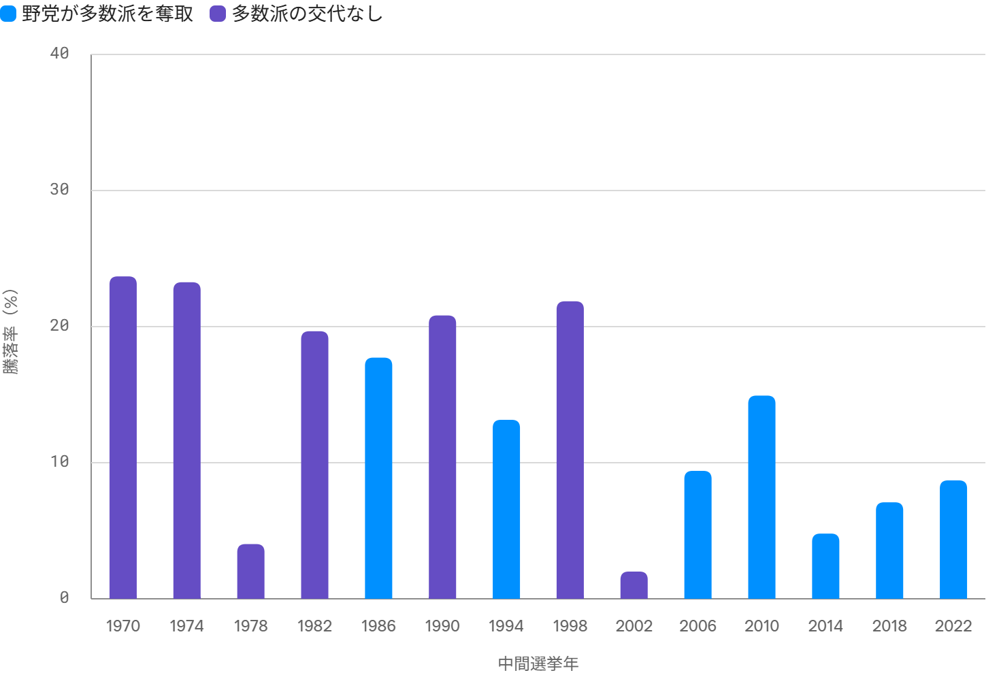

<!--
id: RX-USECASE-0105
type: use-case
language: ja
locale: ja
author: Reflexivity GTM Team
provider: 株式会社QUICK
source_created: 2026-11-02
published: 2026-11-17
revised: 2026-11-17
editorial_reviewed: 2026-11-17
resource: QUICK Reflexivity usage example: Study six-month S&P 500 returns after US midterm elections
status: published
translation_status: current
publication_mode: faithful-source-preserving
prompt_status: present
prompt_basis: source-verbatim
-->

# 米中間選挙後6か月のS&P500を長期比較する

<!-- locale-switcher:start -->
**Languages:** [English](../../../../en/05-use-cases/03-asset-class/04-equities/study-six-month-s-p-500-returns-after-us-midterm-elections.md) · **日本語** · [한국어](../../../../ko/05-유스케이스/03-운용자산별/04-주식/미국-중간선거-후-6개월-S&P500-수익률-검증.md) · [简体中文](../../../../zh-cn/05-使用案例/03-按资产类别/04-股票/检验美国中期选举后六个月标普-500-回报.md) · [繁體中文（臺灣）](../../../../zh-tw/05-使用案例/03-依資產類別/04-股票/檢驗美國中期選舉後六個月標普-500-回報.md) · [繁體中文（香港）](../../../../zh-hk/05-使用案例/03-按資產類別/04-股票/檢驗美國中期選舉後六個月標普-500-回報.md)
<!-- locale-switcher:end -->

[← ユースケース一覧](../../README.md)

**活用例の日付:** 2026-11-02  
**中心となる機能:** Alfred

1970年以降の中間選挙後6か月リターンを計測し、野党の多数派奪取があった年とそれ以外を比較します。

> [!NOTE]
> 数値、予測、画面構成は記載日の調査例です。最新の相場やすべての利用環境での提供状況を示すものではありません。

## 使用したプロンプト

> [!IMPORTANT]
> 米国中間選挙の６か月後のS&P500の数値は中間選挙前と比べてパフォーマンスがどうなっているのかを1970年以降から現在までを分析してください。また、政権を取っていない側の政党が勝利した場合と、政権側がそのまま多数議席を獲得した場合とで違いがあるかも調べてください。

## 調査の目的と進め方

1. 1970年以降の中間選挙後6か月リターンを計測し、野党の多数派奪取があった年とそれ以外を比較します。
2. 要約だけで判断せず、関連する企業、テーマ、イベントや市場の元データを確認します。
3. 分析期間と指標の定義、別の説明要因を確認してから現在の投資判断につなげます。

## この例で確認できること

1970年以降の中間選挙後6か月リターンを計測し、野党の多数派奪取があった年とそれ以外を比較します。

1970〜2022年の中間選挙14回では、6か月のS&P500平均+13.65%、中央値+14.04%と算出しました。

## 画面と分析図表

## 提供時点の詳しい分析

以下は当時の分析内容と数値を保持したスナップショットです。最新の相場見通しとして読むものではありません。

サマリー S&P
500（価格指数、配当除く）について、1970〜2022年の中間選挙14回を対象に騰落率を計算しました。起点は投票日前日の終値、終点は投票日から6か月後の同日の終値です（休場日の場合は直前の営業日）。
*全体の結果*

   - 平均は+13.65%、中央値は+14.04%でした。
   - 14回すべてでプラスです。
   - 1970年以降の任意の6か月間の平均+4.68%（上昇確率70.7%）を大きく上回る水準です。

*野党が多数派を奪った場合との比較*

   - 野党が議会多数を奪取した7回の平均10.83%でした。
   - 多数派の交代がなかった7回の平均+16.47%をやや下回ります。
   - どちらのケースでも株価は上昇しています。

主な発見

   1. *中間選挙後は一貫して上昇しています。*

   - 最小は2002年の+2.00%、最大は1970年の+23.69%でした。
   - 起点を選挙1か月前に置いても、平均+18.54%（上昇確率92.9%）と結論は変わりません。
   - この場合のマイナスは1978年の1回のみで、-4.35%でした（表の参考列）。

2. *野党が多数派を奪取した7回（1986, 94, 2006, 10, 14, 18, 22年）*

   - 中央値は+9.4%で、すべてプラスでした。
   - 幅は+4.79%〜+17.72%です。
   - 「ねじれは政策の不確実性を下げる」という通説とは矛盾しませんが、上昇幅は全体平均をやや下回ります。

3. *政権党が選挙後に両院の多数を握った2回（1978, 2002年）*

   - 質問の「政権側がそのまま多数議席を獲得」に最も近いケースです。
   - 平均+3.01%で、分類の中で最も低い結果でした。
   - 1978年はインフレと利上げ、2002年はITバブル崩壊後でイラク戦争の直前という環境でした。

4. *野党が既存の両院多数を維持した4回（1970, 74, 90, 98年）*

   - 平均+22.41%で、最も高い結果でした。
   - ただし1970・74・90年は景気後退の底打ち局面にあたり、景気循環の影響が大きいと考えられます。

5. *2026年の中間選挙は11月3日に予定されています。*

   - 6か月後のデータはまだ存在しないため、分析の対象外です。
   - 直近の終値は7,720.39（2026-10-29）です。

グラフ・表 中間選挙前日から6か月後までのS&P500騰落率（1970〜2022年）
選挙結果別のS&P500・6か月騰落率の比較
グループ 回数 平均 中央値 上昇確率 最小〜最大
全14回 14 +13.65% +14.04% 100% +2.00%〜+23.69%
野党が多数派を奪取（1986,94,2006,10,14,18,22） 7 +10.83% +9.40% 100% +4.79%〜+17.72%
多数派の交代なし（1970,74,78,82,90,98,2002） 7 +16.47% +20.82% 100% +2.00%〜+23.69%
└ 野党が既存の両院多数を維持（1970,74,90,98） 4 +22.41% +22.56% 100% +20.82%〜+23.69%
└ 選挙後に政権党が両院多数（1978,2002） 2 +3.01% +3.01% 100% +2.00%〜+4.02%
└ ねじれ継続（1982） 1 +19.66% +19.66% 100% +19.66%〜+19.66%
参考：1970年以降の全6か月期間 14,648 +4.68% +5.29% 70.7% -46.76%〜+52.75%
米中間選挙ごとのS&P500：選挙前日終値と6か月後終値
選挙年（投票日） 大統領（政党） 選挙結果 選挙前日終値 6か月後終値 6か月騰落率 参考：選挙1か月前起点
2022（2022-11-08） バイデン（民主） 野党共和党が下院を奪取 3,806.80 4,138.12 +8.70% +13.70%
2018（2018-11-06） トランプ（共和） 野党民主党が下院を奪取 2,738.31 2,932.47 +7.09% +1.63%
2014（2014-11-04） オバマ（民主） 野党共和党が上院を奪取 2,017.81 2,114.49 +4.79% +7.45%
2010（2010-11-02） オバマ（民主） 野党共和党が下院を奪取 1,184.38 1,361.22 +14.93% +18.76%
2006（2006-11-07） ブッシュ（子）（共和） 野党民主党が上下両院を奪取 1,379.78 1,509.48 +9.40% +11.85%
2002（2002-11-05） ブッシュ（子）（共和） 政権党（共和）が下院維持・上院奪還 908.35 926.55 +2.00% +15.73%
1998（1998-11-03） クリントン（民主） 共和党が上下両院の多数を維持（交代なし） 1,111.60 1,354.63 +21.86%
+35.11%
1994（1994-11-08） クリントン（民主） 野党共和党が上下両院を奪取 463.07 523.96 +13.15% +15.13%
1990（1990-11-06） ブッシュ（父）（共和） 民主党が上下両院の多数を維持（交代なし） 314.59 380.08 +20.82%
+22.02%
1986（1986-11-04） レーガン（共和） 野党民主党が上院を奪取 245.80 289.36 +17.72% +23.81%
1982（1982-11-02） レーガン（共和） 政権党（共和）が上院多数を維持、下院は民主のまま（交代なし） 135.47 162.11
+19.66% +32.91%
1978（1978-11-07） カーター（民主） 政権党（民主）が上下両院の多数を維持 95.19 99.02 +4.02% -4.35%
1974（1974-11-05） フォード（共和） 民主党が上下両院の多数を維持（交代なし） 73.08 90.08 +23.26% +44.50%
1970（1970-11-03） ニクソン（共和） 民主党が上下両院の多数を維持（交代なし） 83.51 103.29 +23.69% +21.29%
計算方法

   - *6か月騰落率* ＝（投票日から6か月後の終値 ÷ 投票日前日の終値 − 1）× 100
   - *「野党が多数派を奪取」の定義*
   ：大統領と異なる政党が、選挙前には持っていなかった院（下院または上院）の多数を新たに得た回です。それ以外の回は「交代なし」としています。
   - *比較基準*：1970年以降の全営業日を起点とする6か月リターン（14,648本）です。

制約・注意点

   - サンプルが14回と少なく、グループ間の差は統計的に有意とは言えません。
   - 上昇の主因は、大統領サイクル（中間選挙年に株価が底を打ちやすい傾向）や金融政策などのマクロ要因である可能性が高いです。
   - 配当を含まない価格リターンです。
   -
   選挙結果の分類は外部ウェブ資料（中間選挙結果一覧）と一般的な歴史的事実に基づいています。1982年（ねじれ継続）や2002年（上院奪還）のように、分類の解釈が分かれる回があります。

2026年の結果（下院・上院の帰趨）が判明した後に、同じ枠組みで類似ケースを比較することができます。配当込みのトータルリターンや、3か月・12か月の期間での再検証も可能です。
情報源エンティティ（1）

   - SPX

時系列データ（1）

   - SPX.price

ウェブリンク（11）

   - [Link recorded in original source]
   -
   [Link recorded in original source]
   - [Link recorded in original source]
   - [Link recorded in original source]
   -
   [Link recorded in original source]
   - [Link recorded in original source]
   - [Link recorded in original source]
   - [Link recorded in original source]
   -
   [Link recorded in original source]
   - [Link recorded in original source]
   -
   [Link recorded in original source]

## 解釈上の注意

数値、予測、画面構成は記載日の調査例です。最新の相場やすべての利用環境での提供状況を示すものではありません。

## 関連機能

- [Alfred](https://github.com/reflexivity-kb/platform/blob/main/ja/03-%E8%A3%BD%E5%93%81/Alfred.md)

リンク先の製品マニュアルにはアクセス権が必要な場合があります。

---

本コンテンツは株式会社QUICKから提供された活用例です。数値や市場の見方は提供時点のものです。

[← ユースケース一覧](../../README.md)
