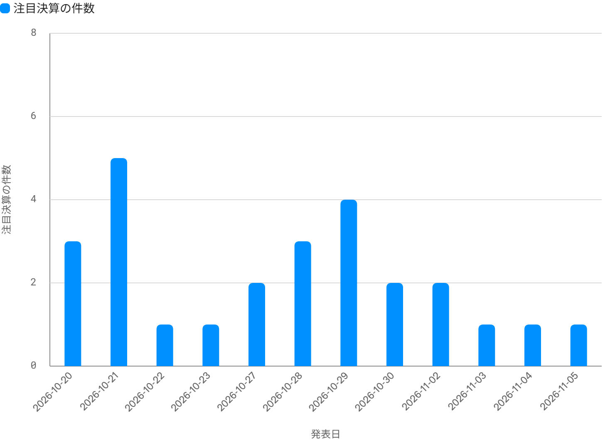

<!--
id: RX-USECASE-0109
type: use-case
language: ja
locale: ja
author: Reflexivity GTM Team
provider: 株式会社QUICK
source_created: 2026-10-15
published: 2026-11-17
revised: 2026-11-17
editorial_reviewed: 2026-11-17
resource: QUICK Reflexivity usage example: Build a dated earnings watchlist for US reporting season
status: published
translation_status: current
publication_mode: faithful-source-preserving
prompt_status: present
prompt_basis: source-verbatim
-->

# 米国決算シーズンの注目銘柄を発表日順に整理する

<!-- locale-switcher:start -->
**Languages:** [English](../../../../en/05-use-cases/03-asset-class/04-equities/build-a-dated-earnings-watchlist-for-us-reporting-season.md) · **日本語** · [한국어](../../../../ko/05-유스케이스/03-운용자산별/04-주식/미국-실적-시즌-관심-기업을-날짜별로-정리.md) · [简体中文](../../../../zh-cn/05-使用案例/03-按资产类别/04-股票/按发布日期整理美国财报季关注公司.md) · [繁體中文（臺灣）](../../../../zh-tw/05-使用案例/03-依資產類別/04-股票/按公布日期整理美國業績季關注企業.md) · [繁體中文（香港）](../../../../zh-hk/05-使用案例/03-按資產類別/04-股票/按公布日期整理美國業績季關注企業.md)
<!-- locale-switcher:end -->

[← ユースケース一覧](../../README.md)

**活用例の日付:** 2026-10-15  
**中心となる機能:** Alfred, Events

10月20日〜11月6日の決算予定から市場への影響が大きい企業を日付順に選び、注目理由を付けます。

> [!NOTE]
> 数値、予測、画面構成は記載日の調査例です。最新の相場やすべての利用環境での提供状況を示すものではありません。

## 使用したプロンプト

> [!IMPORTANT]
> 10月20日から11月6日にかけて多くの企業の決算発表があります。 マーケットの動向をモニターするために、注目すべき企業の決算発表について発表日順にリストアップしてください。注目すべき理由についても記載してください。

## 調査の目的と進め方

1. 10月20日〜11月6日の決算予定から市場への影響が大きい企業を日付順に選び、注目理由を付けます。
2. 要約だけで判断せず、関連する企業、テーマ、イベントや市場の元データを確認します。
3. 分析期間と指標の定義、別の説明要因を確認してから現在の投資判断につなげます。

## この例で確認できること

10月20日〜11月6日の決算予定から市場への影響が大きい企業を日付順に選び、注目理由を付けます。

10月20日〜11月6日の約1,260社の決算予定から、主要な26社を日付順に選んで業種と注目材料を整理しました。

## 画面と分析図表

## 提供時点の詳しい分析

以下は当時の分析内容と数値を保持したスナップショットです。最新の相場見通しとして読むものではありません。

サマリー 2026年10月20日〜11月6日は決算シーズンのピークで、当該期間に決算を予定する企業は*約1,260社*に上ります。そのうち
*時価総額$200B以上のメガキャップ*の決算イベントは*40件*
（GOOG/GOOGLの重複を含む）です。本リストでは、指数寄与と市場心理を左右する主要セクターのバロメーターに絞り、*26社*
をキュレーションして発表日順に整理しました（AI/半導体・大型ハイテク・決済・ヘルスケア・エネルギー）。
主な注目ポイント（発表日順）
*10/20（週明け・序盤）*

   - Netflix (NFLX)（2026-10-20、EPS予想0.82）:
   決算シーズンの口火を切る大型ハイテク。広告・会員動向が消費・メディアの先行指標。
   - GE Aero (GE)、RTX (RTX)（ともに2026-10-20）: 産業・防衛需要のバロメーター。

*10/21（ハイテク・半導体の第一波）*

   - Meta Platforms (META)（2026-10-21、EPS予想6.28）: AI設備投資とデジタル広告市況を映す超大型ハイテク。
   - Tesla (TSLA)（2026-10-21、EPS予想0.4）:
   EV需要・利益率とAI/ロボティクス戦略。ボラティリティが高く市場心理に影響。
   - Texas Instruments (TXN)、Lam Research (LRCX)、IBM (IBM)（いずれも2026-10-21）:
   半導体サイクルとエンタープライズITの指標。

*10/27（決済・ディフェンシブ）*

   - Visa (V)（2026-10-27、EPS予想3.43）、Coca-Cola (KO)（2026-10-27、EPS予想0.88）:
   世界の決済ボリュームとグローバル消費の指標。

*10/28（ビッグテックの本丸）*

   - Microsoft (MSFT)（2026-10-28、EPS予想4.72）:
   AzureのAIクラウド成長とCapExが焦点。指数への影響最大級。
   - Alphabet (GOOGL)（2026-10-28、EPS予想3.01）: 検索広告＋クラウド＋AI(Gemini)。KLA
   (KLAC) も同日。

*10/29（製薬・半導体・ヘルスケア）*

   - Eli Lilly (LLY)（2026-10-29、EPS予想7.89）: GLP-1需要で牽引するヘルスケア最大級の注目株。
   - Mastercard (MA)（2026-10-29、EPS予想5.15）、Merck
   (MRK)（2026-10-29、EPS予想2.12）、Intel (INTC)（2026-10-29、EPS予想0.37）:
   決済・大型製薬・再建途上の半導体。

*10/30〜11/2（エネルギー・Apple）*

   - Chevron (CVX)（2026-10-30、EPS予想4.75）、AbbVie
   (ABBV)（2026-10-30、EPS予想3.79）: エネルギー・製薬の大型株。
   - Apple (AAPL)（2026-11-02、EPS予想1.98）: 時価総額トップ級。iPhone販売とサービス成長に注目。
   - Palantir Technologies (PLTR)（2026-11-02、EPS予想0.4）:
   高バリュエーションのAI人気株で市場心理を象徴。

*11/3〜11/6（AI半導体の後半戦）*

   - Advanced Micro Devices (AMD)（2026-11-03、EPS予想1.88）: AI
   GPU需要の指標。オプションは大幅変動を織り込み。
   - ARM Holdings (ARM)（2026-11-04、EPS予想0.42）: AI/スマホ向けIPの中核。
   - Arista Networks (ANET)、Shopify (SHOP)（ともに11-03付近）、Toyota Motor
   (TM)（2026-11-05）も注目。

一覧表・チャート
注目の決算発表（2026-10-20〜2026-11-06、発表日順）
発表日 ティッカー 企業名 EPS予想 注目理由
2026-11-05 TM Toyota Motor : 世界最大級の自動車メーカー。グローバル自動車需要と日本株の指標
2026-11-04 ARM ARM Holdings 0.42 AI/スマホ向けIPの中核。ロイヤリティ動向が半導体サイクルの指標
2026-11-03 AMD Advanced Micro Devices 1.88 AI
GPU(MI系)でNVIDIAに次ぐ注目。データセンター需要の指標、オプションは大幅変動を織り込み
2026-11-02 PLTR Palantir Technologies 0.4
AI(AIP)関連の人気株。高バリュエーションでボラティリティが大きく市場心理を象徴
2026-11-02 AAPL Apple 1.98 時価総額トップ級。iPhone販売とサービス成長が消費・ハイテク全体に影響
2026-10-30 CVX Chevron 4.75 石油メジャー。原油市況とエネルギーセクターの指標
2026-10-30 ABBV AbbVie 3.79 Humira後の成長を占う大型製薬
2026-10-29 MRK Merck & Co 2.12 Keytruda依存と特許動向が焦点の大型製薬
2026-10-29 MA Mastercard 5.15 Visaと並ぶ決済最大手。グローバル消費の重要指標
2026-10-29 LLY Eli Lilly 7.89 GLP-1(肥満症・糖尿病)需要で牽引するヘルスケア最大級の注目株
2026-10-29 INTC Intel 0.37 再建途上の半導体。ファウンドリ戦略と反トラスト和解後の動向に注目
2026-10-28 MSFT Microsoft 4.72 AzureのAIクラウド成長とCapExが焦点。時価総額トップ級で指数への影響最大級
2026-10-28 KLAC KLA 1.18 半導体検査装置大手。前工程投資サイクルの指標
2026-10-28 GOOGL Alphabet 3.01 検索広告+クラウド+AI(Gemini)の超大型ハイテク。インデックスへの寄与大
2026-10-27 V Visa 3.43 世界の決済ボリューム。消費支出とクロスボーダー回復の指標
2026-10-27 KO Coca-Cola 0.88 グローバル消費の価格・数量動向を映すディフェンシブ・バロメーター
2026-10-23 AXP American Express 4.58 富裕層のカード消費動向を映す金融・消費指標
2026-10-22 PG Procter & Gamble 1.89 世界最大級の生活必需品。消費者の値上げ耐性と数量動向のディフェンシブ指標
2026-10-21 TXN Texas Instruments 2.41 アナログ半導体の雄。産業・自動車向け需要サイクルの重要指標
2026-10-21 TSLA Tesla 0.4 EV需要・利益率とAI/ロボティクス戦略。ボラティリティが高く市場心理に影響
2026-10-21 META Meta Platforms 6.28 AI設備投資とデジタル広告市況を映す超大型ハイテク。市場全体への影響大
2026-10-21 LRCX Lam Research 2.18 半導体製造装置大手。設備投資(WFE)サイクルとメモリ需要の先行指標
2026-10-21 IBM IBM 2.87 エンタープライズIT・AI(watsonx)需要の指標
2026-10-20 RTX RTX 1.77 防衛・航空の需要指標。カウンタードローン受注など受注環境に注目
2026-10-20 NFLX Netflix 0.82 決算シーズンの口火を切る大型ハイテク。広告・会員動向が消費・メディアの先行指標
2026-10-20 GE GE Aero 2 航空エンジン需要と防衛関連の動向を映す産業バロメーター
発表日別の注目決算件数（メガキャップ）
留意事項（データの前提）

   -
   本リストの「40件」はメガキャップ（時価総額$200B以上）の決算イベント総数（GOOG/GOOGLの重複を含む）で、「26社」はそこから主要セクターのバロメーターに絞ってキュレーションした銘柄数です。1,260社は期間内の全企業の決算イベント数です。
   - 発表日・EPS予想（コンセンサス）は当社決算カレンダーの値で、発表日はUTC基準の予定日のため企業により前後する可能性があります。Toyota
   (TM) のEPS予想は当データでは未取得です。GOOG/GOOGLは重複のため一覧ではGOOGLに集約しています。
   - 注目理由は各社のセクター/テーマ上の役割に基づく定性的な整理です。

中小型の「イベント・ドリブン銘柄」まで広げてスクリーニングしたり、特定セクター（AI半導体、決済、ヘルスケア等）に絞って過去のサプライズ実績や想定変動率を深掘りすることもできます。どの切り口を優先しますか？
情報源画面（3）

   - Screen: Market Cap : 23751 matches
   - Screen: Index : 503 matches
   - Screen: Market Cap : 169 matches

カタリストインサイト（100件）

   - AT&T exits Mexico in $2B sale
   - Raytheon wins $729M LIDS counter-drone awards
   - FuelCell adds manufacturing chief for Torrington scale-up
   - Powell Keeps the Fed’s Hawkish Bias Intact
   - Heating oil spike sharpens refinery supply risk
   - U.S. Existing Home Sales Beat Modestly
   - SMCI expands OCP-ready AI data center portfolio
   - FDA finalizes salt-substitute rule for foods
   - Cardinal to acquire Hughes Brothers in Florida expansion
   - Semtech-Tower deal flags AI interconnect bottlenecks
   - Ship Orderbook Fuel Mix Tilts Toward LNG
   - Google TPU share shift reshapes AI chip winners
   - Harmony CEO succession tests confidence, not outlook
   - HighPeak refinancing lifts balance-sheet debate
   - Venture Global signs binding 5-year Vitol LNG deal
   - TTM commits $400M to AI infrastructure expansion
   - Danaher expands board with Comas and Hershberg
   - North Korea Missile Launch Revives Korea Risk
   - Claude Gains Share in Generative AI Traffic
   - Instacart adds Canada and U.S. healthcare channel partners
   - Morgan Stanley trims Hesai target on ADAS LiDAR pricing
   - Report Flags China EV Lead Over Legacy Carmakers
   - Dutch patent ruling hits Keytruda SC in Europe
   - Six Flags shuts 9 coasters after fatal Georgia incident
   - Seadrill locks in major drillship work for 2027-30
   - China stimulus miss triggers Oct. 8 selloff
   - Humana moves CenterWell clinics into BlackRock-backed JV
   - Black Sea shipping attacks escalate security concern
   - China cuts EV export rebate support
   - Duolingo faces new class-action overhang
   - Sinda names Scott Cole interim CFO
   - SentinelOne launches $1.25B 0% convert offering
   - AEP signs 1.6 GW Mainspring generator deal
   - Fermi lands AMD-backed Project Matador lease support
   - IQVIA expands Veeva clinical operations partnership
   - Waters launches AI Link for AI-enabled LC-MS workflows
   - Workday to acquire C1.ai
   - War-driven refining outages keep oil risk premium elevated
   - Archer hit by battery thermal-runaway incident
   - Brookdale closes 17-community buy, signs follow-on Welltower deal
   - Defensive Rotation as 10-Year Yields Hold Near 5.25%
   - BNT113 misses first AHEAD-MERIT primary endpoint
   - Malaysia keeps expansionary budget stance
   - Stagwell formalizes 3-year ADK partnership
   - Docusign expands Salesforce tie-up for native IAM rollout
   - NTT-Anthropic Osaka AI campus spotlights grid strain
   - German Inflation Re-Accelerates in September
   - Accenture buys Sagacity to deepen UK customer-intelligence
   - China cobalt demand softens as battery chain destocks
   - Kesko picks Manhattan for grocery warehouse overhaul
   - Unconfirmed OpenAI hardware report hits Cerebras
   - Big-bank results point to a capital-markets rebound
   - Reported notebook CPU repricing pressures PC chain
   - U.S. Factory Automation Orders Reaccelerate
   - CCC jumps on reported GTCR-Elliott sale talks
   - Intel settles FTC antitrust case
   - EPA delays Clean Water spill-response compliance
   - House stopgap bill cuts near-term shutdown risk
   - BigBear.ai flags $225M+ in new federal awards
   - Samsung-AMD CXL Memory Expansion Demo
   - RBA Minutes Reinforce Australia Tightening Bias
   - Teradyne backs FormFactor with $300M strategic tie-up
   - Japan factory inflation cools, but import pressure lingers
   - Generate lands Zealand obesity collaboration
   - Saudi response to disrupted flows targets Hormuz oil risk
   - Korea Delays Residential PF Rules
   - Q3 Smartphone Shipments Hit a 2012 Low on Memory Shortages
   - Mueller Water plans staged CFO handoff to Michael Morgan
   - Ocean Shipping Delays Deepen Global Logistics Stress
   - Tower wins multi-year Semtech AI interconnect capacity deal
   - SSR Mining strikes $464M Roxmore deal
   - UK Blames Iran for RAF Base Plot
   - Cipher launches $850M zero-coupon convert and note exchange
   - Microsoft Maia 300 lifts the HBM4 demand outlook
   - Global Sulphur Squeeze Hits Fertilizer Chain
   - Overnight Ukraine Strikes Raise Black Sea Trade Risk
   - China Solar Firms Discuss Output Curbs and Price Floors
   - CMS Tightens Transparency in Coverage Rules
   - Red Sea conflict escalates after USS Carney attack
   - Alignment launches Central Health Harmony in Southern California
   - NSW fiscal cap sharpens state spending debate
   - Doximity extends U.S. News partnership
   - FDA clears WELTRUZA for adult schizophrenia
   - AI Infrastructure Funding Fears Hit Semis
   - Piper downgrade puts ASTS launch timing back in focus
   - China AI-chip share shift pressures Nvidia
   - U.S. existing-home sales release lacked catalyst confirmation
   - ALHC expands California MA footprint for 2027
   - AI Data-Center Standards Push Broadens Infra Read-Through
   - Ollie’s adds $500M to buyback capacity
   - Asian Cocoa Demand Recovery
   - IMF WEO frames AI as a growth support
   - Enerflex lands >1 GW data-center power award
   - LVMH miss deepens China luxury demand fears
   - Boston Scientific sues J&J unit over HOTWIRE patent
   - NVIDIA Ecosystem Validates 800V Rack Power
   - DXC teams with LangChain to scale governed enterprise AI
   - Banglalink expands VEON’s Starlink mobile rollout
   - Credo launches 1.6T ZeroFlap light cable
   - Diesel-cap talk and Russian-oil duty risk

ニュース（10件）

   - HP Enterprise Stock at a Crossroads: Earnings Could Trigger a Big Move
   - Advanced Micro Devices Fiscal Q2 Adjusted Earnings, Revenue Rise; Q3
   Guidance Set
   - NVIDIA Earnings Preview: Wall Street Pros Boost Stock Targets Amid AI
   Boom
   - Barclays Sees S&P 500 at 7,950 in 2026: What Do Prediction Markets Say?
   - Oracle at a Crossroads: Big Earnings Could Trigger Massive Swing
   - AMD Stock Rally Stalls Ahead of Earnings as Options Predict a 12% Move
   - Adobe Issues Weak Revenue Outlook, Maintains Full-Year ARR Growth
   Guidance
   - JPMorgan Earnings Prediction Market Preview: What Will Jamie Dimon Say?
   - Meta Platforms Q2 Earnings Fall, Revenue Rises; Issues Q3 Guidance
   - Sector Update: Tech Stocks Mixed Pre-Bell Wednesday

## 解釈上の注意

数値、予測、画面構成は記載日の調査例です。最新の相場やすべての利用環境での提供状況を示すものではありません。

## 関連機能

- [Alfred](https://github.com/reflexivity-kb/platform/blob/main/ja/03-%E8%A3%BD%E5%93%81/Alfred.md)
- [Events](https://github.com/reflexivity-kb/platform/blob/main/ja/03-%E8%A3%BD%E5%93%81/%E3%82%A4%E3%83%99%E3%83%B3%E3%83%88.md)

リンク先の製品マニュアルにはアクセス権が必要な場合があります。

---

本コンテンツは株式会社QUICKから提供された活用例です。数値や市場の見方は提供時点のものです。

[← ユースケース一覧](../../README.md)
