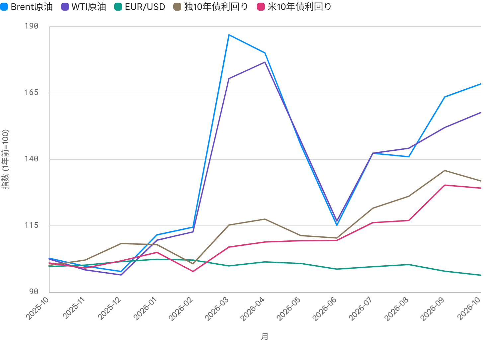

<!--
id: RX-USECASE-0089
type: use-case
language: ja
locale: ja
author: Reflexivity GTM Team
provider: 株式会社QUICK
source_created: 2026-10-13
published: 2026-11-17
revised: 2026-11-17
editorial_reviewed: 2026-11-17
resource: QUICK Reflexivity usage example: Map cross-asset effects of expanded EU sanctions on Russia
status: published
translation_status: current
publication_mode: faithful-source-preserving
prompt_status: present
prompt_basis: source-verbatim
-->

# EUの対ロ制裁拡大が複数市場へ及ぼす影響を追う

<!-- locale-switcher:start -->
**Languages:** [English](../../../../en/05-use-cases/03-asset-class/05-multi-asset/map-cross-asset-effects-of-expanded-eu-sanctions-on-russia.md) · **日本語** · [한국어](../../../../ko/05-유스케이스/03-운용자산별/05-멀티에셋/EU-대러-제재-확대의-자산별-영향-분석.md) · [简体中文](../../../../zh-cn/05-使用案例/03-按资产类别/05-多资产/分析欧盟扩大对俄制裁的跨资产影响.md) · [繁體中文（臺灣）](../../../../zh-tw/05-使用案例/03-依資產類別/05-多資產/分析歐盟擴大對俄制裁的跨資產影響.md) · [繁體中文（香港）](../../../../zh-hk/05-使用案例/03-按資產類別/05-多資產/分析歐盟擴大對俄制裁的跨資產影響.md)
<!-- locale-switcher:end -->

[← ユースケース一覧](../../README.md)

**活用例の日付:** 2026-10-13  
**中心となる機能:** Alfred

株式テーマ、国債、為替、原油への波及を整理し、制裁と同時に起きた供給ショックを分けて考えます。

> [!NOTE]
> 数値、予測、画面構成は記載日の調査例です。最新の相場やすべての利用環境での提供状況を示すものではありません。

## 使用したプロンプト

> [!IMPORTANT]
> EUがロシア軍事産業への制裁を拡大しようとしています。これによる、株式市場、債券市場、外国為替市場、原油市場への今後の影響について分析して下さい。 株式市場については影響を受けるテーマと主な企業についても触れてください。

## 調査の目的と進め方

1. 株式テーマ、国債、為替、原油への波及を整理し、制裁と同時に起きた供給ショックを分けて考えます。
2. 要約だけで判断せず、関連する企業、テーマ、イベントや市場の元データを確認します。
3. 分析期間と指標の定義、別の説明要因を確認してから現在の投資判断につなげます。

## この例で確認できること

株式テーマ、国債、為替、原油への波及を整理し、制裁と同時に起きた供給ショックを分けて考えます。

ロシア軍需調達網への制裁と、原油供給停止・インフレ・防衛財政支出という別の変動要因を区別しています。

## 画面と分析図表

## 提供時点の詳しい分析

以下は当時の分析内容と数値を保持したスナップショットです。最新の相場見通しとして読むものではありません。

サマリー
2026年10月12日、EUは過去最大規模の制裁パッケージを採択し、ロシア軍事産業複合体に関わる約1,600の個人・団体を新たにリスト入りした。本制裁はロシアの防衛調達網（ドローン・部品・デュアルユース品）を標的とするもので、EU/米国の上場企業を直接対象とはしません。したがって、株式・債券・為替・原油の各市場への影響は「二次的な波及経路」であり、並行して進むウクライナ和平交渉や製油所攻撃といった要因と絡み合っています。
主な調査結果（Key Findings）

   - *原油市場*
   ：Brent原油は約$107/bbl、1年で約+68%上昇と大きく上昇。ただし上昇の主因は制裁そのものより、ロシア製油所への攻撃と供給リスクプレミアムです。今回の軍事産業制裁は原油フローを直接対象としないため、追加の上振れ圧力は限定的と見られますが、制裁がエネルギー関連に拡大すれば上値リスクは残ります。
   - *債券市場*：独・米の10年債利回りはともに1年で大幅上昇（独Bund +32%で約3.48%、米UST
   +29%で約5.24%）。欧州の防衛・財政支出拡大に伴う増発観測とインフレ粘着性が背景で、制裁長期化は財政負担を通じて利回りの高止まり要因となります。
   - *為替市場*
   ：EUR/USDは1年で約-3.6%下落し、足元1.1155付近。ドル高と欧州の成長・エネルギー面の重石が続いており、地政学リスク局面ではユーロの重い地合いが継続しやすい状況です。
   - *株式市場（テーマ）*：防衛関連バスケットは1年ベースで下落（Aerospace Defense -12.5%、Defense
   Technology
   -15.1%）、Rheinmetallの時価総額は約48%減。これはウクライナ和平期待が重石となっているためで、構造的な増産需要とは短期的に逆行しています。一方、石油・ガスサービス・バスケットは1年で約+65%上昇と高油価の恩恵を受けています。

データ・チャート EUロシア制裁局面：4市場の推移（1年前=100に基準化）
4市場ダッシュボード（直近値と各期間リターン）
市場 直近値 前日比 月初来 3カ月 6カ月 1年 年初来 52週高値/安値
Brent原油 (USD/bbl) $106.65 +1.84% +4.24% +28.03% +7.34% +68.43% +72.24% $118.35
/ $58.92
WTI原油 (USD/bbl) $93.74 +2.06% +0.94% +19.96% -5.39% +57.57% +63.25% $112.95
/ $55.27
EUR/USD 1.1155 -0.42% -0.77% -2.00% -5.14% -3.58% -5.03% 1.2042 / 1.1155
独10年債利回り (%) 3.4765% -0.26% -1.22% +13.20% +14.02% +31.94% +21.47% 3.6442%
/ 2.551%
米10年債利回り (%) 5.24% -0.08% +0.08% +13.52% +21.27% +29.22% +25.87% 5.313% /
3.955%
影響を受ける株式テーマと主な企業
テーマ 方向性 テーマ1年騰落 主な企業
防衛・航空宇宙 (Aerospace Defense) 構造的に追い風／短期は和平期待で調整 -12.5% Rheinmetall (RHM),
Airbus (AIR), Lockheed Martin (LMT), RTX, Northrop Grumman (NOC), General
Dynamics (GD)
防衛テクノロジー (Defense Technology) 中長期は増産・ドローン対応で追い風 -15.1% AeroVironment
(AVAV), L3Harris (LHX), Palantir (PLTR), Kratos (KTOS), Leidos (LDOS)
石油・ガスサービス (Oil & Gas Services) 高油価で追い風 +64.8% Exxon Mobil (XOM), Equinor
(EQNR), Imperial Oil (IMO)
デュアルユース／半導体 (供給網リスク) 輸出規制強化でコンプライアンス負担・下押し : EMS-Chemie (EMSN)
等、対ロ取引疑義で個別に売られる銘柄
今後の市場別見通し（分析）

   - *原油*：制裁が軍事産業に限定される限り直接影響は小さいが、エネルギー分野への波及・製油所攻撃の継続で高油価レジームが長期化するリスク。
   - *債券*：欧州の防衛費増額→増発観測で、独Bund中心に利回りは高止まり／やや上昇バイアス。安全資産需要が強まる局面では一時的な利回り低下も。
   - *為替*：エネルギー輸入コストと成長格差からユーロは相対的に軟調。地政学緊張の高まりはドル高・ユーロ安方向。
   - *株式*
   ：中長期では欧州防衛増産が追い風（Rheinmetall、Airbus等）。デュアルユース・半導体の輸出規制強化はコンプライアンス負担となり、対ロ取引疑義のある個別銘柄（例：EMS-Chemie）には下押し圧力。

留意点（Limitations）

   -
   各市場への影響は二次的な波及経路であり、和平交渉・製油所攻撃・エネルギー条項など並行要因に依存する分析的判断である。確定的な予測ではありません。
   - 原油・金利・為替の騰落は制裁以外の多数の要因を含む市場全体の動きであり、制裁単独の寄与を分離したものではありません。
   - 防衛テーマの1年リターンは等加重バスケットの報告値で、個別銘柄の値動きとは異なります。

防衛主要銘柄（Rheinmetall、Lockheed
Martin等）の個別パフォーマンス比較や、制裁関連ニュースのさらなる深掘り、あるいはウクライナ和平の市場織り込み度合い（予測市場）の分析も可能です。ご希望があればお知らせください。
情報源エンティティ（6）

   - RHM:FSE
   - CL:NYMEX
   - DEU_G10Y
   - CO:ICE
   - EURUSD
   - US_G10Y

時系列データ（6）

   - EURUSD.price
   - DEU_G10Y.yield
   - US_G10Y.yield
   - RHM:FSE.market_cap
   - CO:ICE.price
   - CL:NYMEX.price

カタリストインサイト（15件）

   - FuelCell adds manufacturing chief for Torrington scale-up
   - Mueller Water plans staged CFO handoff to Michael Morgan
   - Banglalink expands VEON’s Starlink mobile rollout
   - NVIDIA Ecosystem Validates 800V Rack Power
   - Morgan Stanley trims Hesai target on ADAS LiDAR pricing
   - North Korea Missile Launch Revives Korea Risk
   - Teradyne backs FormFactor with $300M strategic tie-up
   - Harmony CEO succession tests confidence, not outlook
   - Unconfirmed OpenAI hardware report hits Cerebras
   - TTM commits $400M to AI infrastructure expansion
   - Alignment launches Central Health Harmony in Southern California
   - ALHC expands California MA footprint for 2027
   - Credo launches 1.6T ZeroFlap light cable
   - IonQ’s $1.3B Elisity deal tests security pivot
   - Danaher expands board with Comas and Hershberg

ナレッジグラフ

   - 防衛技術
      - AeroVironment, Inc. - エアロバイロンメント
      - L3Harris Technologies Inc - L3ハリス･テクノロジーズ
      - Lockheed Martin Corporation - ロッキード･マーチン

ニュース（12件）

   - EU to Discuss Potential Inclusion of Alumina in Russia Sanctions After
   Irish Probe
   - EMS-Chemie Denies Media Report of Trading With Sanctioned Russian
   Companies
   - EU Adopts New Sanctions Package Against Russia
   - EU Countries Agreed That Any Release Of Oil Stocks Should Be Done
   Under The Iea's March Stock Release Action
   - Russia Warns 'Strikes' Will Be 'Intensified' After Zelenskyy Vows More
   Attacks on Russian Oil Refineries
   - EU Approves Fresh Sanctions Package Against Russia
   - Richful Lube Additive Placed in EU's Russia Sanctions List; Shares
   Down 6%
   - EU Adds Companies Involved in Drone Warfare to Russia Sanctions List
   - EU Energy Union Taskforce To Meet Friday To Discuss Potential Diesel
   Stock Releases
   - UK Further Expands Sanctions Against Russia
   - Russia's Putin Says Russia Confirms Readiness To Supply Oil And
   Petroleum Products To The Us And Global Markets; The Entry Of Russian Oil
   Into The U.S. Market Will Have A Positive Impact On The Global Economy As A
   Whole; Putin-Trump Phone Call Focused On Prospects For Resolving Ukraine
   Crisis, Also Touched On Iran
   - Trump Says He Has Called For Ban On Diesel Exports; Says Strikes On
   Russian Refining Capacity Are A Serious Hit To Russia And Diesel Prices

ウェブリンク（9）

   -
   [Link recorded in original source]
   -
   [Link recorded in original source]
   - [Link recorded in original source]
   -
   [Link recorded in original source]
   - [Link recorded in original source]
   - [Link recorded in original source]
   -
   [Link recorded in original source]
   - [Link recorded in original source]
   -
   [Link recorded in original source]

## 解釈上の注意

数値、予測、画面構成は記載日の調査例です。最新の相場やすべての利用環境での提供状況を示すものではありません。

## 関連機能

- [Alfred](https://github.com/reflexivity-kb/platform/blob/main/ja/03-%E8%A3%BD%E5%93%81/Alfred.md)

リンク先の製品マニュアルにはアクセス権が必要な場合があります。

---

本コンテンツは株式会社QUICKから提供された活用例です。数値や市場の見方は提供時点のものです。

[← ユースケース一覧](../../README.md)
