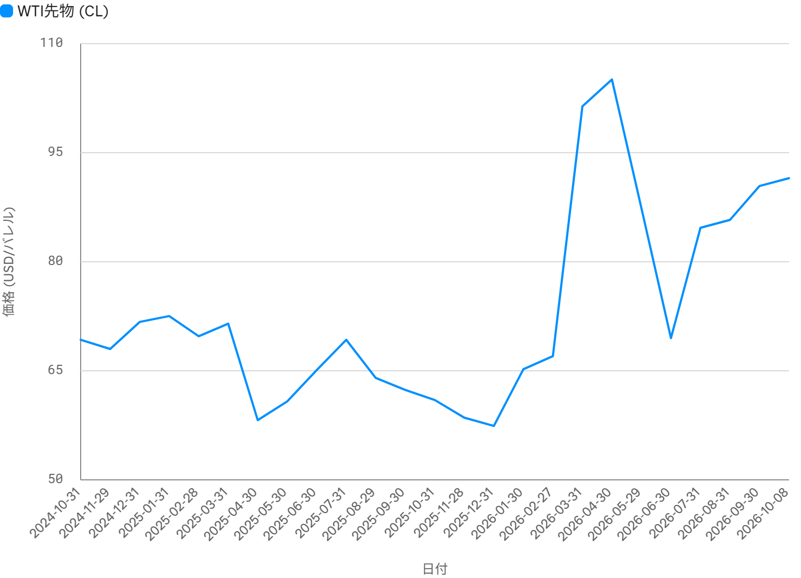

<!--
id: RX-USECASE-0099
type: use-case
language: ja
locale: ja
author: Reflexivity GTM Team
provider: 株式会社QUICK
source_created: 2026-10-09
published: 2026-11-17
revised: 2026-11-17
editorial_reviewed: 2026-11-17
resource: QUICK Reflexivity usage example: Build a six-month WTI oil outlook from supply and demand
status: published
translation_status: current
publication_mode: faithful-source-preserving
prompt_status: present
prompt_basis: source-verbatim
-->

# WTIの需給から今後6か月の価格シナリオを考える

<!-- locale-switcher:start -->
**Languages:** [English](../../../../en/05-use-cases/03-asset-class/05-multi-asset/build-a-six-month-wti-oil-outlook-from-supply-and-demand.md) · **日本語** · [한국어](../../../../ko/05-유스케이스/03-운용자산별/05-멀티에셋/WTI-수급으로-6개월-유가-시나리오-분석.md) · [简体中文](../../../../zh-cn/05-使用案例/03-按资产类别/05-多资产/从供需构建-WTI-原油六个月情景.md) · [繁體中文（臺灣）](../../../../zh-tw/05-使用案例/03-依資產類別/05-多資產/從供需建立-WTI-原油六個月情景.md) · [繁體中文（香港）](../../../../zh-hk/05-使用案例/03-按資產類別/05-多資產/從供需建立-WTI-原油六個月情景.md)
<!-- locale-switcher:end -->

[← ユースケース一覧](../../README.md)

**活用例の日付:** 2026-10-09  
**中心となる機能:** Alfred

供給停止、在庫、需要見通しを分け、需給の改善・悪化によるWTIの6か月シナリオを作ります。

> [!NOTE]
> 数値、予測、画面構成は記載日の調査例です。最新の相場やすべての利用環境での提供状況を示すものではありません。

## 使用したプロンプト

> [!IMPORTANT]
> WTI原油の需給から今後６か月の価格の見通しを分析して下さい

## 調査の目的と進め方

1. 供給停止、在庫、需要見通しを分け、需給の改善・悪化によるWTIの6か月シナリオを作ります。
2. 要約だけで判断せず、関連する企業、テーマ、イベントや市場の元データを確認します。
3. 分析期間と指標の定義、別の説明要因を確認してから現在の投資判断につなげます。

## この例で確認できること

供給停止、在庫、需要見通しを分け、需給の改善・悪化によるWTIの6か月シナリオを作ります。

10月8日のWTI終値91.49ドル/バレルを起点に、供給停止の解消と在庫回復による下落シナリオを考えました。

## 画面と分析図表

## 提供時点の詳しい分析

以下は当時の分析内容と数値を保持したスナップショットです。最新の相場見通しとして読むものではありません。

サマリー
WTI原油は中東の供給途絶を主因に急騰しており、現在の需給は*供給不足（タイト）*の状態です。しかし今後6か月は、ピークを打った後に
*段階的に下落していく軌道*
が最も可能性の高いシナリオです。中東の生産停止が解消し在庫が再積み上げされるにつれ、価格は現在の水準から緩やかに低下すると見込まれます。
主要な調査結果

   1. *現在の価格水準*:
   WTI先物は2026-10-08に$91.49/バレルで引け、前年比+46.3%、年初来+59.3%となりました。足元はWTIの前日比は+3.64%と変動が激しい状態です。
   2. *需給バランス*: 2026年は供給不足（供給101.1 対
   需要102.4百万b/d）だが、2027年にEIAは大幅な供給過剰（供給109.6 対 需要104.6百万b/d）を予測しています。
   3. *在庫動向*:
   世界石油在庫は3Q26に推計1.9百万b/d、4Q26にさらに0.7百万b/d減少見込みであり、現在の供給不足を裏付けています。
   4. *価格の牽引役*: サウジアラビアの東西パイプライン攻撃を受け、9月の原油生産停止量は平均4.8百万b/dに達したことです。

価格見通し（今後6か月）
EIAはBrent原油が4Q26に平均$105/バレル、2027年第2四半期までに$87/バレルへ低下すると予測しています。WTIは通常Brentより数ドル安く推移するため、同じ軌道をやや低い水準でたどる見込みです。

   - *中心シナリオ*:
   向こう6か月でWTIは高値圏（$90台〜$100前後）で始まり、中東情勢の鎮静化と在庫再積み上げに伴い、2027年春にかけて*$80台前半へ軟化*
   。
   - *上振れリスク*: ホルムズ海峡の封鎖拡大、追加のインフラ攻撃、タンカー運賃の高止まり。EIAも「短期的には予測以上の変動」を警告しています。
   - *下振れリスク*: 中東供給の早期正常化、2027年の大幅供給過剰の前倒し、世界経済減速による需要鈍化。

チャートと表 WTI原油 先物価格の推移（2024年10月〜2026年10月）
EIA Brent原油 四半期見通し（今後の軌道）
WTI原油 価格サマリー（2026-10-08時点）
指標 値
直近価格 (先物CL) $91.49 (2026-10-08)
前日比 +$3.21 / +3.64%
月初来 (MTD) +1.18%
3か月 +24.44%
6か月 -3.09%
1年 +46.27%
年初来 (YTD) +59.33%
52週高値 $112.95 (2026-04-07)
52週安値 $55.27 (2025-12-16)
世界石油 需給バランス（EIA STEO, 2026年10月）
項目 2026 (推計) 2027 (予測)
供給 (百万b/d) 101.1 109.6
需要 (百万b/d) 102.4 104.6
需給バランス (百万b/d) -1.3 (供給不足) +5.0 (供給過剰)
Brent平均 (USD/bbl) 96 84
留意点・データの限界

   - 社内WTI先物（$91.49、2026-10-08）とFRED
   WTIスポット（$96.24、2026-10-06）は約$5乖離しています（限月・時点差）。見通しはEIAのBrentベース予測（通常WTIより数ドル高い）を基にしています。
   - 見通しはEIA
   STEO（2026年10月6日公表）に依存しており、同報告書自体が中東情勢に強く左右される前提です。地政学的な急変で大きく外れる可能性があります。
   - 6か月ウィンドウ（2026年10月〜2027年4月）は、EIAの「高値維持→2Q27に向け軟化」という移行局面に当たります。

OPEC+の生産方針や中東の供給途絶の推移をさらに深掘りできます。あるいは、特定のシナリオ（例:
ホルムズ海峡封鎖時のWTIへの影響）をscenario分析で定量化しましょうか？ 情報源エンティティ（1）

   - CL:NYMEX

時系列データ（1）

   - CL:NYMEX.price

ニュース（12件）

   - Update: WTI Oil Rises Ahead of OPEC+ Meeting Likely to Boost Supply
   Again
   - Oil Steady as Geopolitical Risks Balance Rising Global Inventories
   - Update: WTI Oil Rises Again on Supply Risks as U.S. Inventories Rose
   Above Expectations Last Week
   - Update: WTI Oil Rises on Geopolitical Tensions Despite Inventory
   Builds, Supply Warnings
   - Update: WTI Closes With a Small Gain as Traders Weigh OPEC+ Output
   Hike and Supply Risks
   - Update: WTI Oil Rises to a Near Three-Month High as Anti-Government
   Protests in Iran Continue
   - Update: WTI Oil Drops to the Lowest in Five Months as Supply Remains
   Higher Than Demand
   - Update: WTI Oil Falls to the Lowest in Nearly Five Months on Low on
   Rising Supply and Faltering Demand
   - Market Chatter: Oil Extends Losses to Begin the Year
   - Update: WTI Oil Closes Higher as Geopolitical Risks Balance Rising
   Global Inventories
   - Update: WTI Oil Falls to a Near Five-Year Low as Rising Geopolitical
   Risk is Again Offset by Abundant Supply
   - Update: WTI Oil Edges Higher Despite a Larger Rise Than Expected Rise
   in U.S. Inventories

信頼できる外部データ（1）

   - [Link recorded in original source]

ウェブリンク（13）

   - [Link recorded in original source]
   - [Link recorded in original source]
   - [Link recorded in original source]
   -
   [Link recorded in original source]
   - [Link recorded in original source]
   - [Link recorded in original source]
   - [Link recorded in original source]
   - [Link recorded in original source]
   - [Link recorded in original source]
   -
   [Link recorded in original source]
   -
   [Link recorded in original source]
   -
   [Link recorded in original source]
   -
   [Link recorded in original source]

## 解釈上の注意

数値、予測、画面構成は記載日の調査例です。最新の相場やすべての利用環境での提供状況を示すものではありません。

## 関連機能

- [Alfred](https://github.com/reflexivity-kb/platform/blob/main/ja/03-%E8%A3%BD%E5%93%81/Alfred.md)

リンク先の製品マニュアルにはアクセス権が必要な場合があります。

---

本コンテンツは株式会社QUICKから提供された活用例です。数値や市場の見方は提供時点のものです。

[← ユースケース一覧](../../README.md)
