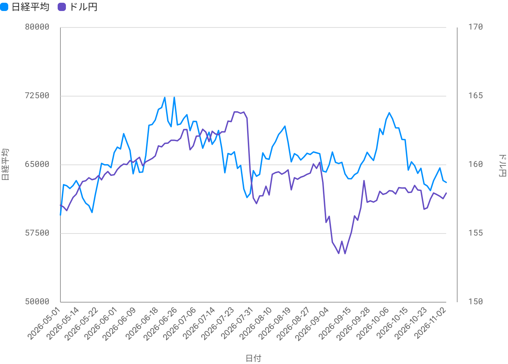

<!--
id: RX-USECASE-0097
type: use-case
language: ja
locale: ja
author: Reflexivity GTM Team
provider: 株式会社QUICK
source_created: 2026-11-04
published: 2026-11-17
revised: 2026-11-17
editorial_reviewed: 2026-11-17
resource: QUICK Reflexivity usage example: Build a morning Japan market briefing with a short Alfred prompt
status: published
translation_status: current
publication_mode: faithful-source-preserving
prompt_status: present
prompt_basis: source-verbatim
-->

# 短いプロンプトで日本市場の朝会資料を作る

<!-- locale-switcher:start -->
**Languages:** [English](../../../../en/05-use-cases/03-asset-class/05-multi-asset/build-a-morning-japan-market-briefing-with-a-short-alfred-prompt.md) · **日本語** · [한국어](../../../../ko/05-유스케이스/03-운용자산별/05-멀티에셋/짧은-프롬프트로-일본-증시-아침-브리핑-만들기.md) · [简体中文](../../../../zh-cn/05-使用案例/03-按资产类别/05-多资产/用简短提示生成日本市场晨会简报.md) · [繁體中文（臺灣）](../../../../zh-tw/05-使用案例/03-依資產類別/05-多資產/用簡短提示生成日本市場晨會簡報.md) · [繁體中文（香港）](../../../../zh-hk/05-使用案例/03-按資產類別/05-多資產/用簡短提示生成日本市場晨會簡報.md)
<!-- locale-switcher:end -->

[← ユースケース一覧](../../README.md)

**活用例の日付:** 2026-11-04  
**中心となる機能:** Alfred

先物、主要指数、為替、金利、当日の重要イベントを一つの短い質問から整理します。

> [!NOTE]
> 数値、予測、画面構成は記載日の調査例です。最新の相場やすべての利用環境での提供状況を示すものではありません。

## 使用したプロンプト

> [!IMPORTANT]
> 今日の日本の相場環境をまとめて

## 調査の目的と進め方

1. 先物、主要指数、為替、金利、当日の重要イベントを一つの短い質問から整理します。
2. 要約だけで判断せず、関連する企業、テーマ、イベントや市場の元データを確認します。
3. 分析期間と指標の定義、別の説明要因を確認してから現在の投資判断につなげます。

## この例で確認できること

先物、主要指数、為替、金利、当日の重要イベントを一つの短い質問から整理します。

「今日の日本の相場環境をまとめて」という一文から、11月4日の休場明け材料、先物、為替、選挙要因を整理しました。

## 画面と分析図表

## 提供時点の詳しい分析

以下は当時の分析内容と数値を保持したスナップショットです。最新の相場見通しとして読むものではありません。

要約：*
11月3日は文化の日で東京市場は休場でした。休場明けの本日は、方向感の乏しい寄り付きが想定されます。日経平均先物は大阪ナイトで6万3090円、シカゴ円建てで63075円と、2日の現物終値63081.86円とほぼ同水準です。材料は米中間選挙の開票、米金利の上昇、円安です。
主なポイント

   1. *日本株は調整局面。*

   - 2日は日経平均が0.33%安、TOPIXが0.88%安（3930.28）でした。
   - 日経平均は25日移動平均（65961.94円）と75日移動平均（65699.53円）をともに下回っています。
   - 52週高値は72366.31円で、6月の52週高値から調整局面にある状態です。
   - 年初来では日経平均が+25.31%、TOPIXが+15.29%と、大幅高を維持しています。
   - 外部の市況記事は、本日の予想レンジを6万2700円～6万3600円としています。

   1. *円安が再び進行。*

   - 米9月の求人件数（JOLTS）が752.3万件（予想713万件）と予想を上回り、米国の利上げ観測が再燃しました。
   - ドル円はNYで158円73銭で引け、今朝は158円60銭台で推移しています。2日の社内データ終値は157.945円でした。
   - 輸出株には追い風ですが、160円に近づくと為替介入への警戒感が強まりやすい点に注意が必要です。

   1. *米国株はまちまち。*

   - 3日の主要指数はダウが197.26ドル安、S&P500が27.52ポイント高の7568.92、ナスダック総合が207.65ポイント高でした。
   - 業種では半導体に買い戻しが入った一方、米10年債利回りは4.963%（+0.058）へ上昇しました。
   - 個別ではアップルが1.89%安、ソフトバンクグループのADRが3.40%安と軟調です。
   - VIX指数は20.83で、警戒感が残っています。

   1. *日銀は12月の利上げに含みを残す。*

   - 日銀は10月30日に政策金利を1.25%で据え置いたものの、利上げを続ける姿勢は崩していません。
   - 決定は賛成8・反対1（高田委員が1.5%への利上げを提案）で、ETFの売却ペースを年8600億円へ引き上げました。
   - 展望レポートでは、2027年度のコアCPI見通しを+2.6%に引き上げています。
   - ETF売却の加速は、株式需給の重しとして意識されています。

   1. *金利と商品。*

   - 日本10年国債利回り（最終利回り）は2.767%です。1カ月では-32.1bp低下しましたが、年初来では+69.5bp上昇しています。
   - 日米10年金利差（米10年債利回り − 日本10年債利回り）は、11月2日時点で213.7bpです。
   - WTI原油先物は96.46ドルへ7.36%急落しました。

主要指標
日本の主要指標 騰落率（2026年11月2日終値時点）
指標 終値 前日比 月初来 3カ月 6カ月 1年 年初来 52週高値 52週安値
日経平均株価 63,081.86 -208.25（-0.33%） -0.33% -1.99% +6.00% +20.36% +25.31%
72,366.31（2026-06-25） 48,537.70（2025-11-19）
TOPIX 3,930.28 -34.79（-0.88%） -0.88% -1.82% +5.41% +17.96% +15.29%
4,197.20（2026-08-14） 3,245.58（2025-11-19）
ドル円（USDJPY） 157.945 +0.400（+0.25%） +0.25% +0.23% +0.57% +2.56% +0.82%
163.855（2026-07-23） 152.195（2026-01-27）
クロスアセット概況（社内時系列ベース）
指標 最新値 日付 直近変化 年初来
ユーロ円 176.693円 2026-11-02 +0.50% -3.98%
日本10年国債利回り 2.767% 2026-11-03 1カ月 -32.1bp +69.5bp
米10年国債利回り 4.904% 2026-11-02 1カ月 -37.7bp +77.8bp
日米10年金利差 213.7bp 2026-11-02 : :
S&P500 7,541.40 2026-11-02 -0.51% +10.17%
VIX先物 19.84 2026-11-02 -2.54% +20.03%
WTI原油先物 96.46ドル 2026-11-02 -7.36% +67.99%
金先物（COMEX） 3,969.6ドル 2026-11-02 +2.16%（月初来） -8.23%
日経平均とドル円の推移（2026年5月〜11月2日）
今日・今週の注目点

   - *本日の材料：*
   - 米中間選挙の開票報道。
   - 国内決算はIHI、三菱商事、NTTなど77社が発表予定です。
   - *今週の米国指標：* ADP雇用統計・ISMサービス業景況指数（11/4）、雇用統計（11/6）。
   - *今週の国内イベント：* 11/5 日銀会合議事要旨・10年国債入札、11/7未明 植田総裁講演。
   - *リスク：*
   - ドル円が160円に近づいた場合の為替介入。
   - 米金利の上昇再燃。
   - 日銀の12月利上げ観測と、ETF売却による需給悪化。

制約・留意点

   - 社内時系列データの日本株・ドル円・S&P500は、11月2日終値までです。
   - 11月3日の米国株・米金利・ドル円・先物の動きは、外部の市況記事で補いました。社内データとは基準日が異なります。
   - 決算カレンダー・日銀文書検索・社内ニュースでは日本関連のデータが限られたため、Webソースで補完しています。
   - 東京市場の寄り付き後の値動きは反映していません。

寄り付き後の業種別の強弱や、本日決算の主要銘柄（三菱商事・NTTなど）を追加で調べることもできます。 情報源エンティティ（11）

   - NKY
   - USDJPY
   - US_G10Y
   - GC:COMEX
   - TPX
   - EURJPY
   - JAP_G10Y
   - SPX
   - UX:CBOE
   - CL:NYMEX
   - QQQ:NASD

時系列データ（11）

   - NKY.price
   - TPX.price
   - USDJPY.price
   - EURJPY.price
   - JAP_G10Y.yield
   - UX:CBOE.price
   - CL:NYMEX.price
   - GC:COMEX.price
   - SPX.price
   - US_G10Y.yield
   - QQQ:NASD.price

イベント（2件）

   - 米国 の経済イベント
   - 日本 の経済イベント

ニュース（6件）

   - Toho Bank Launches Solar-Powered Electricity Supply Service Across 28
   Locations
   - MS&AD Insurance Completes 190 Billion Yen Share Buyback Program
   - Kamigumi Repurchases Shares Worth 2.77 Billion Yen in October
   - Kyocera Logs Higher Fiscal H1 Attributable Profit; Sales Revenue Up
   - Sumitomo Logs Higher Fiscal H1 Attributable Profit; Revenue Up
   - Matsui Securities' Total Equity Trading Value Falls in October

ウェブリンク（21）

   - [Link recorded in original source]
   - [Link recorded in original source]
   - [Link recorded in original source]
   - [Link recorded in original source]
   - [Link recorded in original source]
   - [Link recorded in original source]
   - [Link recorded in original source]
   - [Link recorded in original source]
   - [Link recorded in original source]
   - [Link recorded in original source]
   - [Link recorded in original source]
   - [Link recorded in original source]
   - [Link recorded in original source]
   - [Link recorded in original source]
   -
   [Link recorded in original source]
   -
   [Link recorded in original source]
   -
   [Link recorded in original source]
   -
   [Link recorded in original source]
   -
   [Link recorded in original source]
   - [Link recorded in original source]
   - [Link recorded in original source]

## 解釈上の注意

数値、予測、画面構成は記載日の調査例です。最新の相場やすべての利用環境での提供状況を示すものではありません。

## 関連機能

- [Alfred](https://github.com/reflexivity-kb/platform/blob/main/ja/03-%E8%A3%BD%E5%93%81/Alfred.md)

リンク先の製品マニュアルにはアクセス権が必要な場合があります。

---

本コンテンツは株式会社QUICKから提供された活用例です。数値や市場の見方は提供時点のものです。

[← ユースケース一覧](../../README.md)
