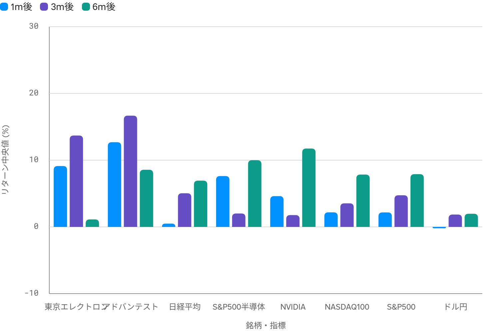

<!--
id: RX-USECASE-0097
type: use-case
language: ja
locale: ja
source_type: partner-provided-use-case
provider: 株式会社QUICK
source_manifest: RX-USECASE-0097
source_created: 2026-11-05
published: 2026-11-17
revised: 2026-11-17
editorial_reviewed: 2026-11-17
resource: QUICK-provided Reflexivity analysis example
status: published
translation_status: current
prompt_status: present
prompt_basis: source-verbatim
-->

# 米中間選挙後のAI株とドル円のシナリオを比較する

<!-- locale-switcher:start -->
**言語:** [English](../../../../en/05-use-cases/03-asset-class/05-multi-asset/compare-post-midterm-ai-shares-across-us-and-japan-with-fx-scenarios.md) · **日本語** · [한국어](../../../../ko/05-유스케이스/03-운용자산별/05-멀티에셋/미국-중간선거-후-AI주와-달러엔-시나리오-비교.md) · [简体中文](../../../../zh-cn/05-使用案例/03-按资产类别/05-多资产/比较美国中期选举后-AI-股及美元日元情景.md) · [繁體中文（臺灣）](../../../../zh-tw/05-使用案例/03-依資產類別/05-多資產/比較美國期中選舉後-AI-股及美元日圓情境.md) · [繁體中文（香港）](../../../../zh-hk/05-使用案例/03-按資產類別/05-多資產/比較美國中期選舉後-AI-股及美元日圓情景.md)
<!-- locale-switcher:end -->

[← Use Cases](../../README.md)

**QUICK | 2026-11-05**

## 使用したプロンプト

> [!IMPORTANT]
> 米国中間選挙の結果、民主党が大勝しました。この結果、日本の株式市場ではAI関連株や半導体関連株が下落しました。一方で米国ではS&P500もNASDAQ指数も上昇しました。今後のAI関連株や半導体関連株について市場の見通しはどうなるのかシナリオを示してください。また、ドル円の為替レートの見通しも合わせてシナリオを提示して下さい。

## 提供時点の分析

11月5日の分析は、日本のAI・半導体株の下落と米国主要指数の上昇を比べます。一方でNVIDIAも下落しており、データセンター規制リスクと原油・金利要因を分け、株式とドル円の複数シナリオを示しました。

## 解釈と留意点

原資料に記載された議席数は当時の速報値で、後の集計とは異なります。シナリオ確率は主観的な想定であり、市場価格から推定した確率ではありません。

## 関連機能

- [Alfred](https://github.com/reflexivity-kb/platform/blob/main/ja/03-%E8%A3%BD%E5%93%81/Alfred.md)

製品マニュアルにはアクセス権が必要な場合があります。

## 調査画面と図表

以下は提供日時点の調査画面・図表であり、現在の市場数値ではありません。

## 提供元

本コンテンツは、株式会社QUICKよりご提供いただいたものです。

国・地域や言語環境、利用製品、データ提供範囲などによっては、内容をそのまま適用できない場合があります。

[← Use Cases](../../README.md)
