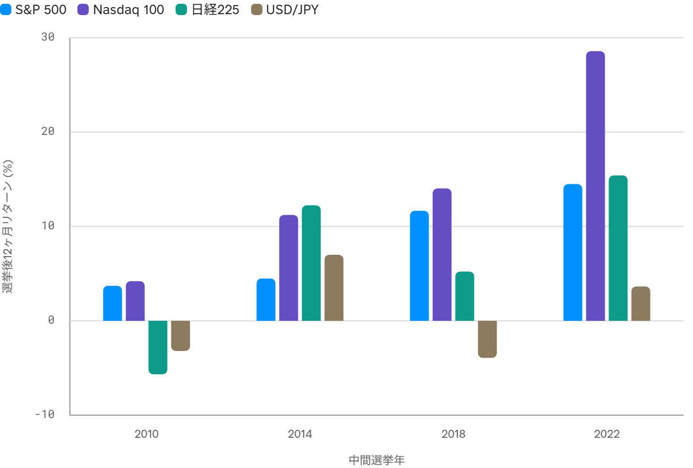
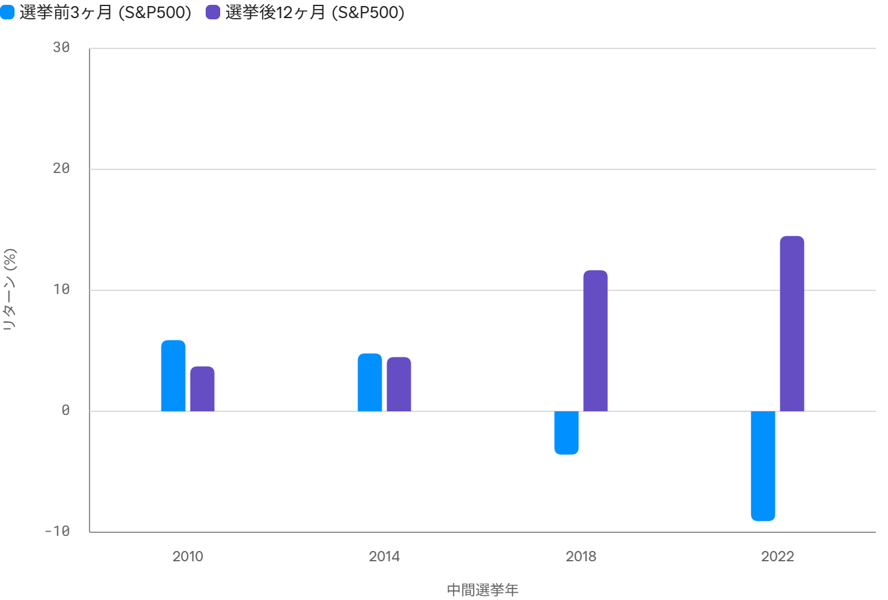
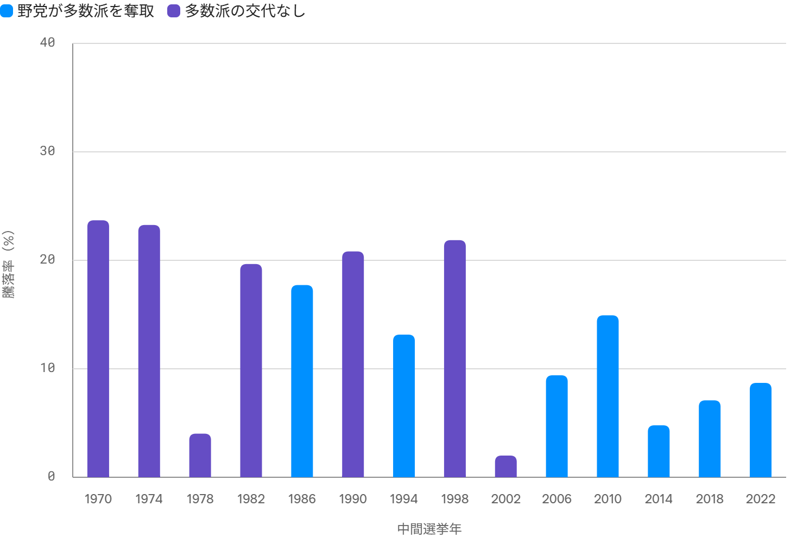

<!--
id: RX-USECASE-0074
type: use-case
language: ja
locale: ja-JP
provider: 株式会社QUICK
source_created: 2026-10-05
provided: 2026-10-05
status: published
translation_status: current
original_language: ja
source_text_status: original_partner_source_reconciled
editorial_reviewed: 2026-10-05
source_type: partner-provided-use-case
source_manifest: RX-USECASE-0074
asset_class: マルチアセット, 株式, FX, マクロ
insight_type: Scenario Insight
publication_mode: faithful-source-preserving
prompt_status: present
-->

# 米中間選挙後の米国株・ドル円・日本株を過去事例と比較する

<!-- locale-switcher:start -->
**Languages:** [English](../../../../en/05-use-cases/03-asset-class/05-multi-asset/us-midterm-election-cross-market-scenarios.md) · **日本語** · [한국어](../../../../ko/05-유스케이스/03-운용자산별/05-멀티에셋/미국-중간선거-이후-미국주식-달러엔-일본주식을-과거사례와-비교하기.md) · [简体中文](../../../../zh-cn/05-使用案例/03-按资产类别/05-多资产/比较美国中期选举后的美股-美元日元与日股表现.md) · [繁體中文（台灣）](../../../../zh-tw/05-使用案例/03-依資產類別/05-多資產/比較美國期中選舉後的美股-美元日圓與日股表現.md) · [繁體中文（香港）](../../../../zh-hk/05-使用案例/03-按資產類別/05-多資產/比較美國中期選舉後的美股-美元日圓及日股表現.md)
<!-- locale-switcher:end -->

[← マルチアセットユースケース](README.md) · [運用資産別](../README.md) · [ユースケース一覧](../../README.md)

**提供日:** 2026-10-05  
**主な運用資産・領域:** 米国株式、為替、日本株式、マクロ

> 数値、選挙予測、市場環境は2026-10-05時点の提供資料に基づくスナップショットです。現在の予測として掲載するものではありません。

> この活用例には、直接開くためのReflexivityリンクは含まれていません。

## 使用したプロンプト

> [!IMPORTANT]
> 11月の米中間選挙で米国株式市場はどうなるか？ 米国株式、為替、日本株式などマーケットへの影響を過去事例と現状を比較して分析してください。

## 過去4回の中間選挙後に見られた動き

**2010年、2014年、2018年、2022年**の米中間選挙を比較します。4回すべてでS&P 500の選挙後12か月リターンはプラスとなり、平均は約**+8.6%**でした。Nasdaq 100は同期間で平均約**+14.5%**でした。

> 以下のチャートは作成時の表示をそのまま掲載しています。

*原図：S&P 500、Nasdaq 100、日経225、USD/JPYの中間選挙後12か月リターン。*

**2018年**は選挙前3か月が**-3.6%**、選挙後12か月が**+11.7%**、**2022年**はそれぞれ**-9.1%**、**+14.5%**でした。これは因果関係ではなく、過去に見られたアノマリーとして捉える必要があります。

*原図：S&P 500の選挙前3か月と選挙後12か月のリターン比較。*

## 2026年は出発点が異なる

提供時点のS&P 500は**7,666.45**、Nasdaq 100は**26,871.60**で、いずれも高値圏です。FF金利は約**3.75%**、CPIは約**3.35%**、USD/JPYは約**158.07**でした。

過去事例には選挙前に大きく調整したケースが含まれます。2026年は高値圏からのスタートであるため、過去の「調整後の反発」をそのまま当てはめないことが重要です。

## 市場別のシナリオの見方

### 米国株式

過去事例では選挙後の株高が目立ちますが、2026年は出発点が異なります。ねじれ議会となった場合、政策の予見可能性が高まり、株式市場にプラスに受け止められる可能性があります。ただし、提供時点で選挙結果は確定していません。

### 為替（USD/JPY）

過去4回の中間選挙後のUSD/JPYは、概ね**-3.9%〜+7.0%**と方向が一定していません。選挙そのものより、日米金利差や日銀政策の方が重要なドライバーになりやすいという整理です。

### 日本株式

日経225は、**2014年 +12.2%**、**2018年 +5.2%**、**2022年 +15.4%**と3回上昇し、**2010年は-5.7%**でした。2026年の提供時点では日経225が**68,309.46**、1年間で約**+52.01%**と高値圏にあり、過去とは出発点が異なります。

## 留意点

- 過去事例は4回のみで、統計的なサンプルは限定的です。
- 選挙後の株高はアノマリーであり、因果関係を示すものではありません。
- 2010年や2022年には金融・政策面の特殊要因が含まれています。
- 2026年は主要株価指数が高値圏から始まります。
- 選挙結果、予測市場、予測モデルは提供時点で確定しておらず、その後変化する可能性があります。
- リターンは価格リターンで、配当や再投資を含みません。

## 追加分析：選挙前後の変動率と6か月後のS&P500

**2026年10月26日**の続編では、過去の米中間選挙の前後1週間を比べ、VIXという予想変動率と株価の実現変動率を分けました。VIXが選挙後に下がっても、その後の日々の株価変動が必ず小さくなるとは限りません。**11月2日**には1970～2022年の中間選挙14回を対象に、S&P500の選挙後6か月の価格リターンを検証。原資料では平均**+13.65%**、対象14回すべてプラスでした。これは本文前半の4回分のクロスアセット分析とは標本と期間が異なります。選挙が株高を引き起こしたことや2026年の結果を証明するものではありません。

## 追加図表：中間選挙前後の変動率と半年後の株価

2026年10月26日の分析では、選挙前後の予想変動率と実現変動率を分けて比較しました。11月2日には過去の中間選挙から半年後のS&P500を別の標本で検証しています。分析期間と標本が異なる点にご注意ください。

## 提供元

本ページは株式会社QUICKから2026-10-05に提供されたReflexivity活用例をもとに整理しています。

本コンテンツは、株式会社QUICKよりご提供いただいたReflexivity活用例です。

*本ユースケースは、日本のパートナーである株式会社QUICKのご厚意により提供されました。* · [免責事項](../../DISCLAIMER.md)

[← マルチアセットユースケース](README.md) · [ユースケース一覧](../../README.md)
