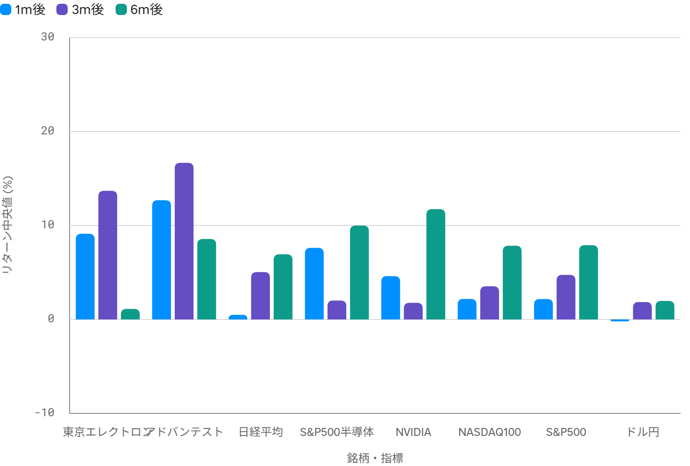

<!--
id: RX-USECASE-0106
type: use-case
language: ja
locale: ja
author: Reflexivity GTM Team
provider: 株式会社QUICK
source_created: 2026-11-05
published: 2026-11-17
revised: 2026-11-17
editorial_reviewed: 2026-11-17
resource: QUICK Reflexivity usage example: Explain different US and Japan equity reactions to midterm results
status: published
translation_status: current
publication_mode: faithful-source-preserving
prompt_status: present
prompt_basis: source-verbatim
-->

# 米中間選挙後の米株と日本株の反応差を分析する

<!-- locale-switcher:start -->
**Languages:** [English](../../../../en/05-use-cases/03-asset-class/05-multi-asset/explain-different-us-and-japan-equity-reactions-to-midterm-results.md) · **日本語** · [한국어](../../../../ko/05-유스케이스/03-운용자산별/05-멀티에셋/미국-중간선거-후-미국·일본-주가-반응-차이-분석.md) · [简体中文](../../../../zh-cn/05-使用案例/03-按资产类别/05-多资产/解释美国中期选举后美日股市反应分化.md) · [繁體中文（臺灣）](../../../../zh-tw/05-使用案例/03-依資產類別/05-多資產/解釋美國中期選舉後美日股市反應分化.md) · [繁體中文（香港）](../../../../zh-hk/05-使用案例/03-按資產類別/05-多資產/解釋美國中期選舉後美日股市反應分化.md)
<!-- locale-switcher:end -->

[← ユースケース一覧](../../README.md)

**活用例の日付:** 2026-11-05  
**中心となる機能:** Alfred

米国指数の上昇と日本のAI・半導体株下落を比較し、規制、政策、為替の複数シナリオを整理します。

> [!NOTE]
> 数値、予測、画面構成は記載日の調査例です。最新の相場やすべての利用環境での提供状況を示すものではありません。

## 使用したプロンプト

> [!IMPORTANT]
> 米国中間選挙の結果、民主党が大勝しました。この結果、日本の株式市場ではAI関連株や半導体関連株が下落しました。一方で米国ではS&P500もNASDAQ指数も上昇しました。今後のAI関連株や半導体関連株について市場の見通しはどうなるのかシナリオを示してください。また、ドル円の為替レートの見通しも合わせてシナリオを提示して下さい。

## 調査の目的と進め方

1. 米国指数の上昇と日本のAI・半導体株下落を比較し、規制、政策、為替の複数シナリオを整理します。
2. 要約だけで判断せず、関連する企業、テーマ、イベントや市場の元データを確認します。
3. 分析期間と指標の定義、別の説明要因を確認してから現在の投資判断につなげます。

## この例で確認できること

米国指数の上昇と日本のAI・半導体株下落を比較し、規制、政策、為替の複数シナリオを整理します。

11月5日時点で日米のAI・半導体株と広範な指数の反応が異なり、基本・強気・弱気の3シナリオに分けました。

## 画面と分析図表

## 提供時点の詳しい分析

以下は当時の分析内容と数値を保持したスナップショットです。最新の相場見通しとして読むものではありません。

サマリー
米中間選挙で民主党は上院54議席・下院228議席を獲得し、上下両院で多数派を奪還しました。議席数はAP通信の暫定集計です。市場はこの結果を、方向の異なる2つの材料として同時に織り込んでいます。

   - *AI・データセンター規制リスク*:日本株はこちらに強く反応し、日経平均は1.42%下落しました。
   - *原油安・金利低下と、議会のねじれによる政策の安定*:米国ではこちらが勝り、Nasdaq・S&P500が約1.6%上昇しました。

ただし米国でもNVIDIAは3.17%下落しており、指数を押し上げたのはAI以外の銘柄です。
今後3〜6カ月の見通しは3つのシナリオに分けて考えます。確率は分析上の主観的な目安です。

   - *メイン(約50%)*:議会のねじれの下で調整した後、銘柄ごとに差がつきながら戻る
   - *強気(約25%)*
   - *弱気(約25%)*

主な分析結果

   - *日米で反応が分かれた理由*
   -
   モルガン・スタンレーは、民主党の大勝がデータセンター規制強化観測を通じAIセンチメントに逆風になると指摘しています。データセンターの許認可、電力網への接続、税優遇は主に州レベルで決まります。データセンターの集積地であるテキサス州で民主党が勝ったことが、AI設備投資への逆風と受け止められました。
   -
   日本のAI・半導体株は、米国のAI設備投資に業績が直結する装置株や投資会社株です。選挙明けの下落率は日経平均を上回りました(日経平均の下落率を上回った)。
   - 東京エレクトロン:-3.42%
   - アドバンテスト:-3.35%
   - ソフトバンクグループ:-3.20%
   - 米国株全体は、原油の急落と長期金利の低下を好感しました。インフレや利上げへの懸念が和らいだことが、AI以外のセクターを支えました。
   - *調整はすでにかなり進んでいる*
   - 10月6日前後の高値からの下落率は以下のとおりです。
   - 東京エレクトロン:-24.54%
   - アドバンテスト:-17.40%
   - ソフトバンクグループ:-37.31%
   - S&P500半導体指数:-17.12%
   - NVIDIA:-16.35%
   -
   いずれの銘柄も、選挙前からAI投資が続くかどうかへの懸念で高値から大きく調整済みです。選挙結果は「とどめ」ではなく、追加の悪材料という位置づけです。
   - *過去の中間選挙後のパターン(2006〜2022年の5回)*
   - 選挙後1カ月のリターン中央値:東京エレクトロン+9.12%、アドバンテスト+12.69%
   - 選挙後3カ月のリターン中央値:S&P500半導体指数+2.01%、S&P500+4.74%
   -
   「選挙後は不透明感が晴れて株高になりやすい」という経験則はあります。ただし今回は、選挙結果そのものにAI固有の悪材料が含まれている点が過去と異なります。
   - *短期で最大のイベントはNVIDIAの決算*
   - 決算カレンダー上の発表予定日は2026年11月17日です。日程は変更される可能性があります。
   - データセンター需要と大手クラウド企業の設備投資見通しが維持されれば、規制懸念は「長期的で地域が限られたリスク」として軽く扱われやすくなります。
   - *ドル円の前提条件*
   - 社内時系列データによると、日米10年金利差は約2.19ポイントと依然大きい状態です。ドル円は158.675円(11月3日)と高値圏にあります。
   -
   10月28日のFOMCに関するニュース報道によると、FRBは政策金利を3.75-4.00%に据え置いたとしています(9月に25bp利上げ)。ニュース報道による値で、FRB公表資料では直接確認していません。
   -
   日銀は10月30日の会合で政策金利を1.25%に据え置きました。一方で、9月会合の議事要旨は追加利上げを示唆しています。これもニュース報道に基づく情報です。
   - こうした状況から、日米の金利差は縮小に向かいやすいと考えられます。
   - ただしFRBの利上げリスクも残ります。予測市場の「How many Fed rate hikes in
   2026?」市場では、「2026年中に利上げ2回」の確率が77.5%です。取得時点の価格であり、変動します。
   - 過去の中間選挙後のドル円は3カ月中央値+1.85%と方向感に乏しい結果でした。ドル円を動かす主因は、選挙よりも日米の金融政策とみられます。

AI・半導体株とドル円の今後3〜6カ月シナリオ
シナリオ 主観確率 AI・半導体株 ドル円 主なトリガー
メイン：ねじれ下の調整後、選別的な戻り 約50% 年内は値幅の大きいもみ合い→年明けにかけて部分回復。日本株は米国株より出遅れ
153〜160円のレンジ（緩やかな円高方向） NVIDIA決算が無難、データセンター規制は州レベルで時間を要す、FRB据え置き・日銀は慎重に利上げ
強気：AI投資継続＋原油安でインフレ鈍化 約25% 売られ過ぎの日本の半導体装置株を中心に急反発、過去の選挙後パターン（1カ月+9〜13%）に近い戻り
155〜160円（リスクオンで円高は限定的） NVIDIA決算・ハイパースケーラーのcapex維持、米イラン合意で原油続落、FRB利上げ観測後退
弱気：規制・政治リスク＋金融引き締め 約25% データセンター規制拡大・capex下方修正で一段安。円高が重なり日本株の下げが大きい
円高なら148〜153円／FRB再利上げ・日銀見送りなら160円超（介入警戒）
テキサス等の州規制、12月の政府閉鎖、FRB12月利上げ、日銀1.5%への利上げ
選挙前後の主要指標の騰落率と高値からの下落率
銘柄・指標 最新値（日付） 選挙前比 1カ月騰落率 8月以降高値からの下落率
東京エレクトロン 9,663.0 (2026-11-04) -3.42% -20.14% -24.54%
アドバンテスト 34,570.0 (2026-11-04) -3.35% -10.51% -17.40%
ソフトバンクグループ 4,269.0 (2026-11-04) -3.20% -32.35% -37.31%
日経平均株価 62,188.63 (2026-11-04) -1.42% -8.96% -12.02%
NVIDIA 200.13 (2026-11-04) -3.17% -14.46% -16.35%
S&P500半導体指数 10,397.38 (2026-11-03) 未更新 -16.06% -17.12%
NASDAQ100 25,372.01 (2026-11-03) 未更新 -6.69% -8.07%
S&P500 7,568.92 (2026-11-03) 未更新 -1.99% -3.20%
ドル円 158.675 (2026-11-03) 未更新 +0.52% -0.94%
過去5回の米中間選挙後のリターン中央値（2006〜2022年）
シナリオの読み方とウォッチポイント

   - *AI・半導体株*
   - メインシナリオは次の2つを前提にしています。
   - データセンター規制は州ごとに時間をかけて進む。
   - 議会のねじれにより、連邦レベルの大型規制法案は成立しにくい。
   -
   決算でAI需要が確認されれば、年明けにかけて部分的に回復するとみます。ただし日本株は円高の影響と値動きの大きさから、米国株より戻りが遅れやすい傾向があります。
   - 弱気シナリオに転じるきっかけとしては、次の3つが考えられます。
   - 州レベルでデータセンター建設が実際に止まる事例が出る
   - 大手クラウド企業が設備投資計画を下方修正する
   - 12月に米政府機関の閉鎖が起きる
   - *ドル円*
   - メインシナリオは153〜160円のレンジで、緩やかに円高方向とみます。
   - 円高が加速しやすいのは、次の2つが重なる場合です。
   - 日銀が追加利上げに踏み切る
   - 原油安で米国のインフレが鈍化し、FRBの利上げ観測が後退する
   - 逆に、FRBが12月に再利上げし日銀が利上げを見送れば、160円超えと為替介入への警戒が焦点になります。
   - *日本の半導体株は円高と同時に下げやすい*
   :弱気シナリオでは「AI規制」と「円高」が同時に効くため、日本の半導体株は米国株より大きく下落しやすい構図です。

留意点・制約

   - 米国指数・ドル円の時系列は11月3日終値までです。11月4日の米国市場の上昇は、ニュース報道に基づいています。
   - 選挙結果はAP暫定集計、一部未確定です。
   - FRBと日銀の政策金利水準はニュース報道に基づいており、中央銀行の公表資料では直接確認していません。
   -
   シナリオ確率と想定レンジはアナリスト判断であり、統計的な予測ではありません。過去の中間選挙のイベントスタディはサンプルが5件と少なく、結果のばらつきも大きいです。
   - 本稿は情報提供を目的とした分析であり、特定の売買を推奨するものではありません。

NVIDIA決算の結果を踏まえたシナリオの更新や、日銀12月会合に向けたドル円の金利差の分析にも対応できます。 情報源シナリオ（1）

   - Scenario event study : 5 supplied events (2006-11-07 → 2022-11-08)

エンティティ（11）

   - SP5ISES
   - USDJPY
   - 8035:JPX
   - NKY
   - NDX
   - JAP_G10Y
   - SPX
   - 6857:JPX
   - NVDA:NASD
   - 9984:JPX
   - US_G10Y

時系列データ（11）

   - NKY.price
   - SP5ISES.price
   - 6857:JPX.price
   - 9984:JPX.price
   - US_G10Y.yield
   - JAP_G10Y.yield
   - SPX.price
   - NDX.price
   - USDJPY.price
   - 8035:JPX.price
   - NVDA:NASD.price

イベント（2件）

   - 米国 の経済イベント
   - 日本 の経済イベント

ニュース（60件）

   - Japanese Stocks Slip at Open Ahead of Megacap Earnings, Central Bank
   Decisions
   - Bank of Japan Sees Inflation Risks Tilted to Upside in October Outlook
   - Asia Week Ahead: Interest Rate Decisions; Trade Data; Industrial Output
   - US Equity Futures Rise Pre-Bell as Traders Assess Implications of
   Democrat Win in US Midterm Elections
   - Update: Equities Rally, Oil Plunges Intraday Following Democrats'
   Election Win
   - US Midterm Polls Close With Control of Congress at Stake
   - Nate Silver Says Democrats Are Clear Senate Favorites: 'A Really Bad
   Night for Pollsters' if They Lose
   - Barack Obama Calls on Democrats to 'Roll Up' Their Sleeves and Prevent
   'Further Damage' After Midterm Election Wins: 'A Clear Message'
   - AI Stocks Fall as Democratic Midterm Wins Raise Data Center Concerns
   - Sector Update: Tech Stocks Mixed Late Afternoon
   - VTI Vs. SPY: Why Wall Street's Post-Midterm Rally Isn't as Broad as It
   Looks
   - Tech Rebound, US Elections Roil Asian Stock Markets
   - Yokogawa Electric Posts Lower Fiscal H1 Attributable Profit; Net Sales
   Up
   - Japanese Stocks Fall After Democrats Sweep US Midterm Elections; Oil
   Prices Rise
   - Update: US Equity Futures Mixed Pre-Bell as Traders Await Midterm
   Election Results
   - Why South Korea’s Largest US ETF Rallied While Seoul Sold Off : and
   What the Midterms Mean Next
   - Matsui Securities' Total Equity Trading Value Falls in October
   - Update: US Equity Futures Rise Pre-Bell as Traders Focus on Midterm
   Elections, Earnings, Lower Oil Prices
   - Japanese Stocks Slip as AI Rally Concerns Weigh on Tech
   - Japanese Stocks Slip at Opening
   - Update: US Equity Futures Rise Pre-Bell as Traders Assess Implications
   of Democrat Win in US Midterm Elections
   - Japanese Stocks Fall As AI Investment Concerns Weigh on Technology
   Stocks; Oil Falls
   - NTT Posts Lower Fiscal H1 Attributable Profit; Operating Revenue Up;
   Shares Down 6%
   - --US Equity Index Futures Jump While Dollar Weakens, Treasury Yields
   Slide After Democrats Take Congress in Midterm Elections
   - ING Keeps Bearish Canadian Dollar Outlook Despite Further Central Bank
   Hike Expectations
   - US Fiscal Outlook Remains Investor Concern Ahead of Midterms
   - BOJ Holds Rates Steady as Tokyo Inflation Takes a Step Back
   - 2026 Midterms Prediction Market Odds Update: Democratic Senate Chances
   Fall to 73%
   - Update: Equities Mixed Intraday as Traders Await US Midterm Election
   Results
   - Update: US Equity Indexes Surge as Democrats' Seismic Gains in Midterm
   Elections Send Crude Oil Tumbling
   - Update: US Equity Indexes Surge as Democrats' Seismic Gains in Midterm
   Elections Send Crude Oil Tumbling
   - Democrats' Midterm Victory Negative For AI Sentiment, Morgan Stanley
   Says
   - Market Chatter: Democrats Win Control of US Congress in 2026 Midterm
   Elections; Gold Rises
   - -- Democrats Win Control of Congress in 2026 US Midterm Elections
   - Stocks Mostly Down Pre-Bell Ahead of Midterm Elections
   - Update: US Equity Indexes Surge After Democrats Win Midterm Elections
   - Mark Kelly Says Midterm Results Were a 'Rejection' of Trump : Blasts
   Republicans for Doing 'Nothing But Enable Him'
   - US Dollar Mixed Early Tuesday Ahead, Eyes on Midterm Elections
   - US Dollar Falls Early Wednesday Ahead of Busy Data Release Schedule
   - BOJ Sees Further Rate Hikes as Inflation Moves Towards Target
   - Update: Equities Rise Intraday Ahead of Midterm Elections as Oil Slides
   - US Dollar Mixed Early Monday, Focus on Midterm Elections, October
   Employment Report This Week
   - US Dollar Weakens Against Canadian Currency After Midterm Election
   Results
   - Update: US Equity Indexes Mixed as Apple's Fiscal Q4 Disappoints While
   Investors Await Midterm Election Results
   - Commerzbank Says Treasuries Retreat From Highs as Oil Prices Rise
   - Kevin Warsh-Led Fed Faces Inflation Test Ahead Of Midterms As Stephen
   Moore Calls For Another Hike: Crypto Bettors Weigh In
   - Kevin Warsh Plans Fewer Fed Rate Decisions as Central Bank Sets Aside
   Meetings for Long-Term Strategy : Rate Votes Drop to Six by 2028
   - FOMC Holds Rate Steady, Seeks More Information; Hammack, Cook Dissent
   - FOMC Expected to Maintain Target Rate Range at October Meeting After
   September Hike
   - Update: Fed Holds Rate Steady; Chair Warsh Announces Adjusted FOMC
   Meeting Schedule
   - Will the Fed Hike Rates in December? Here’s What the Prediction Market
   Is Saying
   - Fed Holds Rates Steady in Divided Decision, Vows to Remain
   Data-Dependent
   - Fed Chair Warsh Says Inflation Remains Elevated After Recent Pickup
   - Mark Zandi Warns Fed Rate Hike Would Be a Policy 'Misstep' as
   'Growing' Economic Risks Mount Ahead of This Week’s Meeting
   - Stephen Moore Warns Kevin Warsh May Need Another Rate Hike to Crush
   Inflation Despite Trump's Push for Lower Rates
   - Bank of Japan Maintains Benchmark Interest Rate at 1.25%
   - South Korea Keeps Interest Rate Steady at 3%
   - Japan's Monetary Base Decline Eases to 13.6% in October
   - Japan's Core Inflation Tops BOJ Target, Bolstering Rate Hike Case
   - Market Chatter: BOJ Seen Hiking in December as Economists Bet on
   Quarterly Pace

信頼できる外部データ（5）

   -
   [Link recorded in original source]
   -
   [Link recorded in original source]
   -
   [Link recorded in original source]
   - [Link recorded in original source]
   - [Link recorded in original source]

## 解釈上の注意

数値、予測、画面構成は記載日の調査例です。最新の相場やすべての利用環境での提供状況を示すものではありません。

## 関連機能

- [Alfred](https://github.com/reflexivity-kb/platform/blob/main/ja/03-%E8%A3%BD%E5%93%81/Alfred.md)

リンク先の製品マニュアルにはアクセス権が必要な場合があります。

---

本コンテンツは株式会社QUICKから提供された活用例です。数値や市場の見方は提供時点のものです。

[← ユースケース一覧](../../README.md)
