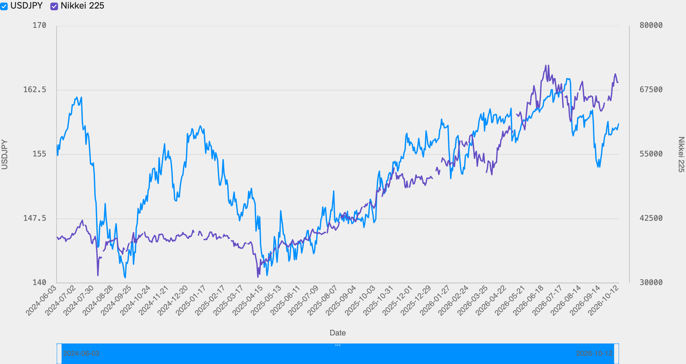
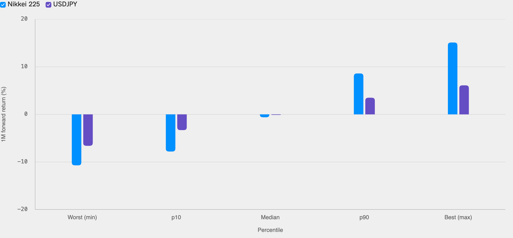

<!--
id: RX-USECASE-0081
type: use-case
language: ko
locale: ko-KR
author: Reflexivity Research
kb_imported: 2026-10-17
status: draft
translation_status: localized_from_en_canonical
original_language: en
source_type: reflexivity-platform-demo
source_manifest: RX-USECASE-0081
prompt_status: present
prompt_basis: localized_from_en_verbatim
-->

# 엔화 숏포지션과 닛케이 청산 위험 분석하기

<!-- locale-switcher:start -->
**Languages:** [English](../../../../en/05-use-cases/03-asset-class/01-FX/jpy-positioning-nikkei-unwind-asymmetry.md) · [日本語](../../../../ja/05-ユースケース/03-運用資産別/01-FX/円ショートの混雑度と日経平均の巻き戻しリスクを検証する.md) · **한국어** · [简体中文](../../../../zh-cn/05-使用案例/03-按资产类别/01-FX/分析-日元空头持仓-与日经指数挤仓风险.md) · [繁體中文（台灣）](../../../../zh-tw/05-使用案例/03-依資產類別/01-FX/分析-日圓空頭部位-與日經指數的平倉風險.md) · [繁體中文（香港）](../../../../zh-hk/05-使用案例/03-按資產類別/01-FX/分析-日圓空倉-與日經指數的平倉風險.md)
<!-- locale-switcher:end -->

[← 운용자산별 유스케이스](../README.md) · [전체 유스케이스](../../README.md)

**대상 사용자:** 외환 운용역, 매크로 헤지펀드, 멀티에셋 리스크 담당자  
**운용자산:** 외환, 일본 주식, 거시경제  
**연구 기준 기간:** 2024년 8월 청산과 2026년 10월 환경 비교

> 시장가격과 계산 결과는 해당 연구 기간의 설명용 예시이며, 현재 수치나 투자 권고가 아닙니다.

**[Reflexivity에서 이 연구 예시 열기 →](https://app.reflexivity.com/alfred?mode=research&conversationId=b41ccc9c-ac43-4804-8946-921699212de6&scrollTo=top)**

## 사용한 프롬프트

> [!IMPORTANT]
> 현재 USD/JPY와 엔 크로스의 투기적 포지션을 2024년 8월 캐리트레이드 청산 당시와 비교해 주세요. 남아 있는 엔화 숏포지션은 얼마나 밀집되어 있으며 BOJ가 예상보다 매파적으로 움직일 때 무질서한 청산의 손실 비대칭성은 얼마나 큰가요? 일본 주식시장의 심리와 닛케이 상승세의 롱 포지션 쏠림 여부, 외국인 보유분의 환헤지·비헤지 비중도 검토해 주세요.

## 엔 캐리 환경과 실제 포지션을 구분하기

엔화를 차입해 다른 자산을 보유하는 캐리 전략은 환율, 금리차, 레버리지, 일본 주식시장 심리와 연결됩니다. 다만 거래가격과 금리차만으로 **실제 엔화 숏 계약 수**나 외국인 주식 투자자의 환헤지 비율을 알아낼 수는 없습니다.

## 캐리 청산 전후의 시장 맥락

*그림 1. USD/JPY와 닛케이225 수준을 서로 다른 축으로 표시했습니다. 선의 동행만으로 투기적 포지션을 직접 측정할 수는 없습니다.*

| 비교 항목 | 2024년 8월 청산 당시 | 2026년 10월 분석 시점 |
| --- | --- | --- |
| USD/JPY | 161.70 → 144.20 | 약 158.64 |
| 미국·일본 정책금리 차 | 약 5.4%p | 약 2.75%p |
| BOJ 정책금리 | 0.10% | 1.25% |
| 2024년 급격한 엔화 강세 | 약 10.8% | 해당 새 청산 사건 관측 없음 |

금리차가 줄었다는 것은 엔화 매도 캐리의 이자 수익 여력이 작아졌다는 의미이지, 남은 포지션 규모가 얼마인지 보여주는 증거는 아닙니다.

## 엔화 급등 이후의 역사적 결과

*그림 2. 과거 22개 대리 사건에 대한 최악값·10백분위·중앙값·90백분위·최고값입니다. 확률밀도나 장래 BOJ 이벤트의 손실 확률이 아닙니다.*

이 사례에서 닛케이의 불리한 1개월 관측값은 약 **−10.7%**였고 긍정적인 꼬리 관측치도 존재했습니다. 하지만 사건의 원인이 같지 않아 BOJ의 예상 밖 발표 효과만 분리한 수치는 아닙니다.

**미확인 자료:** 영어 분석에는 CFTC 엔 선물 순매도 시계열과 외국인의 일본 주식 보유분 중 환헤지·비헤지 비중이 정량적으로 포함되지 않았습니다. 정확한 혼잡도를 평가하려면 CFTC 포지션, 옵션 스큐, 실제 외국인 수급 및 헤지 상품별 자산 데이터를 추가해야 합니다.

## 추가 자료 문의

해당 사례를 다른 연구 환경인 **LSEG Workspace에서 재현한 결과**에 관심이 있으시면, 데이터 접근 권한과 재배포 가능 범위를 확인한 뒤 별도 제공 가능 여부를 안내해 드립니다. **jim@reflexivity.com**으로 문의하면서 문서번호 **RX-USECASE-0081**를 알려주세요.

---

[← 운용자산별 유스케이스](../README.md) · [전체 유스케이스](../../README.md)
