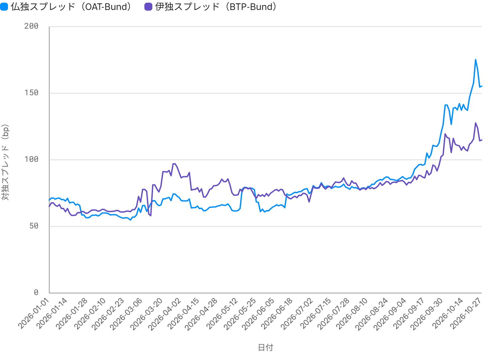

<!--
id: RX-USECASE-0110
type: use-case
language: ko
locale: ko
author: Reflexivity GTM Team
provider: 株式会社QUICK
source_created: 2026-10-28
published: 2026-11-17
revised: 2026-11-17
editorial_reviewed: 2026-11-17
resource: QUICK Reflexivity usage example: Compare Fed, ECB and BOJ policy stances and bond-market risks
status: published
translation_status: current
publication_mode: faithful-source-preserving
prompt_status: present
prompt_basis: source-verbatim
-->

# 연준·ECB·일본은행 정책 방향과 국채 리스크 비교

<!-- locale-switcher:start -->
**Languages:** [English](../../../../en/05-use-cases/03-asset-class/03-macro/compare-fed-ecb-and-boj-policy-stances-and-bond-market-risks.md) · [日本語](../../../../ja/05-ユースケース/03-運用資産別/03-マクロ/FRB・ECB・日銀の政策姿勢と国債リスクを比較する.md) · **한국어** · [简体中文](../../../../zh-cn/05-使用案例/03-按资产类别/03-宏观/比较美联储-欧央行-日银政策及债券风险.md) · [繁體中文（臺灣）](../../../../zh-tw/05-使用案例/03-依資產類別/03-總體/比較聯儲局-歐央行-日銀政策及債券風險.md) · [繁體中文（香港）](../../../../zh-hk/05-使用案例/03-按資產類別/03-宏觀/比較聯儲局-歐央行-日銀政策及債券風險.md)
<!-- locale-switcher:end -->

[← 유스케이스 목록](../../README.md)

**사례 작성일:** 2026-10-28  
**주요 활용 기능:** Alfred

연준·ECB·일본은행 금리 전망과 인플레이션을 비교한 뒤 프랑스 국채 신용 위험까지 확장합니다.

> [!NOTE]
> 수치, 전망, 화면 구성은 표시된 작성일 당시의 연구 사례이며 실시간 시장 정보가 아닙니다.

## 사용한 프롬프트

> [!IMPORTANT]
> FRB、ECB、BOJのそれぞれの金融スタンスと、利上げや利下げの可能性をどのように考えているかをまとめてください。

실제 입력된 질문은 일본어 원문입니다. 조건과 기간을 생략하지 않도록 원문 그대로 표시했습니다.

## 조사 목적과 워크플로

1. 연준·ECB·일본은행 금리 전망과 인플레이션을 비교한 뒤 프랑스 국채 신용 위험까지 확장합니다.
2. 요약만 보지 않고 관련 기업·테마·이벤트 및 시장 데이터를 확인합니다.
3. 관측 기간·지표 정의·대안적 설명을 검토한 뒤 투자 판단에 활용합니다.

## 이 사례가 보여주는 점

연준·ECB·일본은행 금리 전망과 인플레이션을 비교한 뒤 프랑스 국채 신용 위험까지 확장합니다.

10월 28일 기준 연준 목표 범위·ECB 예금금리·일본은행 익일물 금리를 구분하고 프랑스 국채 위험까지 살폈습니다.

## 제품 화면과 분석 차트

## 해석할 때 유의할 점

수치, 전망, 화면 구성은 표시된 작성일 당시의 연구 사례이며 실시간 시장 정보가 아닙니다.

## 관련 제품 기능

- [Alfred](https://github.com/reflexivity-kb/platform/blob/main/ko/03-%EC%A0%9C%ED%92%88/alfred.md)

연결된 제품 매뉴얼을 열람하려면 접근 권한이 필요할 수 있습니다.

---

이 유스케이스는 QUICK이 제공한 활용 사례를 바탕으로 작성되었습니다. 수치와 시나리오는 당시 분석 기준입니다.

[← 유스케이스 목록](../../README.md)
