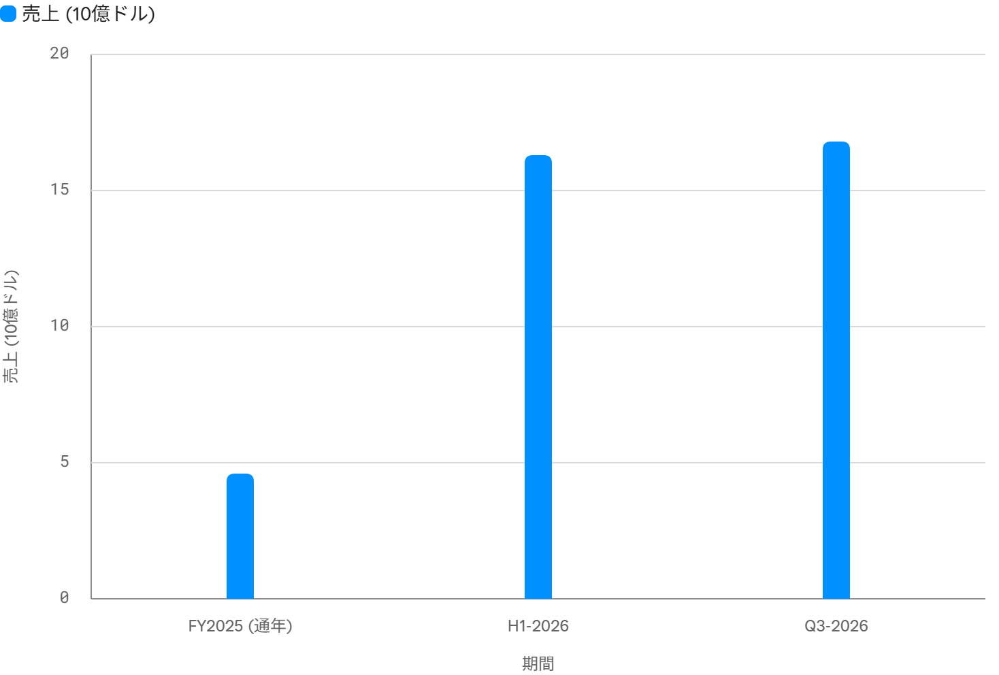

<!--
id: RX-USECASE-0087
type: use-case
language: ko
locale: ko
author: Reflexivity GTM Team
provider: 株式会社QUICK
source_created: 2026-10-27
published: 2026-11-17
revised: 2026-11-17
editorial_reviewed: 2026-11-17
resource: QUICK Reflexivity usage example: Read Anthropic’s IPO filing and map its market impact
status: published
translation_status: current
publication_mode: faithful-source-preserving
prompt_status: present
prompt_basis: source-verbatim
-->

# Anthropic S-1 기반 재무 및 IPO 파급 분석

<!-- locale-switcher:start -->
**Languages:** [English](../../../../en/05-use-cases/03-asset-class/04-equities/read-anthropics-ipo-filing-and-map-its-market-impact.md) · [日本語](../../../../ja/05-ユースケース/03-運用資産別/04-株式/AnthropicのS-1から財務とIPO波及先を分析する.md) · **한국어** · [简体中文](../../../../zh-cn/05-使用案例/03-按资产类别/04-股票/解读-Anthropic-S-1-与-IPO-连锁影响.md) · [繁體中文（臺灣）](../../../../zh-tw/05-使用案例/03-依資產類別/04-股票/解讀-Anthropic-S-1-與-IPO-連鎖影響.md) · [繁體中文（香港）](../../../../zh-hk/05-使用案例/03-按資產類別/04-股票/解讀-Anthropic-S-1-與-IPO-連鎖影響.md)
<!-- locale-switcher:end -->

[← 유스케이스 목록](../../README.md)

**사례 작성일:** 2026-10-27  
**주요 활용 기능:** Alfred, Asset Overview

제출된 S-1의 매출·손실·컴퓨트 계약을 분석하고 수혜 기업과 경쟁사 영향을 구분합니다.

> [!NOTE]
> 수치, 전망, 화면 구성은 표시된 작성일 당시의 연구 사례이며 실시간 시장 정보가 아닙니다.

## 사용한 프롬프트

> [!IMPORTANT]
> Anthoropicの発行したS-1を読んで、直近と今後の財務情報を分析してください。 またこの会社のIPOにより恩恵を受ける会社や大きな影響を受ける会社についても調べてください。

실제 입력된 질문은 일본어 원문입니다. 조건과 기간을 생략하지 않도록 원문 그대로 표시했습니다.

## 조사 목적과 워크플로

1. 제출된 S-1의 매출·손실·컴퓨트 계약을 분석하고 수혜 기업과 경쟁사 영향을 구분합니다.
2. 요약만 보지 않고 관련 기업·테마·이벤트 및 시장 데이터를 확인합니다.
3. 관측 기간·지표 정의·대안적 설명을 검토한 뒤 투자 판단에 활용합니다.

## 이 사례가 보여주는 점

제출된 S-1의 매출·손실·컴퓨트 계약을 분석하고 수혜 기업과 경쟁사 영향을 구분합니다.

S-1의 매출 급증·대규모 적자·컴퓨트 지출 약정을 비교하고 확정 채무와 보도상 총액을 구분합니다.

- [관련 공식 공시](https://www.sec.gov/Archives/edgar/data/2130357/000162828026067168/anthropicpbc-sx1.htm)

## 제품 화면과 분석 차트

## 해석할 때 유의할 점

수치, 전망, 화면 구성은 표시된 작성일 당시의 연구 사례이며 실시간 시장 정보가 아닙니다.

## 관련 제품 기능

- [Alfred](https://github.com/reflexivity-kb/platform/blob/main/ko/03-%EC%A0%9C%ED%92%88/alfred.md)
- [Asset Overview](https://github.com/reflexivity-kb/platform/blob/main/ko/03-%EC%A0%9C%ED%92%88/asset-overview.md)

연결된 제품 매뉴얼을 열람하려면 접근 권한이 필요할 수 있습니다.

---

이 유스케이스는 QUICK이 제공한 활용 사례를 바탕으로 작성되었습니다. 수치와 시나리오는 당시 분석 기준입니다.

[← 유스케이스 목록](../../README.md)
