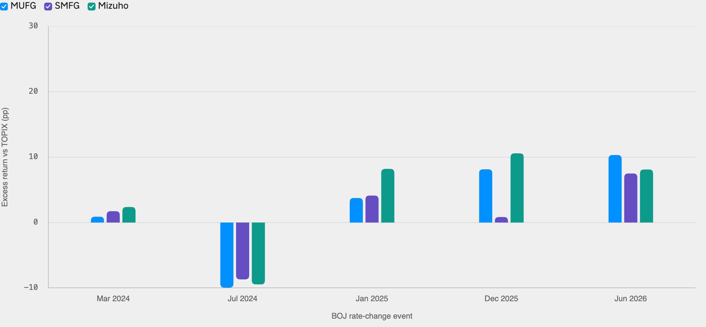
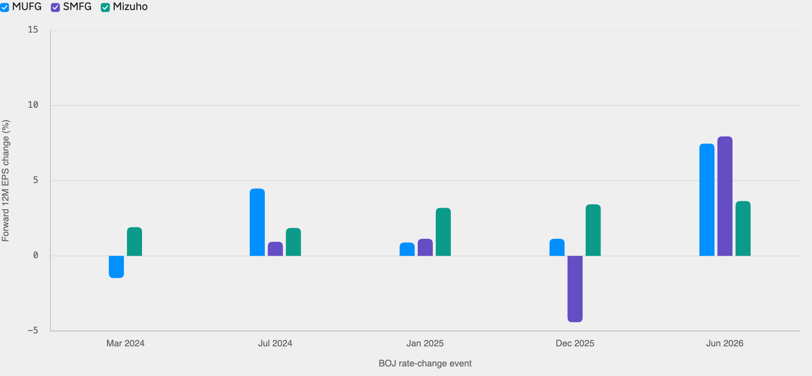

<!--
id: RX-USECASE-0078
type: use-case
language: ko
locale: ko-KR
author: Reflexivity Research
kb_imported: 2026-10-17
status: draft
translation_status: localized_from_en_canonical
original_language: en
source_type: reflexivity-platform-demo
source_manifest: RX-USECASE-0078
prompt_status: present
prompt_basis: localized_from_en_verbatim
-->

# BOJ 금리 변경 후 일본 은행주와 EPS 변화 분석하기

[← 운용자산별 유스케이스](../README.md) · [전체 유스케이스](../../README.md)

**대상 사용자:** 일본 주식 운용역, 은행업 애널리스트, 멀티에셋 운용역  
**운용자산:** 일본 주식, 은행업  
**연구 기준 기간:** 2024년 3월~2026년 10월 14일

> 시장가격과 계산 결과는 해당 연구 기간의 설명용 예시이며, 현재 수치나 투자 권고가 아닙니다.

**[Reflexivity에서 이 연구 예시 열기 →](https://app.reflexivity.com/alfred?mode=research&conversationId=bc6b5c73-5d73-4c6e-8bec-af825d1e1605&scrollTo=top)**

## 사용한 프롬프트

> [!IMPORTANT]
> 2024년 이후 BOJ의 정책금리 변경이 있을 때마다 20거래일 동안 MUFG, SMFG, Mizuho의 주가가 TOPIX 대비 어떤 성과를 보였는지, 같은 기간 각 은행의 향후 12개월 EPS 컨센서스 전망치가 얼마나 변화했는지 비교해 주세요.

## 금리 인상 뒤 은행주가 항상 강세인 것은 아닙니다

일본은행이 금리를 올리면 은행의 순이자마진 개선을 예상하기 쉽지만, 주가에는 엔 캐리 청산과 시장 전반의 위험 회피가 동시에 영향을 미칩니다. 이 사례는 세 은행의 **20거래일 TOPIX 대비 초과수익률**과 **같은 기간 향후 12개월 EPS 컨센서스 수정률**을 함께 분석합니다.

2026년 10월 14일을 기준으로 관측 구간이 완전히 끝난 BOJ 이벤트는 **5건**이었습니다. 2026년 9월 18일 변경은 아직 20거래일이 지나지 않아 제외했습니다.

## TOPIX 대비 초과수익률

*그림 1. MUFG, SMFG, Mizuho의 이벤트별 20거래일 초과수익률이며 단위는 %p입니다.*

| BOJ 이벤트 | MUFG | SMFG | Mizuho |
| --- | ---: | ---: | ---: |
| 2024년 7월 | −9.95%p | −8.69%p | −9.46%p |
| 2025년 1월 | +3.76%p | +4.13%p | +8.21%p |
| 2025년 12월 | +8.15%p | +0.85%p | +10.59%p |
| 2026년 6월 | +10.33%p | +7.51%p | +8.12%p |

2024년 7월처럼 엔화 캐리트레이드 청산이 겹치면 금리 인상 이후에도 은행주 세 종목 모두 TOPIX를 크게 밑돌 수 있습니다.

## 실적 전망의 변화

*그림 2. 동일한 20거래일 구간의 forward 12M EPS 변화율입니다.*

2026년 6월 구간의 EPS 수정률은 MUFG **+7.47%**, SMFG **+7.95%**, Mizuho **+3.65%**였습니다. 주가의 초과수익률과 이익 전망 수정률이 항상 같은 방향으로 움직이지 않는다는 점이 핵심입니다.

**주의할 점:** MUFG·SMFG의 일부 전망치는 달러 기준 ADR 커버리지, Mizuho는 엔화 기준 컨센서스입니다. 단순 변화율 비교만으로 추정 기준과 환율 효과가 완전히 통제되지는 않습니다. 또한 시장 전체 충격과 정책 발표의 인과효과를 분리한 결과가 아닙니다.

## 추가 자료 문의

해당 사례를 다른 연구 환경인 **LSEG Workspace에서 재현한 결과**에 관심이 있으시면, 데이터 접근 권한과 재배포 가능 범위를 확인한 뒤 별도 제공 가능 여부를 안내해 드립니다. **jim@reflexivity.com**으로 문의하면서 문서번호 **RX-USECASE-0078**를 알려주세요.

---

[← 운용자산별 유스케이스](../README.md) · [전체 유스케이스](../../README.md)
