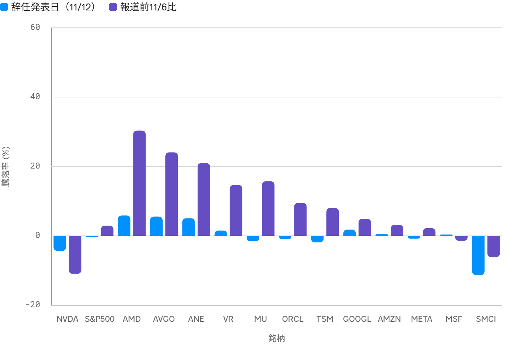

<!--
id: RX-USECASE-0103
type: use-case
language: ko
locale: ko
author: Reflexivity GTM Team
source_type: partner-provided-use-case
provider: QUICK
source_manifest: RX-USECASE-0103
source_created: 2026-11-13
published: 2026-11-17
revised: 2026-11-17
editorial_reviewed: 2026-11-17
resource: QUICK-provided Reflexivity research example
status: published
translation_status: current
prompt_status: present
prompt_basis: faithful-translation
-->

# NVIDIA CEO 교체와 과거 창업자 퇴임 사례 비교

<!-- locale-switcher:start -->
**언어:** [English](../../../../en/05-use-cases/03-asset-class/04-equities/compare-founder-ceo-departures-and-nvidia-s-industry-spillovers.md) · [日本語](../../../../ja/05-ユースケース/03-運用資産別/04-株式/NVIDIAのCEO交代を過去の創業者退任例と比較する.md) · **한국어** · [简体中文](../../../../zh-cn/05-使用案例/03-按资产类别/04-股票/将-NVIDIA-CEO-更替与历史创始人离任事件比较.md) · [繁體中文（臺灣）](../../../../zh-tw/05-使用案例/03-依資產類別/04-股票/將-NVIDIA-CEO-更替與歷史創辦人離任事件比較.md) · [繁體中文（香港）](../../../../zh-hk/05-使用案例/03-按資產類別/04-股票/將-NVIDIA-CEO-更替與歷史創辦人離任事件比較.md)
<!-- locale-switcher:end -->

[← Use Cases](../../README.md)

**QUICK | 2026-11-13**

## 사용한 프롬프트

> [!IMPORTANT]
> NVIDIA 젠슨 황 CEO 사임 이후 지난 20년간 대형 기업 창업자 CEO 퇴임 사례의 1·3·6개월 주가 성과와 AI·데이터센터 업계 영향을 분석해 주세요.

## 분석 절차

계획된 창업자 승계와 갑작스러운 퇴임을 구분합니다. Apple·Oracle·Wynn·Alphabet·Amazon의 과거 사례에 비창업자 Intel을 참고 비교했고 NVIDIA의 교체는 11월 12일 발표됐습니다.

## 당시 결과

창업자 5개 사례의 주가 수익률 중앙값은 1개월 +5.2%, 3개월 +0.1%, 6개월 +6.9%였습니다. NVIDIA와 AMD·Broadcom·데이터센터 인프라 종목도 함께 비교했습니다.

## 해석과 주의점

사례 5개는 표본이 작고 계획 승계와 돌발 퇴임은 다릅니다. 주가 구간은 거래일 기준으로 배당을 제외합니다. NVIDIA 공식 발표가 확인하는 것은 인사 변동이지 주가 인과관계가 아닙니다.

공식 발표: [NVIDIA CEO transition](https://nvidianews.nvidia.com/news/nvidia-announces-ceo-transition/)

## 관련 제품

- [Alfred](https://github.com/reflexivity-kb/platform/blob/main/ko/03-%EC%A0%9C%ED%92%88/alfred.md)

제품 매뉴얼 열람에는 접근 권한이 필요할 수 있습니다.

## 조사 화면과 차트

아래 두 화면은 2026년 11월 13일의 창업자 CEO 퇴임 사례 및 주가·산업 파급 분석을 보여줍니다.

## 제공처

본 콘텐츠는 QUICK에서 제공한 자료입니다.

국가·지역, 언어 환경, 이용 제품, 권한 및 데이터 제공 범위에 따라 이 예시를 그대로 재현하기 어려울 수 있습니다.

[← Use Cases](../../README.md)
