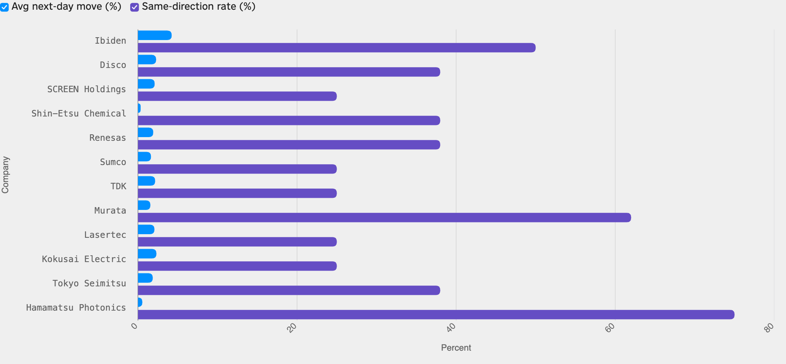

<!--
id: RX-USECASE-0079
type: use-case
language: ko
locale: ko-KR
author: Reflexivity Research
kb_imported: 2026-10-17
status: draft
translation_status: localized_from_en_canonical
original_language: en
source_type: reflexivity-platform-demo
source_manifest: RX-USECASE-0079
prompt_status: present
prompt_basis: localized_from_en_verbatim
-->

# NVIDIA 실적발표와 일본 공급망 기업 주가 반응 분석하기

<!-- locale-switcher:start -->
**Languages:** [English](../../../../en/05-use-cases/03-asset-class/04-equities/japanese-nvidia-supply-chain-earnings-reactions.md) · [日本語](../../../../ja/05-ユースケース/03-運用資産別/04-株式/NVIDIA決算から日本の関連企業と株価反応を調べる.md) · **한국어** · [简体中文](../../../../zh-cn/05-使用案例/03-按资产类别/04-股票/筛选-NVIDIA-相关日本供应链-及其财报后股价反应.md) · [繁體中文（台灣）](../../../../zh-tw/05-使用案例/03-依資產類別/04-股票/從-NVIDIA-財報篩選日本供應鏈企業及股價反應.md) · [繁體中文（香港）](../../../../zh-hk/05-使用案例/03-按資產類別/04-股票/從-NVIDIA-業績篩選日本供應鏈企業及股價反應.md)
<!-- locale-switcher:end -->

[← 운용자산별 유스케이스](../README.md) · [전체 유스케이스](../../README.md)

**대상 사용자:** 일본 주식 운용역, 반도체 애널리스트, 테마 운용역  
**운용자산:** 일본 주식, 반도체 공급망  
**연구 기준 기간:** 2024년 11월~2026년 8월 NVIDIA 실적발표 8회

> 시장가격과 계산 결과는 해당 연구 기간의 설명용 예시이며, 현재 수치나 투자 권고가 아닙니다.

**[Reflexivity에서 이 연구 예시 열기 →](https://app.reflexivity.com/alfred?mode=research&conversationId=06d26e49-ffa1-410c-9725-de2c78214b28&scrollTo=top)**

## 사용한 프롬프트

> [!IMPORTANT]
> Tokyo Electron과 Advantest를 제외하고 NVIDIA 공급망과 연결성이 강한 일본 상장기업을 찾아 주세요. 각 기업에 대해 NVIDIA의 최근 8번 실적발표 이후 도쿄증권거래소 다음 거래일의 평균 주가 변화, NVIDIA와 같은 방향으로 움직인 비율을 제시하고 순위를 매겨 주세요.

## NVIDIA 실적을 일본 공급망 투자 후보로 연결하기

AI 반도체 기업의 실적은 일본의 기판, 소재, 장비, 전자부품 업체에도 영향을 줄 수 있습니다. 먼저 기업 간 산업적 연결을 바탕으로 일본 상장기업 후보 **12곳**을 찾고, NVIDIA 실적발표 8회 전후의 일본 주가 반응을 비교합니다. Tokyo Electron과 Advantest는 질문 조건에 따라 제외했습니다.

## 평균 변동률과 방향 일치율 비교

*그림 1. 파란 막대는 평균 주가 변동률, 보라색은 방향 일치율입니다. 두 지표는 값의 범위가 크게 다르므로 길이를 직접 비교해서는 안 됩니다.*

| 일본 기업 | 평균 측정 변동률 | NVIDIA와 방향 일치 |
| --- | ---: | ---: |
| Ibiden | +4.24% | 4/8 |
| Disco | +2.28% | 3/8 |
| Kokusai Electric | +2.32% | 2/8 |
| Murata | +1.56% | 5/8 |
| Hamamatsu Photonics | +0.55% | 6/8 |

Ibiden은 측정한 평균 변동폭이 컸고, Hamamatsu Photonics는 방향 일치율이 가장 높았습니다. **주가 반응 크기**, **방향 일치 횟수**, **기업 간 공급망 연결성**은 각각 다른 지표입니다.

## 날짜 정렬과 기업 관계 검증

NVIDIA의 실적은 주로 **미국 장 마감 후** 발표됩니다. 일본의 첫 번째 거래일이 미국 시장이 실적을 반영하기 전에 시작되는 경우, 그래프가 표시한 일본 주가 반응은 엄밀한 의미의 실적 이후 반응이 아닐 수 있습니다. 해당 구간에서는 미국과 일본의 거래일을 다시 맞추고 필요하면 일본 **두 번째 거래일**을 사용해야 합니다.

또한 산업·지식그래프상 연결은 직접 공급계약이나 매출 의존도의 검증과 같지 않습니다. 따라서 이 결과는 매수 추천 순위가 아니라, 1차 공시와 거래일 정렬을 추가로 확인할 **조사 대상 목록**입니다.

## 추가 자료 문의

해당 사례를 다른 연구 환경인 **LSEG Workspace에서 재현한 결과**에 관심이 있으시면, 데이터 접근 권한과 재배포 가능 범위를 확인한 뒤 별도 제공 가능 여부를 안내해 드립니다. **jim@reflexivity.com**으로 문의하면서 문서번호 **RX-USECASE-0079**를 알려주세요.

---

[← 운용자산별 유스케이스](../README.md) · [전체 유스케이스](../../README.md)
