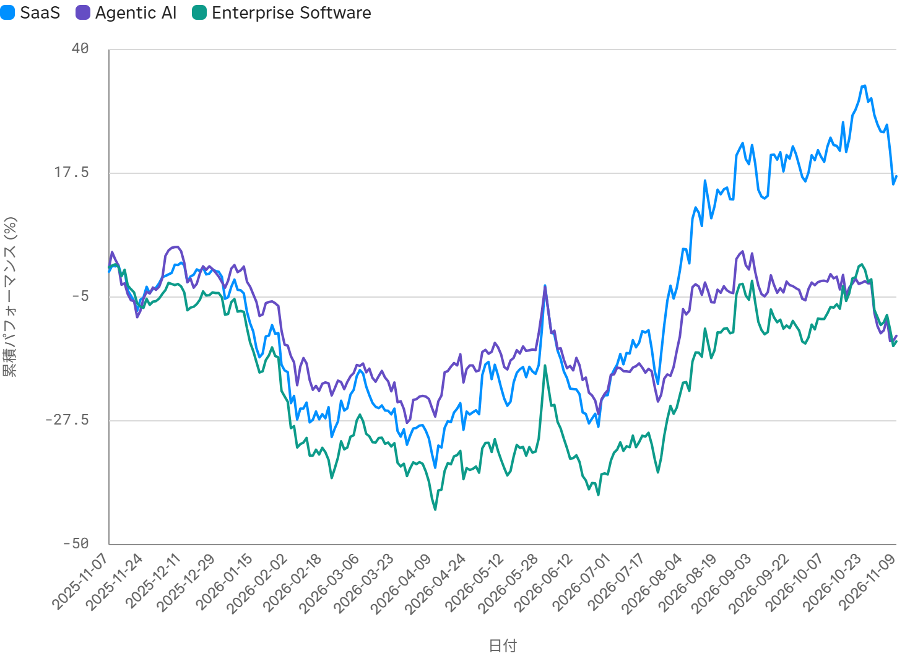
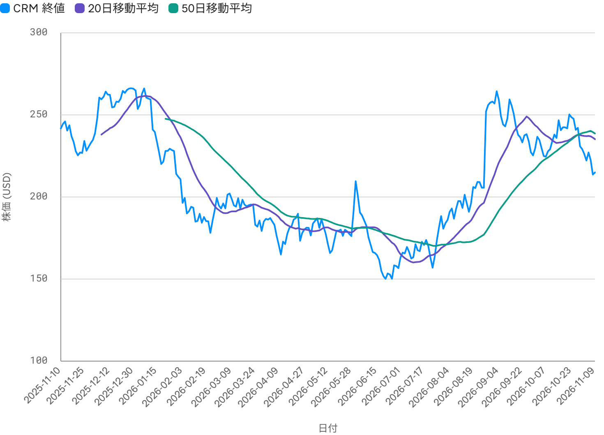

<!--
id: RX-USECASE-0098
type: use-case
language: ko
locale: ko
author: Reflexivity GTM Team
provider: 株式会社QUICK
source_created: 2026-11-10
published: 2026-11-17
revised: 2026-11-17
editorial_reviewed: 2026-11-17
resource: QUICK Reflexivity usage example: Create a reusable company summary report using Salesforce
status: published
translation_status: current
publication_mode: faithful-source-preserving
prompt_status: present
prompt_basis: source-verbatim
-->

# Salesforce 예시로 기업 요약 보고서 작성

<!-- locale-switcher:start -->
**Languages:** [English](../../../../en/05-use-cases/03-asset-class/04-equities/create-a-reusable-company-summary-report-using-salesforce.md) · [日本語](../../../../ja/05-ユースケース/03-運用資産別/04-株式/Salesforceを例に企業サマリーレポートを作る.md) · **한국어** · [简体中文](../../../../zh-cn/05-使用案例/03-按资产类别/04-股票/以-Salesforce-为例制作公司摘要报告.md) · [繁體中文（臺灣）](../../../../zh-tw/05-使用案例/03-依資產類別/04-股票/以-Salesforce-為例製作企業摘要報告.md) · [繁體中文（香港）](../../../../zh-hk/05-使用案例/03-按資產類別/04-股票/以-Salesforce-為例製作企業摘要報告.md)
<!-- locale-switcher:end -->

[← 유스케이스 목록](../../README.md)

**사례 작성일:** 2026-11-10  
**주요 활용 기능:** Alfred, Asset Overview, Themes

기업 개요·최근 뉴스·실적·1년 재무·테마·주가 차트 순서를 프롬프트로 지정합니다.

> [!NOTE]
> 수치, 전망, 화면 구성은 표시된 작성일 당시의 연구 사례이며 실시간 시장 정보가 아닙니다.

## 사용한 프롬프트

> [!IMPORTANT]
> アナリストレポートのような体裁で、企業のレポートを作成してください。 * *企業名はSalesforceです。 * *最初に企業概要、その次に最近の話題を記載してください。* *そ**の下には、１か月以内に決算発表があれば、決算内容のサマリーを載せてください。 * *その下には、過去１年分の業績の表と、直近の業績に関するコメントを記載。 * *その下には、この企業が属するテーマとそのテーマのパフォーマンスや市場の受け止め方を記載してください。 * *その下には過去１年間の日足のチャートを載せてください。

실제 입력된 질문은 일본어 원문입니다. 조건과 기간을 생략하지 않도록 원문 그대로 표시했습니다.

## 조사 목적과 워크플로

1. 기업 개요·최근 뉴스·실적·1년 재무·테마·주가 차트 순서를 프롬프트로 지정합니다.
2. 요약만 보지 않고 관련 기업·테마·이벤트 및 시장 데이터를 확인합니다.
3. 관측 기간·지표 정의·대안적 설명을 검토한 뒤 투자 판단에 활용합니다.

## 이 사례가 보여주는 점

기업 개요·최근 뉴스·실적·1년 재무·테마·주가 차트 순서를 프롬프트로 지정합니다.

Salesforce 사례는 기업 개요·뉴스·실적·1년 재무표·테마·일간 주가 차트 순서로 구성됩니다.

## 제품 화면과 분석 차트

## 해석할 때 유의할 점

수치, 전망, 화면 구성은 표시된 작성일 당시의 연구 사례이며 실시간 시장 정보가 아닙니다.

## 관련 제품 기능

- [Alfred](https://github.com/reflexivity-kb/platform/blob/main/ko/03-%EC%A0%9C%ED%92%88/alfred.md)
- [Asset Overview](https://github.com/reflexivity-kb/platform/blob/main/ko/03-%EC%A0%9C%ED%92%88/asset-overview.md)
- [Themes](https://github.com/reflexivity-kb/platform/blob/main/ko/03-%EC%A0%9C%ED%92%88/themes.md)

연결된 제품 매뉴얼을 열람하려면 접근 권한이 필요할 수 있습니다.

---

이 유스케이스는 QUICK이 제공한 활용 사례를 바탕으로 작성되었습니다. 수치와 시나리오는 당시 분석 기준입니다.

[← 유스케이스 목록](../../README.md)
