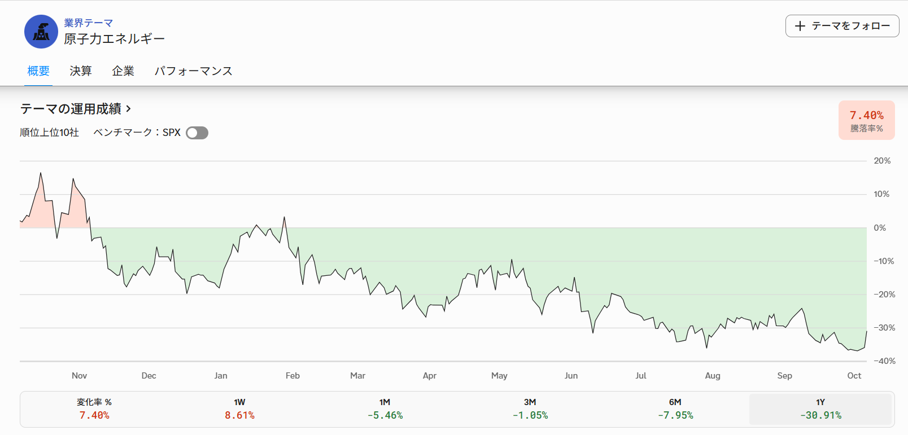

<!--
id: RX-USECASE-0084
type: use-case
language: ko
locale: ko
author: Reflexivity GTM Team
source_type: partner-provided-use-case
provider: QUICK
source_manifest: RX-USECASE-0084
source_created: 2026-10-07
published: 2026-11-17
revised: 2026-11-17
editorial_reviewed: 2026-11-17
resource: QUICK-provided Reflexivity research example
status: published
translation_status: current
prompt_status: not_provided
-->

# 대시보드 테마 성과와 구성 기업을 함께 살펴보기

<!-- locale-switcher:start -->
**언어:** [English](../../../../en/05-use-cases/03-asset-class/04-equities/investigate-theme-performance-and-constituents-from-dashboard.md) · [日本語](../../../../ja/05-ユースケース/03-運用資産別/04-株式/ダッシュボードのテーマ別パフォーマンスから構成企業を確認する.md) · **한국어** · [简体中文](../../../../zh-cn/05-使用案例/03-按资产类别/04-股票/从仪表盘主题表现研究相关公司.md) · [繁體中文（臺灣）](../../../../zh-tw/05-使用案例/03-依資產類別/04-股票/從儀表板主題表現研究相關企業.md) · [繁體中文（香港）](../../../../zh-hk/05-使用案例/03-按資產類別/04-股票/從儀表板主題表現研究相關企業.md)
<!-- locale-switcher:end -->

[← Use Cases](../../README.md)

**QUICK | 2026-10-07**

## 사용한 프롬프트

제공 자료에서는 사용한 프롬프트의 정확한 문구를 확인할 수 없습니다.

## 리서치 활용 절차

주목받는 시장 테마는 종목 선정의 시작점입니다. Dashboard의 테마 성과를 열고 관련 기업과 1년간의 수익률을 비교합니다.

## 제공 당시 분석

2026년 10월 7일 사례는 전날 미국 시장에서 주목받은 원자력 관련 테마를 다룹니다. 테마 순위에서 구성 기업으로 이동한 뒤 1년 성과를 비교하면 단기 상승과 장기 흐름이 다를 수 있음을 알 수 있습니다.

## 해석과 한계

과거 화면을 보여주는 사례이며 현재 테마 순위가 아닙니다. 테마와 연결됐다는 이유만으로 매출 기여도나 투자 적합성을 판단할 수는 없습니다.

## 관련 기능

- [Dashboard](https://github.com/reflexivity-kb/platform/blob/main/ko/03-%EC%A0%9C%ED%92%88/dashboard.md)
- [Themes](https://github.com/reflexivity-kb/platform/blob/main/ko/03-%EC%A0%9C%ED%92%88/themes.md)

제품 매뉴얼 열람에는 접근 권한이 필요할 수 있습니다.

## 조사 화면과 도표

아래는 제공 당시의 실제 조사 화면과 도표이며 현재 시장 데이터가 아닙니다.

*본 유스케이스는 일본 파트너 QUICK의 협조로 제공되었습니다.* · [면책 고지](../../DISCLAIMER.md)

[← Use Cases](../../README.md)
