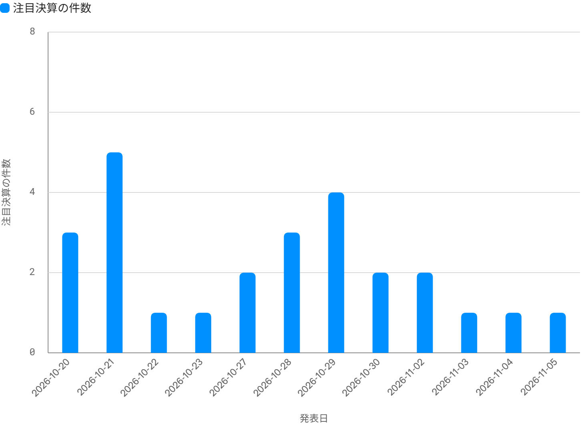

<!--
id: RX-USECASE-0109
type: use-case
language: ko
locale: ko
author: Reflexivity GTM Team
provider: 株式会社QUICK
source_created: 2026-10-15
published: 2026-11-17
revised: 2026-11-17
editorial_reviewed: 2026-11-17
resource: QUICK Reflexivity usage example: Build a dated earnings watchlist for US reporting season
status: published
translation_status: current
publication_mode: faithful-source-preserving
prompt_status: present
prompt_basis: source-verbatim
-->

# 미국 실적 시즌 관심 기업을 날짜별로 정리

<!-- locale-switcher:start -->
**Languages:** [English](../../../../en/05-use-cases/03-asset-class/04-equities/build-a-dated-earnings-watchlist-for-us-reporting-season.md) · [日本語](../../../../ja/05-ユースケース/03-運用資産別/04-株式/米国決算シーズンの注目銘柄を発表日順に整理する.md) · **한국어** · [简体中文](../../../../zh-cn/05-使用案例/03-按资产类别/04-股票/按发布日期整理美国财报季关注公司.md) · [繁體中文（臺灣）](../../../../zh-tw/05-使用案例/03-依資產類別/04-股票/按公布日期整理美國業績季關注企業.md) · [繁體中文（香港）](../../../../zh-hk/05-使用案例/03-按資產類別/04-股票/按公布日期整理美國業績季關注企業.md)
<!-- locale-switcher:end -->

[← 유스케이스 목록](../../README.md)

**사례 작성일:** 2026-10-15  
**주요 활용 기능:** Alfred, Events

10월 20일~11월 6일의 주요 실적 발표를 날짜순으로 나열하고 각 기업의 주목 이유를 설명합니다.

> [!NOTE]
> 수치, 전망, 화면 구성은 표시된 작성일 당시의 연구 사례이며 실시간 시장 정보가 아닙니다.

## 사용한 프롬프트

> [!IMPORTANT]
> 10月20日から11月6日にかけて多くの企業の決算発表があります。 マーケットの動向をモニターするために、注目すべき企業の決算発表について発表日順にリストアップしてください。注目すべき理由についても記載してください。

실제 입력된 질문은 일본어 원문입니다. 조건과 기간을 생략하지 않도록 원문 그대로 표시했습니다.

## 조사 목적과 워크플로

1. 10월 20일~11월 6일의 주요 실적 발표를 날짜순으로 나열하고 각 기업의 주목 이유를 설명합니다.
2. 요약만 보지 않고 관련 기업·테마·이벤트 및 시장 데이터를 확인합니다.
3. 관측 기간·지표 정의·대안적 설명을 검토한 뒤 투자 판단에 활용합니다.

## 이 사례가 보여주는 점

10월 20일~11월 6일의 주요 실적 발표를 날짜순으로 나열하고 각 기업의 주목 이유를 설명합니다.

10월 20일~11월 6일 약 1,260개 실적 이벤트 중 주요 26개 회사를 추려 날짜별로 정리했습니다.

## 제품 화면과 분석 차트

## 해석할 때 유의할 점

수치, 전망, 화면 구성은 표시된 작성일 당시의 연구 사례이며 실시간 시장 정보가 아닙니다.

## 관련 제품 기능

- [Alfred](https://github.com/reflexivity-kb/platform/blob/main/ko/03-%EC%A0%9C%ED%92%88/alfred.md)
- [Events](https://github.com/reflexivity-kb/platform/blob/main/ko/03-%EC%A0%9C%ED%92%88/events.md)

연결된 제품 매뉴얼을 열람하려면 접근 권한이 필요할 수 있습니다.

---

이 유스케이스는 QUICK이 제공한 활용 사례를 바탕으로 작성되었습니다. 수치와 시나리오는 당시 분석 기준입니다.

[← 유스케이스 목록](../../README.md)
