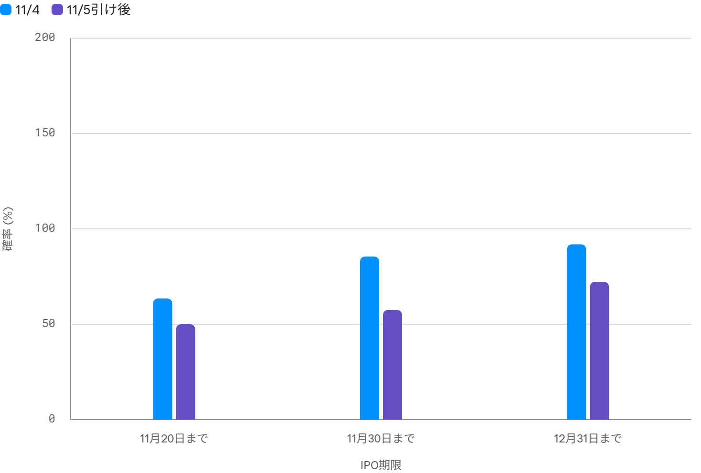

<!--
id: RX-USECASE-0091
type: use-case
language: ko
locale: ko
author: Reflexivity GTM Team
source_type: partner-provided-use-case
provider: QUICK
source_manifest: RX-USECASE-0091
source_created: 2026-10-23
published: 2026-11-17
revised: 2026-11-17
editorial_reviewed: 2026-11-17
resource: QUICK provided Reflexivity workflow
status: published
translation_status: current
prompt_status: present
prompt_basis: faithful-translation
-->

# 반도체 소재 테마의 일본 기업을 6개월 성과로 비교하기

<!-- locale-switcher:start -->
**언어:** [English](../../../../en/05-use-cases/03-asset-class/04-equities/compare-japanese-semiconductor-materials-companies-by-six-month-returns.md) · [日本語](../../../../ja/05-ユースケース/03-運用資産別/04-株式/半導体材料テーマの日本企業を6か月の騰落率で比較する.md) · **한국어** · [简体中文](../../../../zh-cn/05-使用案例/03-按资产类别/04-股票/比较半导体材料主题中日本企业的六个月收益.md) · [繁體中文（臺灣）](../../../../zh-tw/05-使用案例/03-依資產類別/04-股票/比較半導體材料主題中日本企業的六個月報酬.md) · [繁體中文（香港）](../../../../zh-hk/05-使用案例/03-按資產類別/04-股票/比較半導體材料主題中日本企業的六個月回報.md)
<!-- locale-switcher:end -->

[← Use Cases](../../README.md)

**QUICK | 2026-10-23**

## 사용한 프롬프트

> [!IMPORTANT]
> ‘반도체 소재’ 테마에 속한 일본 기업의 지난 6개월 성과를 비교하고 상위·하위 기업의 배경을 분석해 주세요.

## 조사 방법

Knowledge Graph 반도체 소재 테마의 일본 기업을 찾아 같은 6개월 기간의 수익률을 비교합니다. 기업별 사업 영역과 뉴스가 성과 차이에 미친 가능성을 검토합니다.

## 제공 당시 분석

테마에 속한 75개 기업 중 일본 기업 32곳을 확인하고 관련도가 높은 15곳을 비교했습니다. 2026년 4월 23일~10월 22일 이비덴 +54.5%, 스미토모 베이클라이트 +52.5%, 우에무라공업 -22.8%였습니다.

## 해석과 한계

상위 15개는 시가총액이 아닌 테마 관련도로 선정됐습니다. 일부 결산 요약이 없어 가격 변화 배경은 뉴스에 기초한 해석이며 인과관계를 확정할 수 없습니다.

## 관련 제품 기능

- [Themes](https://github.com/reflexivity-kb/platform/blob/main/ko/03-%EC%A0%9C%ED%92%88/themes.md)
- [Alfred](https://github.com/reflexivity-kb/platform/blob/main/ko/03-%EC%A0%9C%ED%92%88/alfred.md)

제품 매뉴얼을 열람하려면 접근 권한이 필요할 수 있습니다.

## 조사 화면과 도표

아래는 제공 당시의 실제 조사 화면과 도표이며 현재 시장 데이터가 아닙니다.

## 제공처

본 콘텐츠는 QUICK에서 제공한 자료입니다.

국가·지역, 언어 환경, 이용 제품, 권한 및 데이터 제공 범위에 따라 이 예시를 그대로 재현하기 어려울 수 있습니다.

[← Use Cases](../../README.md)
