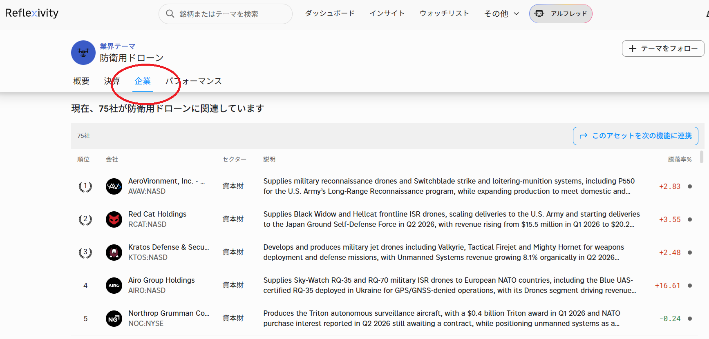

<!--
id: RX-USECASE-0093
type: use-case
language: ko
locale: ko
author: Reflexivity GTM Team
provider: 株式会社QUICK
source_created: 2026-11-16
published: 2026-11-17
revised: 2026-11-17
editorial_reviewed: 2026-11-17
resource: QUICK Reflexivity usage example: Find investable companies through the defense-drone theme
status: published
translation_status: current
publication_mode: faithful-source-preserving
prompt_status: not_provided
prompt_basis: not_provided
-->

# 방위용 드론 테마에서 관련 기업 찾기

<!-- locale-switcher:start -->
**Languages:** [English](../../../../en/05-use-cases/03-asset-class/04-equities/find-investable-companies-through-the-defense-drone-theme.md) · [日本語](../../../../ja/05-ユースケース/03-運用資産別/04-株式/防衛用ドローンのテーマから関連企業を探す.md) · **한국어** · [简体中文](../../../../zh-cn/05-使用案例/03-按资产类别/04-股票/从防务无人机主题寻找相关上市公司.md) · [繁體中文（臺灣）](../../../../zh-tw/05-使用案例/03-依資產類別/04-股票/從防務無人機主題尋找相關上市公司.md) · [繁體中文（香港）](../../../../zh-hk/05-使用案例/03-按資產類別/04-股票/從防務無人機主題尋找相關上市公司.md)
<!-- locale-switcher:end -->

[← 유스케이스 목록](../../README.md)

**사례 작성일:** 2026-11-16  
**주요 활용 기능:** Search, Themes, Screener, Watchlist, Asset Overview

방위 키워드로 드론 테마를 찾고 관련 기업과 성과를 확인한 뒤 관심목록·스크리너로 연결합니다.

> [!NOTE]
> 수치, 전망, 화면 구성은 표시된 작성일 당시의 연구 사례이며 실시간 시장 정보가 아닙니다.

## 사용한 프롬프트

제공 자료에서는 사용한 프롬프트의 정확한 문구를 확인할 수 없습니다.

## 조사 목적과 워크플로

1. 방위 키워드로 드론 테마를 찾고 관련 기업과 성과를 확인한 뒤 관심목록·스크리너로 연결합니다.
2. 요약만 보지 않고 관련 기업·테마·이벤트 및 시장 데이터를 확인합니다.
3. 관측 기간·지표 정의·대안적 설명을 검토한 뒤 투자 판단에 활용합니다.

## 이 사례가 보여주는 점

방위 키워드로 드론 테마를 찾고 관련 기업과 성과를 확인한 뒤 관심목록·스크리너로 연결합니다.

검색어 「防衛」에서 방위용 드론 테마를 선택하고 기업·성과 탭을 거쳐 관심목록과 스크리너로 이동합니다.

## 제품 화면과 분석 차트

## 해석할 때 유의할 점

수치, 전망, 화면 구성은 표시된 작성일 당시의 연구 사례이며 실시간 시장 정보가 아닙니다.

## 관련 제품 기능

- [Search](https://github.com/reflexivity-kb/platform/blob/main/ko/03-%EC%A0%9C%ED%92%88/search.md)
- [Themes](https://github.com/reflexivity-kb/platform/blob/main/ko/03-%EC%A0%9C%ED%92%88/themes.md)
- [Screener](https://github.com/reflexivity-kb/platform/blob/main/ko/03-%EC%A0%9C%ED%92%88/screener.md)
- [Watchlist](https://github.com/reflexivity-kb/platform/blob/main/ko/03-%EC%A0%9C%ED%92%88/watchlist.md)
- [Asset Overview](https://github.com/reflexivity-kb/platform/blob/main/ko/03-%EC%A0%9C%ED%92%88/asset-overview.md)

연결된 제품 매뉴얼을 열람하려면 접근 권한이 필요할 수 있습니다.

---

이 유스케이스는 QUICK이 제공한 활용 사례를 바탕으로 작성되었습니다. 수치와 시나리오는 당시 분석 기준입니다.

[← 유스케이스 목록](../../README.md)
