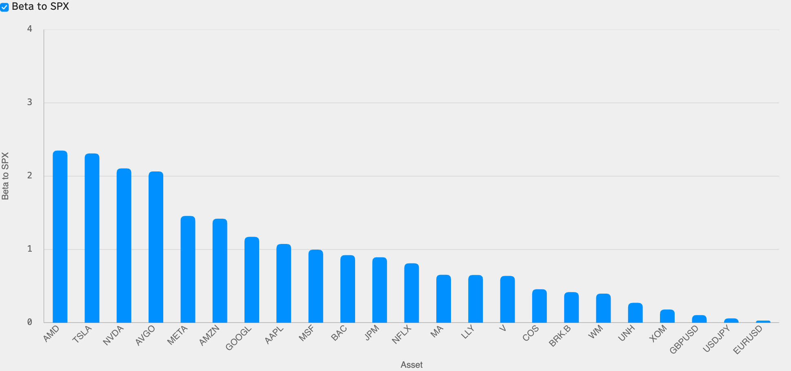
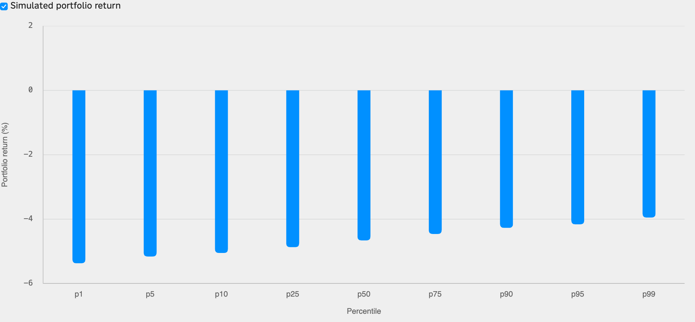

<!--
id: RX-USECASE-0082
type: use-case
language: ko
locale: ko-KR
author: Reflexivity Research
kb_imported: 2026-10-17
status: draft
translation_status: localized_from_en_canonical
original_language: en
source_type: reflexivity-platform-demo
source_manifest: RX-USECASE-0082
prompt_status: present
prompt_basis: localized_from_en_verbatim
-->

# S&P 500 5% 조정 시 포트폴리오 몬테카를로 분석하기

<!-- locale-switcher:start -->
**Languages:** [English](../../../../en/05-use-cases/03-asset-class/05-multi-asset/portfolio-monte-carlo-spx-five-percent-correction.md) · [日本語](../../../../ja/05-ユースケース/03-運用資産別/05-マルチアセット/SP500の5パーセント調整を想定したポートフォリオのモンテカルロ分析.md) · **한국어** · [简体中文](../../../../zh-cn/05-使用案例/03-按资产类别/05-多资产/用蒙特卡洛模拟-评估SP500下跌5百分比时的组合风险.md) · [繁體中文（台灣）](../../../../zh-tw/05-使用案例/03-依資產類別/05-多資產/用蒙地卡羅-評估SP500下跌5百分比時的組合風險.md) · [繁體中文（香港）](../../../../zh-hk/05-使用案例/03-按資產類別/05-多資產/用蒙特卡羅-評估SP500下跌5百分比時的組合風險.md)
<!-- locale-switcher:end -->

[← 운용자산별 유스케이스](../README.md) · [전체 유스케이스](../../README.md)

**대상 사용자:** 멀티에셋 운용역, 포트폴리오 리스크 관리자, 헤지펀드  
**운용자산:** 멀티에셋, 미국 주식, 외환  
**연구 기준 기간:** 2023년 10월~2026년 10월 추정 표본

> 시장가격과 계산 결과는 해당 연구 기간의 설명용 예시이며, 현재 수치나 투자 권고가 아닙니다.

**[Reflexivity에서 이 연구 예시 열기 →](https://app.reflexivity.com/alfred?mode=research&conversationId=4a8bfd1e-951f-4b13-9184-ea44acc7affc&scrollTo=top)**

## 사용한 프롬프트

> [!IMPORTANT]
> S&P 500이 5% 조정받을 때 제 포트폴리오(NVDA, AAPL, MSFT, GOOGL, AMZN, META, AVGO, TSLA, BRK.B, LLY, JPM, V, MA, WMT, COST, XOM, NFLX, AMD, BAC, UNH, USDJPY, EURUSD, GBPUSD)의 하방 위험을 몬테카를로 분석으로 평가해 주세요. 모든 자산은 동일 비중이라고 가정해 주세요.

## 보유 자산을 입력해 조건부 손실 범위를 살펴보기

이 사례는 미국 주식 **20종목**과 **FX 3개 통화쌍**으로 이루어진 23개 포지션에 각각 약 **4.35%**를 배분한다고 가정합니다. S&P 500에 **−5%의 조건부 충격**을 주고, 추정 베타 및 자산 간 잔차 상관을 사용해 **50,000회** 수익률을 모의실험했습니다.

## 자산별 시장 민감도

*그림 1. 2023~2026년 일간 수익률을 바탕으로 추정한 SPX 베타입니다. AMD(2.349), TSLA(2.310), NVIDIA(2.106), Broadcom(2.065)의 민감도가 크게 나타났습니다.*

## 시뮬레이션 결과

*그림 2. 시뮬레이션된 포트폴리오 수익률의 분위수 막대그래프입니다. 확률밀도 히스토그램이 아닙니다.*

| 지표 | 조건부 결과 |
| --- | ---: |
| 평균 포트폴리오 수익률 | −4.66% |
| 포트폴리오 SPX 베타 | 0.93 |
| 95% VaR 수익률 경계 | −5.16% |
| 99% VaR 수익률 경계 | −5.37% |
| 손실 5% 초과 확률 | 13.4% |

이 숫자는 특정 모형을 적용한 **예시 결과**입니다. 베타가 고정되고 잔차가 대체로 정규분포를 따른다는 가정은 급락 국면의 상관관계 급변, 비선형 손실, 유동성 위험을 충분히 설명하지 못할 수 있습니다.

또한 주식과 USD/JPY·EUR/USD·GBP/USD를 단순 동일 비중으로 놓을 때는 실제 거래의 명목금액, 통화쌍 표시 방향과 손익 환산 방식을 명확히 해야 합니다. 실무 적용 전에는 팻테일 모형과 과거 스트레스 구간의 비교 검증이 필요합니다.

## 추가 자료 문의

해당 사례를 다른 연구 환경인 **LSEG Workspace에서 재현한 결과**에 관심이 있으시면, 데이터 접근 권한과 재배포 가능 범위를 확인한 뒤 별도 제공 가능 여부를 안내해 드립니다. **jim@reflexivity.com**으로 문의하면서 문서번호 **RX-USECASE-0082**를 알려주세요.

---

[← 운용자산별 유스케이스](../README.md) · [전체 유스케이스](../../README.md)
