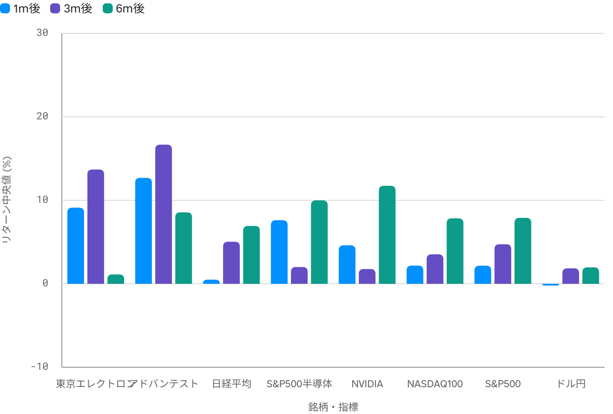

<!--
id: RX-USECASE-0106
type: use-case
language: ko
locale: ko
author: Reflexivity GTM Team
provider: 株式会社QUICK
source_created: 2026-11-05
published: 2026-11-17
revised: 2026-11-17
editorial_reviewed: 2026-11-17
resource: QUICK Reflexivity usage example: Explain different US and Japan equity reactions to midterm results
status: published
translation_status: current
publication_mode: faithful-source-preserving
prompt_status: present
prompt_basis: source-verbatim
-->

# 미국 중간선거 후 미국·일본 주가 반응 차이 분석

<!-- locale-switcher:start -->
**Languages:** [English](../../../../en/05-use-cases/03-asset-class/05-multi-asset/explain-different-us-and-japan-equity-reactions-to-midterm-results.md) · [日本語](../../../../ja/05-ユースケース/03-運用資産別/05-マルチアセット/米中間選挙後の米株と日本株の反応差を分析する.md) · **한국어** · [简体中文](../../../../zh-cn/05-使用案例/03-按资产类别/05-多资产/解释美国中期选举后美日股市反应分化.md) · [繁體中文（臺灣）](../../../../zh-tw/05-使用案例/03-依資產類別/05-多資產/解釋美國中期選舉後美日股市反應分化.md) · [繁體中文（香港）](../../../../zh-hk/05-使用案例/03-按資產類別/05-多資產/解釋美國中期選舉後美日股市反應分化.md)
<!-- locale-switcher:end -->

[← 유스케이스 목록](../../README.md)

**사례 작성일:** 2026-11-05  
**주요 활용 기능:** Alfred

미국 지수 상승과 일본 AI·반도체주 하락을 비교하고 규제·정책·달러엔 시나리오를 구분합니다.

> [!NOTE]
> 수치, 전망, 화면 구성은 표시된 작성일 당시의 연구 사례이며 실시간 시장 정보가 아닙니다.

## 사용한 프롬프트

> [!IMPORTANT]
> 米国中間選挙の結果、民主党が大勝しました。この結果、日本の株式市場ではAI関連株や半導体関連株が下落しました。一方で米国ではS&P500もNASDAQ指数も上昇しました。今後のAI関連株や半導体関連株について市場の見通しはどうなるのかシナリオを示してください。また、ドル円の為替レートの見通しも合わせてシナリオを提示して下さい。

실제 입력된 질문은 일본어 원문입니다. 조건과 기간을 생략하지 않도록 원문 그대로 표시했습니다.

## 조사 목적과 워크플로

1. 미국 지수 상승과 일본 AI·반도체주 하락을 비교하고 규제·정책·달러엔 시나리오를 구분합니다.
2. 요약만 보지 않고 관련 기업·테마·이벤트 및 시장 데이터를 확인합니다.
3. 관측 기간·지표 정의·대안적 설명을 검토한 뒤 투자 판단에 활용합니다.

## 이 사례가 보여주는 점

미국 지수 상승과 일본 AI·반도체주 하락을 비교하고 규제·정책·달러엔 시나리오를 구분합니다.

11월 5일 일본 AI주와 미국 전체 지수의 엇갈린 움직임을 기본·강세·약세 세 시나리오로 정리했습니다.

## 제품 화면과 분석 차트

## 해석할 때 유의할 점

수치, 전망, 화면 구성은 표시된 작성일 당시의 연구 사례이며 실시간 시장 정보가 아닙니다.

## 관련 제품 기능

- [Alfred](https://github.com/reflexivity-kb/platform/blob/main/ko/03-%EC%A0%9C%ED%92%88/alfred.md)

연결된 제품 매뉴얼을 열람하려면 접근 권한이 필요할 수 있습니다.

---

이 유스케이스는 QUICK이 제공한 활용 사례를 바탕으로 작성되었습니다. 수치와 시나리오는 당시 분석 기준입니다.

[← 유스케이스 목록](../../README.md)
