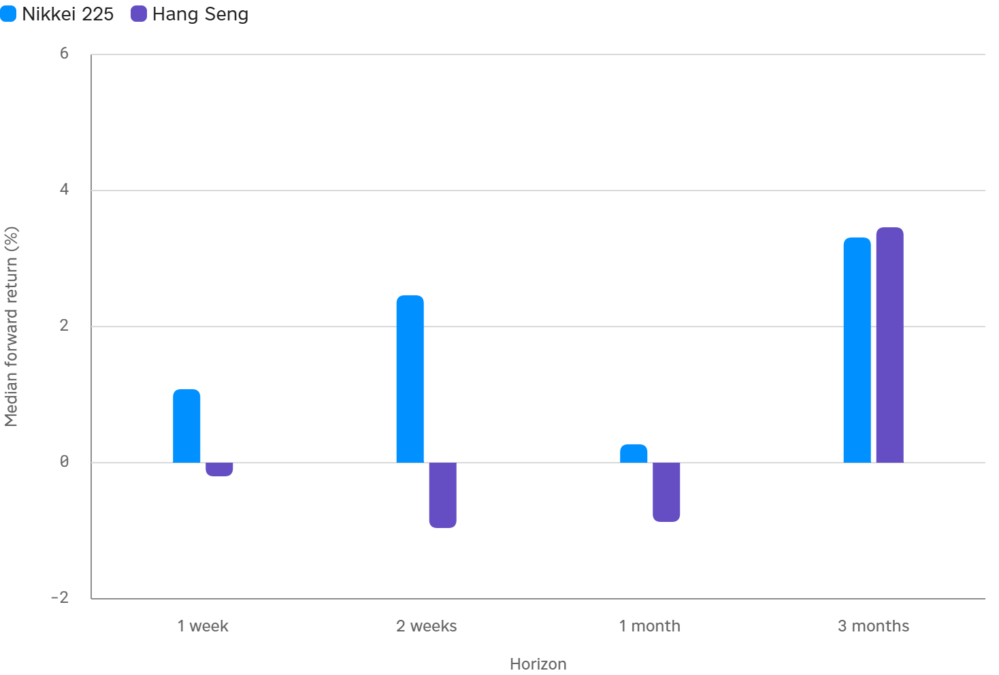

<!--
id: RX-USECASE-0088
type: use-case
language: zh-cn
locale: zh-cn
author: Reflexivity GTM Team
source_type: partner-provided-use-case
provider: QUICK
source_manifest: RX-USECASE-0088
source_created: 2026-10-19
published: 2026-11-17
revised: 2026-11-17
editorial_reviewed: 2026-11-17
resource: QUICK-provided Reflexivity research example
status: published
translation_status: current
prompt_status: present
prompt_basis: faithful-translation
-->

# 比较中国 GDP 发布对日股与港股的影响

<!-- locale-switcher:start -->
**语言:** [English](../../../../en/05-use-cases/03-asset-class/03-macro/compare-japan-and-hong-kong-equity-sensitivity-to-china-s-gdp.md) · [日本語](../../../../ja/05-ユースケース/03-運用資産別/03-マクロ/中国GDP発表に対する日本株と香港株の反応を比較する.md) · [한국어](../../../../ko/05-유스케이스/03-운용자산별/03-매크로/중국-GDP-발표가-일본·홍콩-주식에-미치는-영향-비교.md) · **简体中文** · [繁體中文（臺灣）](../../../../zh-tw/05-使用案例/03-依資產類別/03-總體/比較中國-GDP-公布對日股與港股的影響.md) · [繁體中文（香港）](../../../../zh-hk/05-使用案例/03-按資產類別/03-宏觀/比較中國-GDP-公布對日股與港股的影響.md)
<!-- locale-switcher:end -->

[← Use Cases](../../README.md)

**QUICK | 2026-10-19**

## 使用的提示词

> [!IMPORTANT]
> 今日中国 GDP 公布将如何影响日股？港股又如何解读中国增长？

## 研究流程

中国 GDP 放缓不会对日股与港股造成同样影响。要区分日本出口、材料及旅游相关企业与对内地经济更敏感的香港市场。

## 当时的分析结果

2026 年 10 月 19 日三季度 GDP 公布前，市场预期同比 +4.4%，此前为 +4.8%。在所选的 11 次增长放缓事件中，日经 225 一周后中位涨幅 +1.08%，恒生指数一周后中位变动 -0.20%。

## 解读与限制

该分析作于 GDP 公布之前，+4.4% 是预期而非实际值。11 次样本有限，不能据此认定因果关系或预测新一轮市场走势。

## 相关功能

- [Alfred](https://github.com/reflexivity-kb/platform/blob/main/zh-cn/03-%E4%BA%A7%E5%93%81/Alfred.md)

產品手冊可能需要獲授權才能查閱。

## 研究界面与图表

以下为提供日期的原始研究画面与图表，并非当前市场数据。

## 提供方

本内容由 QUICK 提供。

根据国家或地区、语言环境、所用产品、权限及数据覆盖范围，可能无法完全按本文方式复现该案例。

[← Use Cases](../../README.md)
