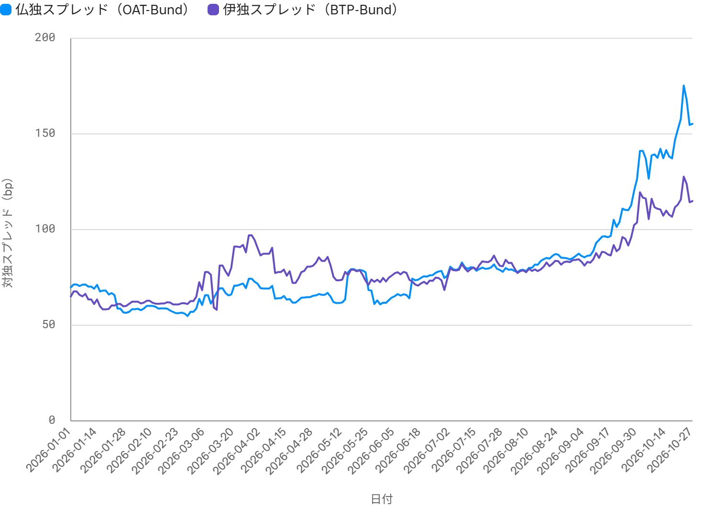

<!--
id: RX-USECASE-0110
type: use-case
language: zh-cn
locale: zh-cn
author: Reflexivity GTM Team
provider: 株式会社QUICK
source_created: 2026-10-28
published: 2026-11-17
revised: 2026-11-17
editorial_reviewed: 2026-11-17
resource: QUICK Reflexivity usage example: Compare Fed, ECB and BOJ policy stances and bond-market risks
status: published
translation_status: current
publication_mode: faithful-source-preserving
prompt_status: present
prompt_basis: source-verbatim
-->

# 比较美联储、欧央行、日银政策及债券风险

<!-- locale-switcher:start -->
**Languages:** [English](../../../../en/05-use-cases/03-asset-class/03-macro/compare-fed-ecb-and-boj-policy-stances-and-bond-market-risks.md) · [日本語](../../../../ja/05-ユースケース/03-運用資産別/03-マクロ/FRB・ECB・日銀の政策姿勢と国債リスクを比較する.md) · [한국어](../../../../ko/05-유스케이스/03-운용자산별/03-매크로/연준·ECB·일본은행-정책-방향과-국채-리스크-비교.md) · **简体中文** · [繁體中文（臺灣）](../../../../zh-tw/05-使用案例/03-依資產類別/03-總體/比較聯儲局-歐央行-日銀政策及債券風險.md) · [繁體中文（香港）](../../../../zh-hk/05-使用案例/03-按資產類別/03-宏觀/比較聯儲局-歐央行-日銀政策及債券風險.md)
<!-- locale-switcher:end -->

[← 使用案例](../../README.md)

**案例日期:** 2026-10-28  
**主要使用功能:** Alfred

并列比较三大央行的利率、通胀风险，再延伸到法国主权债信用风险。

> [!NOTE]
> 数字、预测和界面仅反映案例所述日期的研究情形，并非实时市场信息。

## 使用的提示词

> [!IMPORTANT]
> FRB、ECB、BOJのそれぞれの金融スタンスと、利上げや利下げの可能性をどのように考えているかをまとめてください。

演示使用日语提问。以上保留原始措辞，以避免遗漏条件与时间范围。

## 研究目标与操作流程

1. 并列比较三大央行的利率、通胀风险，再延伸到法国主权债信用风险。
2. 不要只看摘要，还应核对相关公司、主题、事件及市场数据。
3. 在得出当前投资结论之前，确认观察区间、指标定义及其他可能原因。

## 案例展示的分析结果

并列比较三大央行的利率、通胀风险，再延伸到法国主权债信用风险。

10 月 28 日比较分别采用美联储目标区间、欧央行存款便利利率及日银隔夜利率，再扩展到法债风险。

## 产品界面与分析图表

## 解读时的注意事项

数字、预测和界面仅反映案例所述日期的研究情形，并非实时市场信息。

## 相关产品功能

- [Alfred](https://github.com/reflexivity-kb/platform/blob/main/zh-cn/03-%E4%BA%A7%E5%93%81/Alfred.md)

查看所链接的产品手册可能需要访问权限。

---

本案例由 QUICK 提供。市场数字与情景判断仅代表当时的分析。

[← 使用案例](../../README.md)
