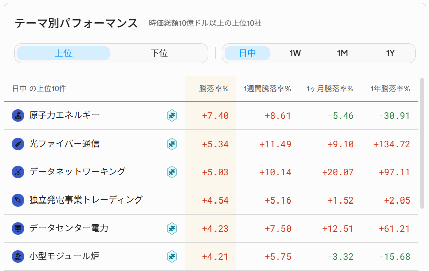

<!--
id: RX-USECASE-0094
type: use-case
language: zh-cn
locale: zh-cn
author: Reflexivity GTM Team
provider: 株式会社QUICK
source_created: 2026-10-07
published: 2026-11-17
revised: 2026-11-17
editorial_reviewed: 2026-11-17
resource: QUICK Reflexivity usage example: Move from Dashboard theme performance to underlying companies
status: published
translation_status: current
publication_mode: faithful-source-preserving
prompt_status: not_provided
prompt_basis: not_provided
-->

# 从仪表盘主题表现深入成分股

<!-- locale-switcher:start -->
**Languages:** [English](../../../../en/05-use-cases/03-asset-class/04-equities/move-from-dashboard-theme-performance-to-underlying-companies.md) · [日本語](../../../../ja/05-ユースケース/03-運用資産別/04-株式/ダッシュボードのテーマ騰落から構成銘柄へ進む.md) · [한국어](../../../../ko/05-유스케이스/03-운용자산별/04-주식/대시보드-테마-성과에서-구성-종목-분석.md) · **简体中文** · [繁體中文（臺灣）](../../../../zh-tw/05-使用案例/03-依資產類別/04-股票/從儀表板主題表現深入成份股.md) · [繁體中文（香港）](../../../../zh-hk/05-使用案例/03-按資產類別/04-股票/從儀表板主題表現深入成份股.md)
<!-- locale-switcher:end -->

[← 使用案例](../../README.md)

**案例日期:** 2026-10-07  
**主要使用功能:** Dashboard, Themes

从主题表现进入相关公司，将短期上涨与一年走势对照。

> [!NOTE]
> 数字、预测和界面仅反映案例所述日期的研究情形，并非实时市场信息。

## 使用的提示词

提供资料中未注明实际使用的提示词全文。

## 研究目标与操作流程

1. 从主题表现进入相关公司，将短期上涨与一年走势对照。
2. 不要只看摘要，还应核对相关公司、主题、事件及市场数据。
3. 在得出当前投资结论之前，确认观察区间、指标定义及其他可能原因。

## 案例展示的分析结果

从主题表现进入相关公司，将短期上涨与一年走势对照。

该示例从仪表盘进入美国核能主题，查看相关公司与一年走势，避免只看短期上涨。

## 产品界面与分析图表

## 解读时的注意事项

数字、预测和界面仅反映案例所述日期的研究情形，并非实时市场信息。

## 相关产品功能

- [Dashboard](https://github.com/reflexivity-kb/platform/blob/main/zh-cn/03-%E4%BA%A7%E5%93%81/%E4%BB%AA%E8%A1%A8%E7%9B%98.md)
- [Themes](https://github.com/reflexivity-kb/platform/blob/main/zh-cn/03-%E4%BA%A7%E5%93%81/%E6%8A%95%E8%B5%84%E4%B8%BB%E9%A2%98.md)

查看所链接的产品手册可能需要访问权限。

---

本案例由 QUICK 提供。市场数字与情景判断仅代表当时的分析。

[← 使用案例](../../README.md)
