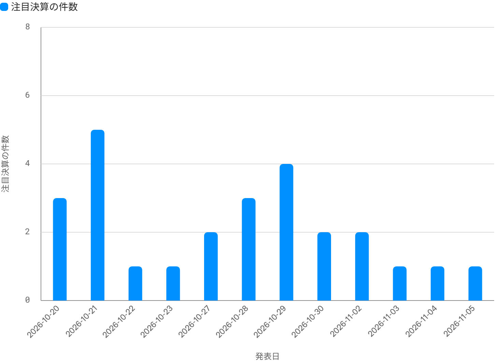

<!--
id: RX-USECASE-0109
type: use-case
language: zh-cn
locale: zh-cn
author: Reflexivity GTM Team
provider: 株式会社QUICK
source_created: 2026-10-15
published: 2026-11-17
revised: 2026-11-17
editorial_reviewed: 2026-11-17
resource: QUICK Reflexivity usage example: Build a dated earnings watchlist for US reporting season
status: published
translation_status: current
publication_mode: faithful-source-preserving
prompt_status: present
prompt_basis: source-verbatim
-->

# 按发布日期整理美国财报季关注公司

<!-- locale-switcher:start -->
**Languages:** [English](../../../../en/05-use-cases/03-asset-class/04-equities/build-a-dated-earnings-watchlist-for-us-reporting-season.md) · [日本語](../../../../ja/05-ユースケース/03-運用資産別/04-株式/米国決算シーズンの注目銘柄を発表日順に整理する.md) · [한국어](../../../../ko/05-유스케이스/03-운용자산별/04-주식/미국-실적-시즌-관심-기업을-날짜별로-정리.md) · **简体中文** · [繁體中文（臺灣）](../../../../zh-tw/05-使用案例/03-依資產類別/04-股票/按公布日期整理美國業績季關注企業.md) · [繁體中文（香港）](../../../../zh-hk/05-使用案例/03-按資產類別/04-股票/按公布日期整理美國業績季關注企業.md)
<!-- locale-switcher:end -->

[← 使用案例](../../README.md)

**案例日期:** 2026-10-15  
**主要使用功能:** Alfred, Events

筛选十至十一月财报季的重要公司，按日期排列并解释关注理由。

> [!NOTE]
> 数字、预测和界面仅反映案例所述日期的研究情形，并非实时市场信息。

## 使用的提示词

> [!IMPORTANT]
> 10月20日から11月6日にかけて多くの企業の決算発表があります。 マーケットの動向をモニターするために、注目すべき企業の決算発表について発表日順にリストアップしてください。注目すべき理由についても記載してください。

演示使用日语提问。以上保留原始措辞，以避免遗漏条件与时间范围。

## 研究目标与操作流程

1. 筛选十至十一月财报季的重要公司，按日期排列并解释关注理由。
2. 不要只看摘要，还应核对相关公司、主题、事件及市场数据。
3. 在得出当前投资结论之前，确认观察区间、指标定义及其他可能原因。

## 案例展示的分析结果

筛选十至十一月财报季的重要公司，按日期排列并解释关注理由。

研究从 10 月 20 日至 11 月 6 日约 1,260 家企业财报中精选 26 家重要公司。

## 产品界面与分析图表

## 解读时的注意事项

数字、预测和界面仅反映案例所述日期的研究情形，并非实时市场信息。

## 相关产品功能

- [Alfred](https://github.com/reflexivity-kb/platform/blob/main/zh-cn/03-%E4%BA%A7%E5%93%81/Alfred.md)
- [Events](https://github.com/reflexivity-kb/platform/blob/main/zh-cn/03-%E4%BA%A7%E5%93%81/%E4%BA%8B%E4%BB%B6%E6%97%A5%E5%8E%86.md)

查看所链接的产品手册可能需要访问权限。

---

本案例由 QUICK 提供。市场数字与情景判断仅代表当时的分析。

[← 使用案例](../../README.md)
