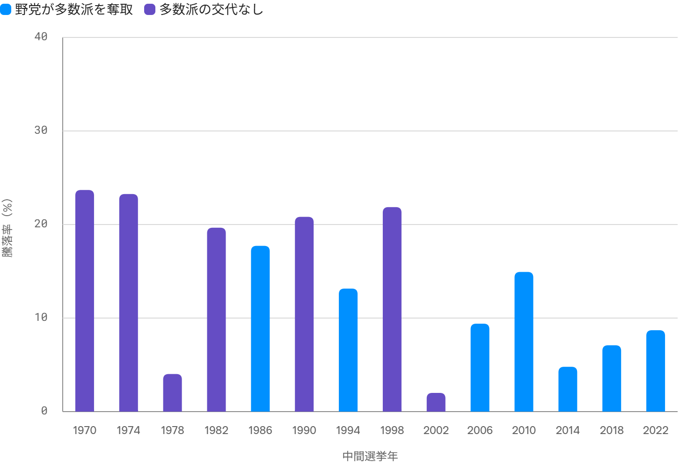

<!--
id: RX-USECASE-0105
type: use-case
language: zh-cn
locale: zh-cn
author: Reflexivity GTM Team
provider: 株式会社QUICK
source_created: 2026-11-02
published: 2026-11-17
revised: 2026-11-17
editorial_reviewed: 2026-11-17
resource: QUICK Reflexivity usage example: Study six-month S&P 500 returns after US midterm elections
status: published
translation_status: current
publication_mode: faithful-source-preserving
prompt_status: present
prompt_basis: source-verbatim
-->

# 检验美国中期选举后六个月标普 500 回报

<!-- locale-switcher:start -->
**Languages:** [English](../../../../en/05-use-cases/03-asset-class/04-equities/study-six-month-s-p-500-returns-after-us-midterm-elections.md) · [日本語](../../../../ja/05-ユースケース/03-運用資産別/04-株式/米中間選挙後6か月のS&P500を長期比較する.md) · [한국어](../../../../ko/05-유스케이스/03-운용자산별/04-주식/미국-중간선거-후-6개월-S&P500-수익률-검증.md) · **简体中文** · [繁體中文（臺灣）](../../../../zh-tw/05-使用案例/03-依資產類別/04-股票/檢驗美國中期選舉後六個月標普-500-回報.md) · [繁體中文（香港）](../../../../zh-hk/05-使用案例/03-按資產類別/04-股票/檢驗美國中期選舉後六個月標普-500-回報.md)
<!-- locale-switcher:end -->

[← 使用案例](../../README.md)

**案例日期:** 2026-11-02  
**主要使用功能:** Alfred

统计 1970 年以来选举后六个月的回报，并比较反对党夺得多数席位的情形。

> [!NOTE]
> 数字、预测和界面仅反映案例所述日期的研究情形，并非实时市场信息。

## 使用的提示词

> [!IMPORTANT]
> 米国中間選挙の６か月後のS&P500の数値は中間選挙前と比べてパフォーマンスがどうなっているのかを1970年以降から現在までを分析してください。また、政権を取っていない側の政党が勝利した場合と、政権側がそのまま多数議席を獲得した場合とで違いがあるかも調べてください。

演示使用日语提问。以上保留原始措辞，以避免遗漏条件与时间范围。

## 研究目标与操作流程

1. 统计 1970 年以来选举后六个月的回报，并比较反对党夺得多数席位的情形。
2. 不要只看摘要，还应核对相关公司、主题、事件及市场数据。
3. 在得出当前投资结论之前，确认观察区间、指标定义及其他可能原因。

## 案例展示的分析结果

统计 1970 年以来选举后六个月的回报，并比较反对党夺得多数席位的情形。

1970–2022 年 14 次中期选举后六个月标普 500 平均 +13.65%、中位数 +14.04%。

## 产品界面与分析图表

## 解读时的注意事项

数字、预测和界面仅反映案例所述日期的研究情形，并非实时市场信息。

## 相关产品功能

- [Alfred](https://github.com/reflexivity-kb/platform/blob/main/zh-cn/03-%E4%BA%A7%E5%93%81/Alfred.md)

查看所链接的产品手册可能需要访问权限。

---

本案例由 QUICK 提供。市场数字与情景判断仅代表当时的分析。

[← 使用案例](../../README.md)
