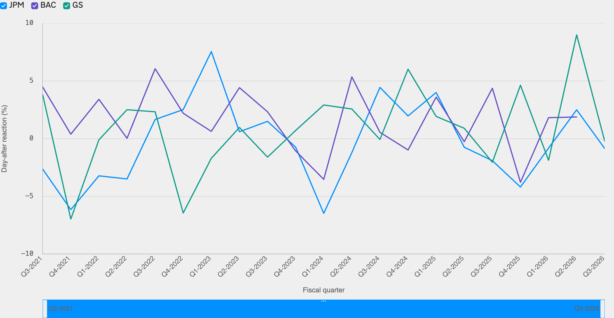
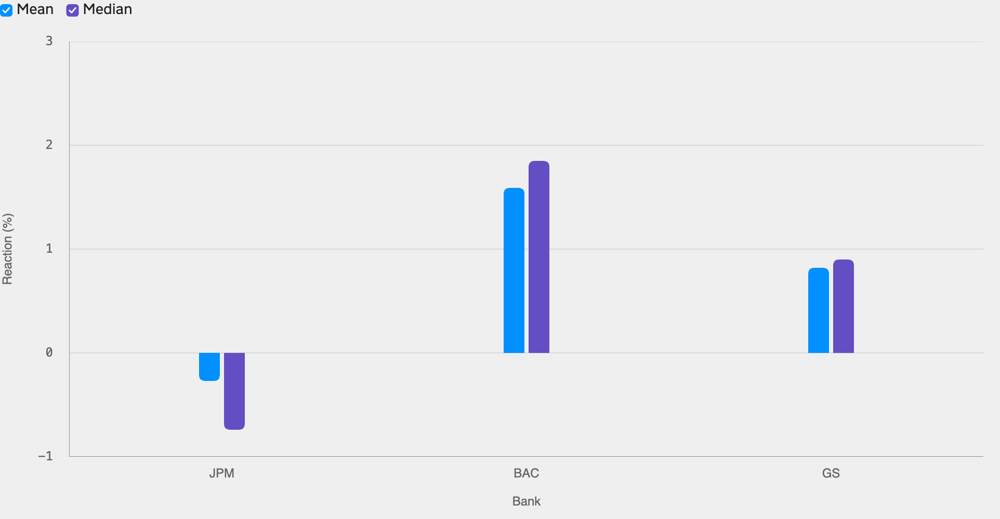

<!--
id: RX-USECASE-0083
type: use-case
language: zh-cn
locale: zh-CN
author: Reflexivity Research
kb_imported: 2026-10-17
status: draft
translation_status: localized_from_en_canonical
original_language: en
source_type: reflexivity-platform-demo
source_manifest: RX-USECASE-0083
prompt_status: present
prompt_basis: localized_from_en_verbatim
-->

# 比较美国银行财报反应与净利息收入指引

<!-- locale-switcher:start -->
**Languages:** [English](../../../../en/05-use-cases/03-asset-class/04-equities/us-bank-earnings-net-interest-income-guidance.md) · [日本語](../../../../ja/05-ユースケース/03-運用資産別/04-株式/米国銀行の決算反応と純金利収入ガイダンスを比較する.md) · [한국어](../../../../ko/05-유스케이스/03-운용자산별/04-주식/미국-은행-실적발표와-순이자이익-가이던스-비교하기.md) · **简体中文** · [繁體中文（台灣）](../../../../zh-tw/05-使用案例/03-依資產類別/04-股票/比較-美國銀行財報反應-與淨利息收入指引.md) · [繁體中文（香港）](../../../../zh-hk/05-使用案例/03-按資產類別/04-股票/比較-美國銀行業績反應-與淨利息收入指引.md)
<!-- locale-switcher:end -->

[← 按资产类别浏览](../README.md) · [全部使用案例](../../README.md)

**适用用户：** 金融股投资经理、银行分析师及事件策略基金  
**资产类别：** 美国股票、银行业  
**研究观察期：** 2021年第三季度至2026年第三季度

> 下列价格、估计和情景为指定时期的研究演示，不代表实时行情或投资建议。

**[在Reflexivity中打开研究示例（英文）→](https://app.reflexivity.com/alfred?mode=research&conversationId=38a711e1-a679-4c88-ab7e-18d97bea0cfc&scrollTo=top)**

## 使用的提示词

> [!IMPORTANT]
> 过去五年，JPMorgan(JPM)、Bank of America(BAC)和Goldman Sachs(GS)在下调净利息收入（NII）指引的季度，财报公布次日的股价表现如何？请与上调或维持NII指引的季度比较。

## 区分财报整体反应与NII指引的影响

银行股在财报后的涨跌同时反映信贷损失、交易收入、成本及资本分配等多种信息。如果要回答NII指引**下调、维持、上调**之间的差别，就必须逐季核验真实指引口径。

## 五年财报市场反应

*图1：整体财报反应，并未按NII指引方向分类。对于盘前公布财报的银行，研究采用公告当日收盘价相对上一交易日收盘价的变动。*

*图2：全部财报的均值和中位数，不是NII下调与上调的收益差。*

| 银行 | 观察季度数 | 平均反应 | 中位数 |
| --- | ---: | ---: | ---: |
| JPM | 21 | −0.27% | −0.74% |
| BAC | 20 | +1.59% | +1.85% |
| GS | 21 | +0.82% | +0.90% |

## 仍未完成的分类

本次结果**未能为三家银行构建可验证的完整季度NII指引方向面板**。尤其Goldman Sachs并不持续使用与商业银行相同的NII指引口径。对于BAC，部分已确认维持或上调指引的季度平均反应约 **+0.58%**，但不能推广到三家银行。

因此，不应把图中整体财报反应误称为NII指引对股价的因果影响。后续需要核对逐季投资者关系公告和具体指引，并对齐公告后的第一个可交易时段。

## 申请其他研究示例

如希望了解同一问题在 **LSEG Workspace等其他研究环境中的再现结果**，请发送邮件至 **jim@reflexivity.com**，并注明文档编号 **RX-USECASE-0083**。能否另行提供资料，需视访问权限及数据再分发许可而定。

---

[← 按资产类别浏览](../README.md) · [全部使用案例](../../README.md)
