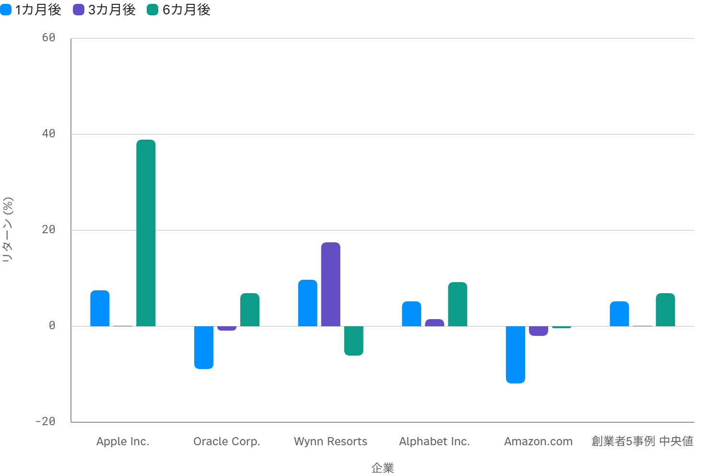

<!--
id: RX-USECASE-0092
type: use-case
language: zh-cn
locale: zh-cn
author: Reflexivity GTM Team
provider: 株式会社QUICK
source_created: 2026-11-13
published: 2026-11-17
revised: 2026-11-17
editorial_reviewed: 2026-11-17
resource: QUICK Reflexivity usage example: Compare founder-CEO departures and subsequent stock performance
status: published
translation_status: current
publication_mode: faithful-source-preserving
prompt_status: present
prompt_basis: source-verbatim
-->

# 比较创始人 CEO 辞任后的股价与行业影响

<!-- locale-switcher:start -->
**Languages:** [English](../../../../en/05-use-cases/03-asset-class/04-equities/compare-founder-ceo-departures-and-subsequent-stock-performance.md) · [日本語](../../../../ja/05-ユースケース/03-運用資産別/04-株式/創業者CEO辞任後の株価と業界波及を比較する.md) · [한국어](../../../../ko/05-유스케이스/03-운용자산별/04-주식/창업자-CEO-사임-이후-주가와-업계-영향-비교.md) · **简体中文** · [繁體中文（臺灣）](../../../../zh-tw/05-使用案例/03-依資產類別/04-股票/比較創辦人-CEO-辭任後的股價及行業影響.md) · [繁體中文（香港）](../../../../zh-hk/05-使用案例/03-按資產類別/04-股票/比較創辦人-CEO-辭任後的股價及行業影響.md)
<!-- locale-switcher:end -->

[← 使用案例](../../README.md)

**案例日期:** 2026-11-13  
**主要使用功能:** Alfred

将 NVIDIA 管理层更替与历史创始人离任案例比较，观察 1、3、6 个月股价及 AI 行业影响。

> [!NOTE]
> 数字、预测和界面仅反映案例所述日期的研究情形，并非实时市场信息。

## 使用的提示词

> [!IMPORTANT]
> NVIDIAのジェイスン・ファンCEOが辞任しました。過去20年間でこのように時価総額の大きな会社で創業者が突然辞任するようなケースがあったかを調べてください。その際の１か月後、３か月後、６か月後の株価のパフォーマンスも分析してください。 また、今回のファンCEOの辞任で、AIやデータセンターの業界に与える影響がどの程度と市場は見ていますでしょうか？

演示使用日语提问。以上保留原始措辞，以避免遗漏条件与时间范围。

## 研究目标与操作流程

1. 将 NVIDIA 管理层更替与历史创始人离任案例比较，观察 1、3、6 个月股价及 AI 行业影响。
2. 不要只看摘要，还应核对相关公司、主题、事件及市场数据。
3. 在得出当前投资结论之前，确认观察区间、指标定义及其他可能原因。

## 案例展示的分析结果

将 NVIDIA 管理层更替与历史创始人离任案例比较，观察 1、3、6 个月股价及 AI 行业影响。

通过五个创始人交接案例，分别讨论 NVIDIA 短期股价与 AI 行业中期影响。

- [相关官方披露](https://nvidianews.nvidia.com/news/nvidia-announces-ceo-transition)

## 产品界面与分析图表

## 解读时的注意事项

数字、预测和界面仅反映案例所述日期的研究情形，并非实时市场信息。

## 相关产品功能

- [Alfred](https://github.com/reflexivity-kb/platform/blob/main/zh-cn/03-%E4%BA%A7%E5%93%81/Alfred.md)

查看所链接的产品手册可能需要访问权限。

---

本案例由 QUICK 提供。市场数字与情景判断仅代表当时的分析。

[← 使用案例](../../README.md)
