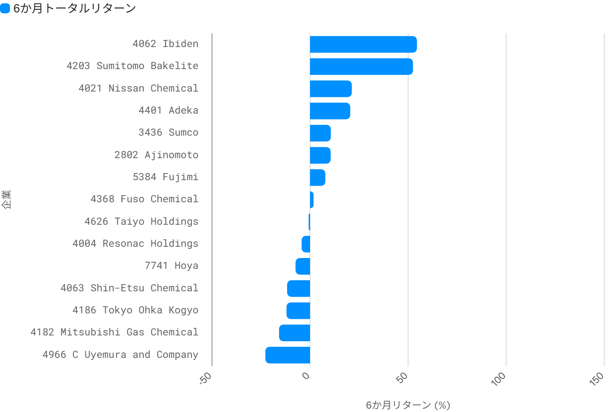

<!--
id: RX-USECASE-0101
type: use-case
language: zh-cn
locale: zh-cn
author: Reflexivity GTM Team
provider: 株式会社QUICK
source_created: 2026-10-23
published: 2026-11-17
revised: 2026-11-17
editorial_reviewed: 2026-11-17
resource: QUICK Reflexivity usage example: Compare Japanese stocks inside the semiconductor materials theme
status: published
translation_status: current
publication_mode: faithful-source-preserving
prompt_status: present
prompt_basis: source-verbatim
-->

# 比较半导体材料主题中的日本公司表现

<!-- locale-switcher:start -->
**Languages:** [English](../../../../en/05-use-cases/03-asset-class/04-equities/compare-japanese-stocks-inside-the-semiconductor-materials-theme.md) · [日本語](../../../../ja/05-ユースケース/03-運用資産別/04-株式/半導体材料テーマの日本企業を騰落別に分析する.md) · [한국어](../../../../ko/05-유스케이스/03-운용자산별/04-주식/반도체-소재-테마의-일본-기업-성과-비교.md) · **简体中文** · [繁體中文（臺灣）](../../../../zh-tw/05-使用案例/03-依資產類別/04-股票/比較半導體材料主題中的日本企業表現.md) · [繁體中文（香港）](../../../../zh-hk/05-使用案例/03-按資產類別/04-股票/比較半導體材料主題中的日本企業表現.md)
<!-- locale-switcher:end -->

[← 使用案例](../../README.md)

**案例日期:** 2026-10-23  
**主要使用功能:** Themes, Knowledge Graph, Alfred

提取半导体材料主题下的日本企业，比较六个月回报及公司层面驱动因素。

> [!NOTE]
> 数字、预测和界面仅反映案例所述日期的研究情形，并非实时市场信息。

## 使用的提示词

> [!IMPORTANT]
> 業界テーマ「半導体材料」に含まれている日本企業で、過去6か月間のパフォーマンスを分析し、高パフォーマンスの企業と、低パフォーマンスの企業の背景について説明してください。

演示使用日语提问。以上保留原始措辞，以避免遗漏条件与时间范围。

## 研究目标与操作流程

1. 提取半导体材料主题下的日本企业，比较六个月回报及公司层面驱动因素。
2. 不要只看摘要，还应核对相关公司、主题、事件及市场数据。
3. 在得出当前投资结论之前，确认观察区间、指标定义及其他可能原因。

## 案例展示的分析结果

提取半导体材料主题下的日本企业，比较六个月回报及公司层面驱动因素。

半导体材料主题的 15 家日本公司中，揖斐电 +54.5%、住友电木 +52.5% 等表现领先。

## 产品界面与分析图表

## 解读时的注意事项

数字、预测和界面仅反映案例所述日期的研究情形，并非实时市场信息。

## 相关产品功能

- [Themes](https://github.com/reflexivity-kb/platform/blob/main/zh-cn/03-%E4%BA%A7%E5%93%81/%E6%8A%95%E8%B5%84%E4%B8%BB%E9%A2%98.md)
- [Knowledge Graph](https://github.com/reflexivity-kb/platform/blob/main/zh-cn/03-%E4%BA%A7%E5%93%81/%E7%9F%A5%E8%AF%86%E5%9B%BE%E8%B0%B1.md)
- [Alfred](https://github.com/reflexivity-kb/platform/blob/main/zh-cn/03-%E4%BA%A7%E5%93%81/Alfred.md)

查看所链接的产品手册可能需要访问权限。

---

本案例由 QUICK 提供。市场数字与情景判断仅代表当时的分析。

[← 使用案例](../../README.md)
