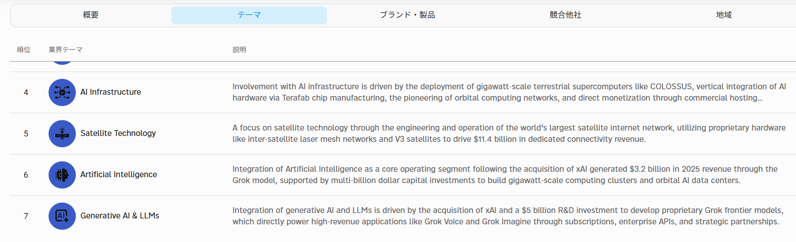
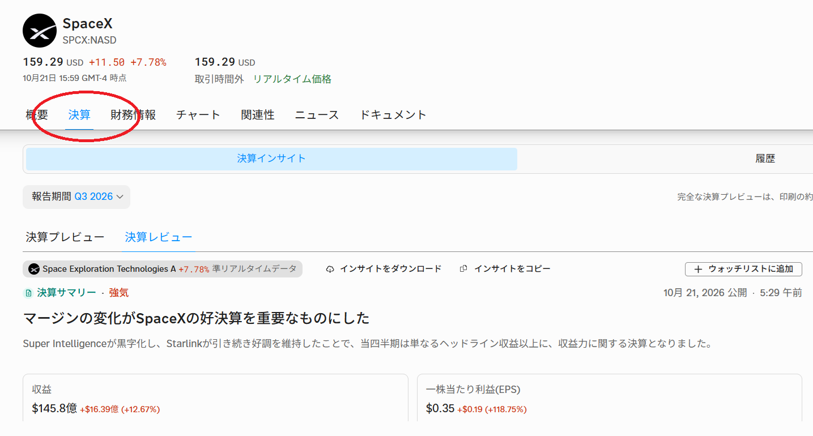

<!--
id: RX-USECASE-0090
type: use-case
language: zh-cn
locale: zh-cn
author: Reflexivity GTM Team
source_type: partner-provided-use-case
provider: QUICK
source_manifest: RX-USECASE-0090
source_created: 2026-10-22
published: 2026-11-17
revised: 2026-11-17
editorial_reviewed: 2026-11-17
resource: QUICK provided Reflexivity workflow
status: published
translation_status: current
prompt_status: not_provided
-->

# 通过关联主题跨行业研究 SpaceX

<!-- locale-switcher:start -->
**语言:** [English](../../../../en/05-use-cases/03-asset-class/04-equities/use-related-themes-to-understand-spacex-across-industries.md) · [日本語](../../../../ja/05-ユースケース/03-運用資産別/04-株式/SpaceXを関連テーマから複数の業種横断で調べる.md) · [한국어](../../../../ko/05-유스케이스/03-운용자산별/04-주식/SpaceX의-관련-테마로-산업-간-연결을-살펴보기.md) · **简体中文** · [繁體中文（臺灣）](../../../../zh-tw/05-使用案例/03-依資產類別/04-股票/透過關聯主題跨產業研究-SpaceX.md) · [繁體中文（香港）](../../../../zh-hk/05-使用案例/03-按資產類別/04-股票/透過關聯主題跨行業研究-SpaceX.md)
<!-- locale-switcher:end -->

[← Use Cases](../../README.md)

**QUICK | 2026-10-22**

## 使用的提示词

提供资料中未注明实际使用的提示词全文。

## 研究流程

不能只用一个行业标签理解 SpaceX。可从个股概览的“关联”进入主题，再查看财报摘要以理解多种业务联系。

## 当时的分析结果

2026 年 10 月 22 日的界面示例显示前三项为航天主题、第四、第六、第七项与 AI 有关，并继续进入财报摘要。

## 解读与限制

主题排名表达关系而不是营收占比、持仓权重或股价收益。业务数据应以公司披露为准，界面与覆盖范围也可能变化。

## 相关产品功能

- [Asset Overview](https://github.com/reflexivity-kb/platform/blob/main/zh-cn/03-%E4%BA%A7%E5%93%81/%E4%B8%AA%E8%82%A1%E6%A6%82%E8%A7%88.md)
- [Themes](https://github.com/reflexivity-kb/platform/blob/main/zh-cn/03-%E4%BA%A7%E5%93%81/%E6%8A%95%E8%B5%84%E4%B8%BB%E9%A2%98.md)
- [Insights](https://github.com/reflexivity-kb/platform/blob/main/zh-cn/03-%E4%BA%A7%E5%93%81/%E7%A0%94%E7%A9%B6%E6%B4%9E%E5%AF%9F.md)

產品手冊可能需要獲授權才能查閱。

## 研究界面与图表

以下为提供日期的原始研究画面与图表，并非当前市场数据。

*本使用案例由我们在日本的合作伙伴 QUICK 友情提供。* · [免责声明](../../DISCLAIMER.md)

[← Use Cases](../../README.md)
