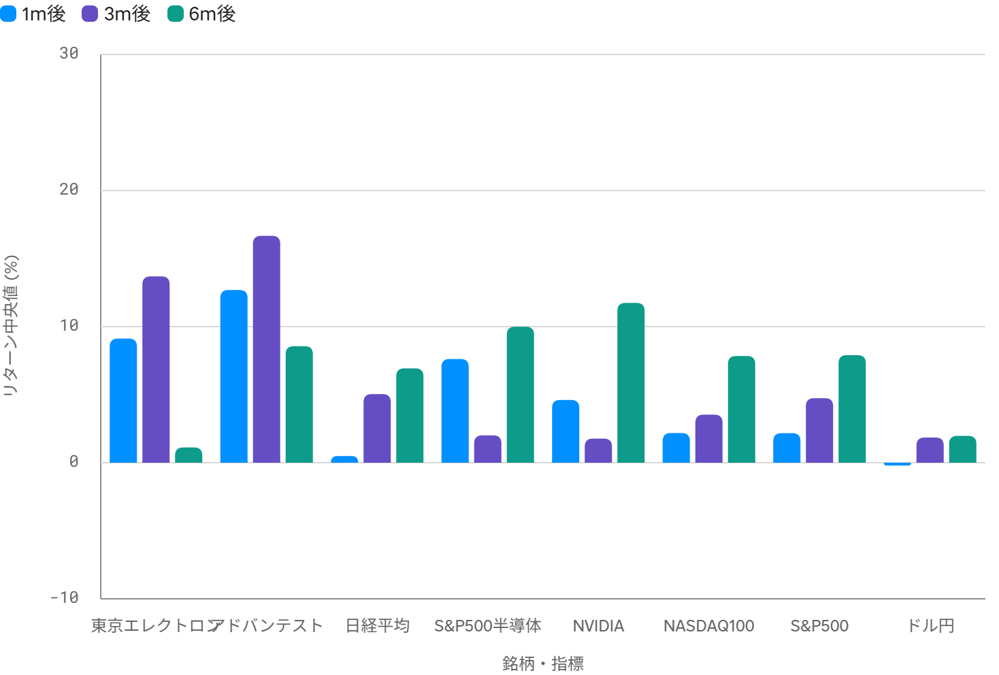

<!--
id: RX-USECASE-0106
type: use-case
language: zh-cn
locale: zh-cn
author: Reflexivity GTM Team
provider: 株式会社QUICK
source_created: 2026-11-05
published: 2026-11-17
revised: 2026-11-17
editorial_reviewed: 2026-11-17
resource: QUICK Reflexivity usage example: Explain different US and Japan equity reactions to midterm results
status: published
translation_status: current
publication_mode: faithful-source-preserving
prompt_status: present
prompt_basis: source-verbatim
-->

# 解释美国中期选举后美日股市反应分化

<!-- locale-switcher:start -->
**Languages:** [English](../../../../en/05-use-cases/03-asset-class/05-multi-asset/explain-different-us-and-japan-equity-reactions-to-midterm-results.md) · [日本語](../../../../ja/05-ユースケース/03-運用資産別/05-マルチアセット/米中間選挙後の米株と日本株の反応差を分析する.md) · [한국어](../../../../ko/05-유스케이스/03-운용자산별/05-멀티에셋/미국-중간선거-후-미국·일본-주가-반응-차이-분석.md) · **简体中文** · [繁體中文（臺灣）](../../../../zh-tw/05-使用案例/03-依資產類別/05-多資產/解釋美國中期選舉後美日股市反應分化.md) · [繁體中文（香港）](../../../../zh-hk/05-使用案例/03-按資產類別/05-多資產/解釋美國中期選舉後美日股市反應分化.md)
<!-- locale-switcher:end -->

[← 使用案例](../../README.md)

**案例日期:** 2026-11-05  
**主要使用功能:** Alfred

比较美国指数上涨与日本 AI、半导体股下跌，并区分政策、监管和美元日元情景。

> [!NOTE]
> 数字、预测和界面仅反映案例所述日期的研究情形，并非实时市场信息。

## 使用的提示词

> [!IMPORTANT]
> 米国中間選挙の結果、民主党が大勝しました。この結果、日本の株式市場ではAI関連株や半導体関連株が下落しました。一方で米国ではS&P500もNASDAQ指数も上昇しました。今後のAI関連株や半導体関連株について市場の見通しはどうなるのかシナリオを示してください。また、ドル円の為替レートの見通しも合わせてシナリオを提示して下さい。

演示使用日语提问。以上保留原始措辞，以避免遗漏条件与时间范围。

## 研究目标与操作流程

1. 比较美国指数上涨与日本 AI、半导体股下跌，并区分政策、监管和美元日元情景。
2. 不要只看摘要，还应核对相关公司、主题、事件及市场数据。
3. 在得出当前投资结论之前，确认观察区间、指标定义及其他可能原因。

## 案例展示的分析结果

比较美国指数上涨与日本 AI、半导体股下跌，并区分政策、监管和美元日元情景。

11 月 5 日美日 AI 股票与大盘指数走势分化，研究提出基准、乐观和悲观三种情景。

## 产品界面与分析图表

## 解读时的注意事项

数字、预测和界面仅反映案例所述日期的研究情形，并非实时市场信息。

## 相关产品功能

- [Alfred](https://github.com/reflexivity-kb/platform/blob/main/zh-cn/03-%E4%BA%A7%E5%93%81/Alfred.md)

查看所链接的产品手册可能需要访问权限。

---

本案例由 QUICK 提供。市场数字与情景判断仅代表当时的分析。

[← 使用案例](../../README.md)
